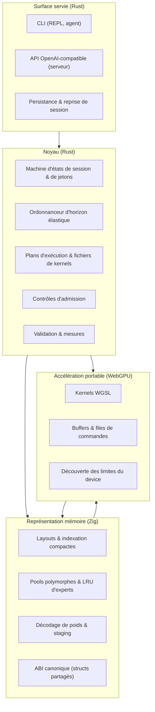
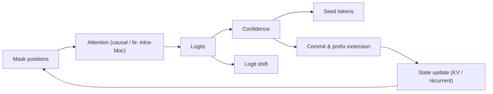
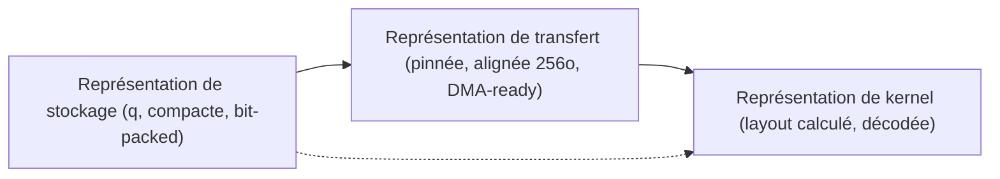
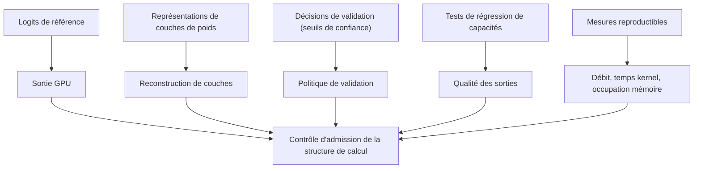

# Alethe.IA — Document de référence unique

**Statut** : référence normative du projet. Ce fichier est **la source unique** pour l'agent IA en charge du développement. En cas de contradiction avec un autre document du dépôt, **ce fichier prévaut** ; les fiches de `docs/fiches_techniques/` restent la source des justifications.

**Mots normalisés (RFC 2119)** : MUST, REQUIRED, SHOULD, RECOMMENDED, MAY, OPTIONAL. `NEVER` = `MUST NOT` ; `AVOID` = `SHOULD NOT`.

## 0. Usage de ce document

L'agent IA MUST :

1. Lire ce fichier **entièrement** avant toute modification de code.
2. Respecter les exigences (`R-x`), les invariants (`I-x`) et les règles d'implémentation (`C-x`).
3. NE PAS inventer de concepts absents de ce document ; AVOID les extensions non décrites.
4. Signaler les contradictions, ambiguïtés et zones non couvertes **avant** d'écrire le code correspondant.
5. Traiter chaque livrable comme adossé à une exigence : un changement sans exigence est une dérive.

Sources consultées pour l'écriture de ce document : les 4 fiches de `docs/fiches_techniques/`, `docs/fiches_techniques/références.txt`, les sources primaires des références (repos Strata, FreeToken, DwarfStar4 ; articles WeDLM, FLARE, FLUID, Repr-Align).

---

## 1. Vision produit

**Alethe.IA** est un moteur d'inférence **natif pour les modèles génératifs à diffusion (dLLM)**, écrit en coopération **Rust + Zig** et accéléré par **WebGPU** de manière portable.

Le moteur ne se limite pas à la diffusion : il traite la génération autoregressive (AR) comme un **cas dégénéré du modèle unifié de génération par blocs**. Un dLLM est le mode natif ; l'AR est un mode compatible. Les deux coexistent dans un même moteur, un même modèle de mémoire, un même ordonnanceur.

**Produit final** : un moteur d'inférence portable, compact, capable de servir des checkpoints dLLM natifs, des checkpoints hybrides AR/dLLM, des checkpoints AR adaptés, sur des GPU grand public et sur des machines sans GPU discret.

**Utilisateurs** : (a) l'agent IA de développement, (b) les intégrateurs d'applications locales (CLI, serveurs API, agents de code), (c) les opérateurs de machines hétérogènes (VRAM limitée, RAM faible, NVMe rapide, WSL, iGPU).

**Fonctionnalités primaires** :
- génération dLLM native (dénoisage par bloc, parallèle) ;
- génération AR sur le même moteur (mode compatible) ;
- préfill/decodage en continu, réutilisation de préfixe, reprise de session ;
- serving OpenAI-compatible (streaming, tool calls) ;
- persistance d'états d'inférence (checkpoints de KV, sessions) ;
- gestion polymorphe de la mémoire (KV, états récurrents, états de diffusion) sur VRAM / RAM / NVMe.

**Non-objectifs** (exclusions explicites, `N-x`) : voir §13.

---

## 2. Principes de conception

### 2.1 Architecture des couches

| Couche | Rôle principal |
|---|---|
| **Rust** | cohérence d'état, concurrence, ordonnanceur, contrats d'interface, métadonnées canoniques de tenseurs, formats de fichiers, validation, API |
| **Zig** | représentation mémoire des données, layouts, indexation, structures compactes, chemins critiques, décodage de poids, préparation des buffers |
| **WebGPU** | accélération portable des calculs, kernels de dLLM, allocation de buffers, files de commandes, plans d'exécution, synchronisation |

**Aucune hiérarchie artificielle** : Rust n'est pas supérieur à Zig, WebGPU n'est pas subordonné aux deux. Chaque couche possède une zone de responsabilité délimitée.

**Règle de non-duplication** : chaque concept (position logique, position physique, bloc, masque, horizon, fenêtre glissante, état récurrent, état de validation, préfixe autorisé, état de session, format de poids) MUST avoir **une seule définition** dans le moteur.

**Règle de séparation stricte** (adaptée de DwarfStar4) : le CLI/server MUST NOT connaître les internals de tenseurs ; l'ordonnanceur MUST NOT connaître les formats de poids.

### 2.2 Principes d'architecture

| Principe | Formulation normative |
|---|---|
| Primauté du dLLM | les structures principales MUST être conçues pour les processus de dénoisage et de validation |
| Coopération des couches | les responsabilités MUST être clairement définies, sans subordination |
| Portabilité WebGPU | le moteur MUST s'adapter aux capacités des appareils, sans dépendre d'une extension propriétaire |
| Préservation de la sémantique | les représentations, formats et interfaces MUST conserver la sémantique des checkpoints |
| Optimisation mesurée | les optimisations MUST être justifiées par des mesures de mémoire, latence, débit, bandes passantes |
| Limites explicites | les interfaces MUST définir ce que le moteur fait et ne fait pas |
| Dégradation contrôlée | les capacités manquantes (device limitations, format unsupported, kernel fallback, cache thrashing, graph incompatibility, VRAM fragmentation) MUST être explicites, jamais silencieuses |

### 2.3 Invariants

| # | Invariant |
|---|---|
| I-1 | **Un seul modèle de génération** : AR et dLLM sont des configurations du même cycle de blocs. |
| I-2 | **Un seul ordonnanceur** : le scheduler décide l'horizon, la fenêtre et le rythme de commit pour tous les modes. |
| I-3 | **Un seul modèle de mémoire** : KV, états récurrents, états de blocs, états intermédiaires sont des entrées d'une même hiérarchie de placement. |
| I-4 | **Un seul modèle de validation** : la validité d'un jeton, d'un préfixe, d'une couche de poids, d'un plan de kernels est décidée par le même mécanisme de référence. |
| I-5 | **Sémantique des checkpoints préservée** : formats de poids, structures d'attention, schémas de routage, top-k, nombres d'experts MUST rester fidèles aux checkpoints. |
| I-6 | **Aucune hiérarchie artificielle entre couches** : la frontière se définit par des contrats, pas par la profondeur d'appel. |
| I-7 | **Pas de duplication fonctionnelle** : un concept a une définition, un champ, une sémantique. |
| I-8 | **Pas de lock-in GPU** : les extensions propriétaires MAY être des accélérateurs optionnels, jamais la sémantique principale. |
| I-9 | **Pas de variantes sémantiques permanentes derrière des flags** (règle DwarfStar4) : les switchs de diagnostic valident le chemin de release. |
| I-10 | **Correctivité avant rapidité** : NEVER garder un chemin plus rapide avec attention, KV ou logits drift inexpliqués. |
| I-11 | **Le CPU est un chemin de référence/debug** : NEVER la production sur CPU, sauf sur appareils sans GPU adapté. |
| I-12 | **C++ NEVER** dans le codebase. |

---

## 3. Exigences fonctionnelles

### 3.1 Cycle de génération

| # | Exigence |
|---|---|
| R-1 | Le moteur MUST convertir un checkpoint en structures d'inférence (grappes de kernels, buffers, formats de poids, plans d'exécution). |
| R-2 | Le cycle MUST traiter le préfill, la construction des préfixes autorisés, le dénoisage de bloc, la validation de jetons, la mise à jour de l'état d'attention, la décision d'horizon, le commit. |
| R-3 | Un cycle MUST exposer des points de contrôle observables pour l'ordonnanceur : position du prochain bloc, taille de l'horizon, politique d'attention, politique de validation, révision, fenêtre active. |
| R-4 | Le cycle MUST être compatible avec la capture de plans d'exécution à formes fixes et les appels de kernels. |
| R-5 | Le cycle MUST permettre des révisions locales : un jeton non validé, une fenêtre annulée, un état intermédiaire rejeté. |
| R-6 | Le cycle MUST être réutilisable pour le préfill, la continuation, la reprise de session, l'interpolation, la reconstruction. |

Cycle canonique (7 étapes) :

```
1. Préfixe autorisé       — le préfixe valide est présent dans la mémoire de l'état
2. Horizon                — l'ordonnanceur définit l'horizon de génération
3. Fenêtre de bloc        — une fenêtre de blocs est placée pour la dénoisation
4. Forward + attention    — le modèle évalue le contenu masqué
5. Candidats + validation — le modèle produit des jetons candidats, la politique de validation marque les validés
6. Commit                 — les jetons validés deviennent préfixe autorisé
7. Décision d'horizon     — l'ordonnanceur ajuste l'horizon pour le cycle suivant
```

### 3.2 États de jetons

| # | Exigence |
|---|---|
| R-7 | Le moteur MUST distinguer jeton masqué, jeton candidat provisoire, jeton validé. |
| R-8 | Le moteur MUST distinguer **position logique** (ordre dans la séquence d'inférence) et **position physique** (ordre dans les buffers/cache). |
| R-9 | Le moteur MUST gérer le réordonnement topologique (WeDLM), la réordonnement de blocs (windowing), la réordonnement pour réutilisation de préfixe. |
| R-10 | Un jeton validé MUST devenir un préfixe autorisé et cache-valide immédiatement dans le régime causal. |
| R-11 | Un jeton révisé MUST rester réversible : l'état d'attention et l'état de bloc MUST pouvoir être restaurés (rollback). |

### 3.3 Modes de génération

| # | Exigence |
|---|---|
| R-12 | Le moteur MUST servir un dLLM natif en dénoisage parallèle par bloc. |
| R-13 | Le moteur MUST servir un checkpoint bilingue (clean/noisy) en mode Diffusion-Trust. |
| R-14 | Le moteur MUST servir un checkpoint bilingue en mode AR-Trust (vérification spéculative sur clean-stream). |
| R-15 | Le moteur MUST servir un checkpoint AR comme cas dégénéré du cycle (0 étape de raffinement, largeur 1, validation immédiate). |
| R-16 | Le moteur MUST servir un checkpoint adapté dLLM (WeDLM/FLUID) en streaming causal. |
| R-17 | La sélection du mode MUST être déclarative (déduite du checkpoint + configuration), pas un fork de code. |

### 3.4 Ordonnanceur

| # | Exigence |
|---|---|
| R-18 | L'ordonnanceur MUST fonctionner comme un contrôleur d'horizon élastique : à chaque pas, il choisit le nombre de positions résolues, la longueur de la fenêtre, la profondeur de vérification. |
| R-19 | L'horizon MUST être adaptatif, borné par un plafond d'horizon (paramètre K). |
| R-20 | L'horizon MUST être borné par la **frontière de compétence** : au-delà de la confiance de validation, l'horizon ne doit pas s'étendre. |
| R-21 | La porte de confiance MUST être un seuil de confiance par position (γ). Les positions sous le seuil ne sont pas résolues. |
| R-22 | Le pas de stride MUST être adaptatif : `stride = 1 + Δ`, Δ étant la confiance moyenne au-delà du seuil (1 + Δ positions résolues à chaque pas). |
| R-23 | L'ordonnanceur MUST s'informer de : incertitude de prédictions, stabilité de préfixe, coût de transfert, disponibilité de VRAM, cache misses, bandes passantes, capacité de kernels. |
| R-24 | L'ordonnanceur MUST décider la réallocation dynamique des pools de VRAM entre pools (KV, récurrent, cache d'experts) et l'adaptation de la fenêtre active. |
| R-25 | L'ordonnanceur MUST appliquer la sélection de remplissage par entropie **pénalisée par la distance** : `H̃ᵢ = Hᵢ + λ·dᵢ` (dᵢ = distance au masque le plus à gauche), et remplir les positions dont `H̃ᵢ < τ`. |
| R-26 | L'ordonnanceur MUST maximiser la métrique de cache-prefix (p_cache) : la croissance du préfixe contigu, pas la couverture de masque. |
| R-27 | L'ordonnanceur MUST éviter les pauses de fin de bloc : le remplissage de la fenêtre glissante MUST se faire à la volée, à travail par forward quasi constant. |
| R-28 | La politique de commit MUST être déterministe pour une graine donnée. |

### 3.5 Mémoire polymorphe

| # | Exigence |
|---|---|
| R-29 | Le moteur MUST gérer une hiérarchie de mémoire unique sur VRAM, RAM, NVMe. |
| R-30 | Le moteur MUST stocker en VRAM : attention et mixeurs DeltaNet, poids gated-residual, routeurs, experts partagés, tête de sortie, couche de draft, KV cache (partie la plus lue), cache d'experts, états récurrents. |
| R-31 | Le moteur MUST garder en RAM : l'ensemble des experts (pinnés), les tables n-gram (pinnées), la hiérarchie de blocs. |
| R-32 | Le moteur MUST garder sur NVMe : tables n-gram complètes, poids quantifiés, séquences de validation, checkpoints de KV. |
| R-33 | Les décisions de placement MUST prendre en compte le coût de transfert, la taille du bloc, la réutilisation de préfixe, les fenêtres glissantes, les graphes d'exécution. |
| R-34 | Le moteur MUST effectuer des contrôles d'admission : une requête, un état de cache, un pool d'experts, une fenêtre de génération est admise ou refusée en fonction des limites mesurées du device. |
| R-35 | Le moteur MUST utiliser des tampons double pour le streaming de poids et la persistance. |
| R-36 | Le moteur MUST masquer les chargements : charger un expert manquant pendant l'inférence de l'expert partagé et des experts déjà en RAM ; charger la couche suivante pendant l'inférence de la couche courante. |
| R-37 | Le moteur MUST calculer les experts manquants sur CPU **en place**, en parallèle avec le GPU, selon un ratio d'allocation par pas calibré par mesure. |
| R-38 | Le cache d'experts MUST être un pool LRU à capacité adaptative (taux d'occupation d'une fraction de VRAM). |
| R-39 | Le moteur MUST adapter le cache d'experts aux métriques de routeur (fréquence d'apparition, entropie, couverture de top-k). |
| R-40 | Le moteur MUST anticiper la sélection d'experts (prediction routing) : prédire les experts nécessaires pour les 1 à 2 prochains tokens afin de déclencher le transfert en avance. |
| R-41 | Le cache MUST avoir un **plancher de capacité** garantissant que le pool tient au moins les experts d'un pas complet (le pool d'un pas ne MUST pas thrasher pendant la décodation du pas). |
| R-42 | Le moteur MUST utiliser la mémoire pinnée zéro-copy, les plans d'exécution, la réallocation dynamique de VRAM. |

### 3.6 Persistance et reprise

| # | Exigence |
|---|---|
| R-43 | Le moteur MUST persister des checkpoints d'états d'inférence (KV, états récurrents, états de blocs) sur NVMe. |
| R-44 | Le moteur MUST reprendre une session depuis un checkpoint persisté (sessions locales longues). |
| R-45 | Le moteur MUST réutiliser un préfixe persisté entre requêtes (réutilisation de préfixe, radix cache). |
| R-46 | La persistance MUST respecter la sémantique de la politique d'attention : un état récurrent MUST être cohérent avec la position d'acceptation, pas seulement coupé comme un tail de KV. |
| R-47 | Le moteur MUST valider la cohérence d'un checkpoint persisté avant de le charger. |

### 3.7 Serving

| # | Exigence |
|---|---|
| R-48 | Le moteur MUST exposer une API OpenAI-compatible (chat completions, streaming SSE, tool calls). |
| R-49 | Le moteur MUST servir plusieurs sessions avec une file de workers et un ordonnanceur de batch. |
| R-50 | Le moteur MUST servir un service local (127.0.0.1) par défaut ; une clé d'API MUST être disponible pour toute exposition au-delà de la boucle locale. |
| R-51 | Le CLI MUST être la porte d'entrée des agents (invocable, non-interactive, sortie JSON). |

### 3.8 Validation

| # | Exigence |
|---|---|
| R-52 | Le moteur MUST valider la sortie GPU contre des logits de référence. |
| R-53 | Le moteur MUST valider les représentations de couches de poids contre des représentations de couches de poids de référence. |
| R-54 | Le moteur MUST valider les décisions de validation de jetons (quand la validation est sensible à des seuils de confiance). |
| R-55 | Le moteur MUST exécuter des tests de régression de capacités contre un checkpoint réel (suites de cas, pas des scores de leaderboard). |
| R-56 | Le moteur MUST produire des mesures reproductibles (débit, temps kernel, temps de transfert, occupation mémoire) associées à chaque optimisation. |
| R-57 | Un changement affectant l'attention, le KV cache, la sémantique de validation, la sélection d'experts, le placement mémoire MUST être testé sur les chemins affectés **avant** d'être retenu. |

---

## 4. Architecture technique

### 4.1 Couches et noyau



Frontière normative : **Rust** possède les décisions, l'état et les contrats ; **Zig** possède la représentation et le mouvement des données ; **WebGPU** possède l'exécution. Un contrat ABI partagé (structs C, pas de C++) est le seul moyen de passer des données entre couches.

### 4.2 Métadonnées canoniques

- Un seul jeu de métadonnées MUST décrire les shapes de tenseurs, les types de kernels, les layouts de buffers, les formats de poids, les exigences d'alignement.
- Le contrat d'interface entre couches MUST être basé sur cette source unique de métadonnées.
- Les couches MUST partager la sémantique par des formats communs, des buffers communs et des contrats explicites — NEVER par des suppositions sur la profondeur d'appel.

### 4.3 Catalogue de kernels dLLM

Fichiers de kernels MUST couvrir les opérations de base du dénoisage dLLM :



| Kernel | Rôle contractuel |
|---|---|
| mask positions | pose des `[MASK]` sur la fenêtre active |
| attention | causal sur préfixe autorisé ; bidirectionnel intra-bloc si la politique le déclare |
| logits | sortie par position, propre au stream |
| logit shift | aligne la prédiction d'un bloc sur ses positions (FLARE) |
| confidence | score de confiance par position (entropie, marge, seuil) |
| seed tokens | sélection des positions à remplir (entropie + pénalité de distance) |
| commit & prefix extension | validés → préfixe, préfixe → cache-valide |
| state update | KV softmax et état récurrent linéaire |
| expert gather / scatter | LRU d'experts, H2D, scatter des poids manquants |
| quant decode | décodage q<N> / fp4 / fp8 / ggml vers le layout de kernel |

Chaque kernel MUST être **compact, parallèle, compatible avec les plans d'exécution**, et MUST éviter les allocations inutiles, les dépendances excessives, les synchronisations superflues.

### 4.4 Plans d'exécution et WebGPU

WebGPU n'offre pas de capture de graphe avec buffers variables : le moteur MUST émuler un plan d'exécution par :

1. compilation WGSL au chargement, pipeline cache keyed par identifiant canonique de kernel ;
2. **plans à forme fixe** : bind group layouts stables, shapes pré-établies, un command encoder regroupe les kernels d'un pas ;
3. offsets dynamiques (workgroup count, dynamic buffer offsets) pour les variantes de taille ;
4. réutilisation de buffers par pool, NEVER un buffer par requête.

Le moteur MUST lire les **limites réelles du device** au démarrage (limites WebGPU exposées par l'adaptateur : taille max de storage buffer, taille de workgroup memory, nombre d'invocations par workgroup, nombre de workgroups, limites de binding, absence d'atomic sur f32, absence de type f16 dans le langage de shaders). Le moteur MUST adapter les kernels aux limites, jamais les supposer.

**Précision** : la sémantique numérique de la production est **f32 dans les shaders** ; les poids stockés MUST être décodés vers le layout de kernel. Les conversions MUST être explicites. NEVER compter sur f16 dans les shaders WGSL. NEVER utiliser d'atomic sur f32 (non supporté par la spec WebGPU de base) : les réductions MUST être réalisées par des passes hiérarchiques dans la workgroup memory.

**Requêtes de timing** : les requêtes de timestamps GPU MAY ne pas être disponibles. Le moteur MUST fournir des mesures de timing CPU-side (timer sur submit + map) comme chemin de base, et la précision GPU-side uniquement quand le device l'expose.

---

## 5. Stratégies de génération

### 5.1 Mapping AR / dLLM sur le cycle unifié

| Étape du cycle | dLLM natif | AR |
|---|---|---|
| préfixe autorisé | préfixe + positions masquées | préfixe complet |
| horizon | bloc, fenêtre, horizon élastique | 1 token |
| politique d'attention | causal strict, ou bidirectionnel intra-bloc | causale |
| validation | seuil de confiance, entropie, marge | validation immédiate (0 étape de raffinement) |
| mise à jour d'état | KV, état récurrent, état de bloc, état intermédiaire | KV |
| décision d'horizon | taille de bloc, fenêtre glissante, extension | extension de préfixe (horizon trivial) |

Le modèle AR MUST être exprimé comme la configuration `{refinement_steps = 0, block_width = 1, validation = immediate}` du cycle dLLM. NEVER une seconde boucle AR.

### 5.2 Streaming parallèle (WeDLM)

- La sélection de remplissage MUST utiliser l'entropie pénalisée par la distance : `H̃ᵢ = Hᵢ + λ·dᵢ`, remplissage des positions sous le seuil τ.
- Le préfixe contigu rempli MUST être immédiatement cache-valide sous attention causale stricte.
- La fenêtre glissante MUST conserver une taille W fixe ; à chaque pas les jetons commités sortent et un nombre égal de `[MASK]` entre.
- Le streaming causal MUST rester nativement supportable par les kernels d'attention causale (prefill en continu), sans kernel modifié.
- τ ∈ [0.3, 0.6] est la plage recommandée ; λ > 0 contrôle la préférence gauche→droite.

### 5.3 Horizon élastique (FLUID)

- Le décodage MUST être strictement causal sur le préfixe autorisé : aucune position masquée n'est visible.
- L'horizon de vérification MUST contenir un nombre borné de `[MASK]` (plafond d'horizon K).
- La porte de confiance MUST être paramétrée par un seuil par position γ.
- La fenêtre MUST avancer avec `stride = 1 + Δ` ; les positions sous le seuil sont décalées vers la droite.
- Le pas MUST être borné par la frontière de compétence : l'horizon ne s'étend pas au-delà de la confiance mesurée.

### 5.4 Diffusion-Trust (bloc)

- Bloc de taille B derrière le préfixe causal, dénoisé sur S étapes.
- À chaque étape s : positions non résolues `Rₛ` ; score `cᵢ` par position ; `Aₛ = {i ∈ Rₛ : cᵢ ≥ γₛ}` ; à `s = S`, toutes les positions restantes sont commitées.
- Les forwards intermédiaires contiennent des contenus provisoires : leurs états récurrents MUST NOT être écrits dans l'état causal vivant.
- Après finalisation du bloc, le préfixe autorisé est reconstruit par **causal state replay** : les jetons du bloc sont appliqués à l'état causal.

### 5.5 AR-Trust (spéculatif sur clean-stream)

- Fenêtre `[y<t ; d₁..d_K ; [MASK]^(N-1)]` ; vérification clean-stream par jeton draft.
- Acceptation : `aᵢ ~ Bernoulli(min(1, pᵢ(dᵢ)/qᵢ(dᵢ)))`, `qᵢ` étant **exactement la loi de proposition qui a échantillonné dᵢ**. Recompter `qᵢ` pendant la vérification MUST NOT casser l'équivalence de distribution.
- Rejet : échantillonner la correction normalisée `[pᵢ − qᵢ]₊`.
- **Rewind de l'état récurrent à la frontière d'acceptation** : accepter r de K jetons MUST rembobiner l'état récurrent à `S⁽ʳ⁾`, pas seulement couper un tail de KV. Deux chemins : replay (r mises à jour par couche GDN) ou cache-and-scatter (états enregistrés par position de vérification, commit par un kernel fused gather-scatter).

### 5.6 Vérification de couches récurrentes

- Pour les architectures hybrides (softmax + linéaire), le moteur MUST préserver la cohérence de l'état récurrent à la frontière de commit. NEVER traiter l'état récurrent comme un KV tail trim.

### 5.7 Politiques de validation

- La politique de validation MUST être déclarée par le mode de génération : seuil d'entropie, marge, confiance de score, acceptation spéculative.
- La politique MUST être testable : un test MUST mesurer la décision de validation elle-même (pas seulement la sortie finale).

---

## 6. Format de checkpoint et représentation de poids

### 6.1 Contrat de format

| # | Exigence |
|---|---|
| R-58 | Le moteur MUST lire des checkpoints au format canonique du dépôt (format interne à spécifier), MUST lire GGUF et safetensors comme sources d'import. |
| R-59 | Le format MUST conserver la sémantique du checkpoint : formats de poids, structures d'attention, schémas de routage, top-k, nombres d'experts, échelles globales. |
| R-60 | Les formats de poids MUST supporter : fp8, int4, int3, ggml q<N> (Q3, Q4, Q5, Q6), NVFP4, i-quants. |
| R-61 | Les formats MUST supporter la conversion de formats de poids vers des representations de stockage, de transfert et de kernel **sans changer la sémantique**. |
| R-62 | Un format MUST stocker les formats de poids, les structures d'attention, les schémas de routage, la métadonnée de validation. |
| R-63 | L'import MUST refuser un checkpoint dont la sémantique ne peut être reproduite, avec un diagnostic explicite (NEVER un chargement silencieux). |
| R-64 | Les tables n-gram MUST rester sur disque et MUST être lues par lignes par token, avec leurs échelles résidentes en RAM. |

### 6.2 Représentations de poids

Trois représentations MUST être définies et coordonnées par la métadonnée canonique :



- Le décodage de poids MUST se faire pendant le transfert, caché par le calcul de la couche courante.
- Les couches de poids MUST rester stockées compactement, MUST être déplacées par le mouvement mémoire, MUST être calculées par les kernels.

---

## 7. Validation et QA

### 7.1 Hiérarchie de validation



### 7.2 Règles

| # | Exigence |
|---|---|
| R-65 | La validation MUST utiliser des logits de référence (sortie d'une implémentation de référence du même checkpoint, même graine, même politique d'échantillonnage). |
| R-66 | Les tolérances MUST être exprimées par format de poids et par politique d'attention, et MUST être mesurées, pas estimées. |
| R-67 | Les tests de régression de capacités MUST tourner contre un vrai checkpoint (suites de cas : noyau, difficile), MUST être re-exécutables sans génération pour la notation. |
| R-68 | Un chemin plus rapide avec drift inexpliqué de l'attention, du KV cache ou des logits MUST être rejeté. |
| R-69 | Les tests MUST couvrir : chemin GPU normal, streaming NVMe, chemins d'offload, chemins de décodage quantifié, chemins de reprise de session. |
| R-70 | Les tests live de l'API MUST être exécutés uniquement quand la surface d'API est intentionnellement testée. |

---

## 8. Écosystème de modèles

Le moteur MUST prendre en charge la génération de checkpoints, l'évaluation de checkpoints et la validation de checkpoints pour trois familles :

1. **Checkpoints dLLM natifs** — générés directement comme dLLM.
2. **Checkpoints dLLM adaptés** — AR convertis (WeDLM, FLUID, FLARE, Repr-Align).
3. **Checkpoints AR** — compatibles par le mode dégénéré.

Objectif : permettre les comparaisons de capacités, la validation de transferts et la sélection de configurations sans redéfinir l'architecture.

### 8.1 Méthodes d'adaptation

| # | Exigence |
|---|---|
| R-71 | Le moteur MUST supporter la conversion AR → dLLM par supervision bilingue (clean-stream causale + noisy-stream masqué) et MUST conserver la capacité AR du checkpoint source. La seule supervision de bloc-diffusion pure n'est pas preservatrice de capacité. |
| R-72 | Le moteur MUST supporter la supervision de type Repr-Align : alignement cosinus par couche vers un enseignant AR **congelé**, sans modules d'adaptation, avec un loss pondéré. MUST supporter le gel de sous-ensembles de couches (embeddings, blocs MLP). |
| R-73 | Le moteur MUST supporter les masques de blocs avec **packing au niveau document** (isolant des échantillons de longueurs variables dans des batchs packés, sans padding). |
| R-74 | Le moteur MUST supporter le logit shift et le masquage aléatoire du noisy-stream (compatibilité de décodage), sans les traiter comme des pilotes primaires de la qualité. |

### 8.2 Rôle de la mémoire dans les transferts

La mémoire hiérarchique MUST supporter la phase de conversion (préparation des structures de couches, indexation des blocs, reconstruction de couches, validation de la représentation) avec des plans d'exécution explicites et des contrôles d'admission. La conversion est un cas d'usage de la mémoire, pas un module séparé.

---

## 9. Jalons de développement

| Jalon | Livrables | Critères d'acceptance |
|---|---|---|
| **P0** | Le device WebGPU est découvert, les limites sont lues, 2 kernels exécutés, plan d'exécution à forme fixe compilé | `maxBoundStorageBufferSize`, `maxComputeWorkgroupStorageSize`, `maxInvocationsPerInvocation`, `maxTotalBufferSize`, `maxBoundUniformBuffers`, `maxStorageBuffersPerShaderStage` mesurés et appliqués ; absence de f32 atomics et de f16 dans les shaders gérée explicitement |
| **P1** | Mémoire polymorphe avec 3 pools, contrôle d'admission, réallocation dynamique, buffers double | Une requête est admise/refusée par limites mesurées ; le pool d'experts tient ≥ un pas complet sans thrashing |
| **P2** | Cycle dLLM complet en causal strict, avec commit immédiat du préfixe et fenêtre glissante | p_cache croît de façon contiguë ; streaming bat le décodage par blocs en débit à qualité égale (mesuré) |
| **P3** | AR comme mode dégénéré + validation par logits de référence | Le cycle AR est la configuration `{S=0, B=1}` du cycle dLLM ; tolérances mesurées |
| **P4** | Mode bilingue : Diffusion-Trust et AR-Trust sur le même checkpoint, avec rewind d'état récurrent à la frontière d'acceptation | Les deux chemins décodent depuis un même checkpoint ; l'état récurrent est rembobiné à `S⁽ʳ⁾` sans replay complet |
| **P5** | Persistance, reprise de session, serving OpenAI-compatible, tests de régression de capacités | Session longue reprise depuis un checkpoint NVMe ; API sert streaming + tool calls |
| **P6** | Conversion de checkpoints (AR → dLLM, Repr-Align) dans le moteur, avec validation de transfert | Le checkpoint converti préserve la capacité du seed dans les suites de régression |

Ordre imposé par la fiche : P0 → P1 → P2 → P3 → P4 → P5 → P6. NEVER inverser P0 et P3. NEVER implémenter P4 avant la validation de P2.

---

## 10. Métriques d'acceptation

Le moteur MUST mesurer et exposer :

| Métrique | Définition contractuelle |
|---|---|
| `p_cache` | fraction de préfixe cache-valide à chaque pas |
| tokens/s générés | débit effectif, mesuré sur submit + timer |
| tokens/forward | jetons produits par forward |
| bytes transférés | total H2D/D2H par pas |
| temps de transfert | temps de la copie de poids |
| temps kernel | temps cumulé des kernels |
| occupation VRAM par pool | KV, récurrent, cache d'experts, buffers |
| taux de cache miss d'experts | misses / top-k par pas |
| décodage de poids | temps de décodage par couche |
| tolérance de logits | écart max contre la référence |
| taux d'acceptation spéculative | α, horizon K |
| taille de bloc B / pas S | paramètres effectifs |

Règle de mesure : une optimisation MUST être justifiée par des **mesures explicites** sur des machines représentatives (VRAM de différentes capacités, RAM, bandes passantes de transfert, occupation de buffers, temps de kernels, débit de tokens). NEVER une revendication sans mesure ; NEVER des mesures non produites par l'agent.

---

## 11. Conventions d'implémentation

| # | Règle |
|---|---|
| C-1 | Code base petit, lisible, compact. NEVER de code mort, NEVER de patchs pour cas spécifiques, NEVER de complexité supérieure à ce que le problème exige. |
| C-2 | Commentaires instructifs à côté de l'implémentation sur la mécanique du modèle, la durée de vie des caches, la politique mémoire, l'orchestration d'API. AVOID les documents de design séparés. |
| C-3 | Interfaces publiques étroites. Le CLI/server MUST NOT connaître les internals de tenseurs. |
| C-4 | NEVER C++. ABI entre couches en C. |
| C-5 | NEVER un chargement de GGUF copiant hâtivement tout le fichier ; MUST être mmap-backed pour le chemin GPU par défaut. |
| C-6 | NEVER ajouter des variantes sémantiques permanentes derrière des flags. |
| C-7 | NEVER modifier un chemin de production sans tester les chemins affectés (GPU, streaming, offload, décodage quantifié). |
| C-8 | MUST garder la portabilité WebGPU : NEVER une extension propriétaire dans la sémantique principale. |
| C-9 | MUST garder le chemin CPU comme référence/debug, pas comme chemin de production. |
| C-10 | MUST sérialiser l'instance : NEVER plusieurs processus de modèle géant concurrents ; un lock d'instance est intentional. |
| C-11 | MUST vérifier les limites du device avant de soumettre des plans d'exécution. |
| C-12 | MUST éviter les grandes exécutions CPU sur des mappings de grande taille. |
| C-13 | MUST respecter les conventions de contribution : titre de PR prefixé par la zone (`[Engine]`, `[Kernel]`, `[Memory]`, `[Scheduler]`, `[Serving]`, `[Docs]`), un problème par PR, problème → résultat → approche → validation (passé / échoué / non exécuté, gardés séparés) → limites. |
| C-14 | Un chemin de default MUST rester identique au dernier release ; une nouvelle fonctionnalité MUST être opt-in. |
| C-15 | AVOID le code non commenté dans les sections de cache, mémoire, formats. |

---

## 12. Interface de l'agent de développement

L'agent IA de développement MUST :

1. Travailler par jalon (§9), en partant de P0.
2. Pour chaque exigence implémentée, écrire le test d'acceptation correspondant **avant** la déclaration de complétion.
3. Signaler les exigences non couvertes, les zones non spécifiées, les contradictions.
4. Produire les mesures (§10) à chaque changement de performance.
5. NEVER déclarer une capacité sans la mesurer sur la machine où elle tourne.
6. NEVER marquer une fonctionnalité comme supportée si le chemin est une simulation.
7. MUST marquer comme **non confirmée** une conclusion issue d'une lecture de code.
8. MUST signaler le matériel non testé.
9. MUST garder la hiérarchie des couches dans la structure du dépôt (`core` = Rust, `mem` = Zig, `gpu` = WGSL) avec une arborescence de fichiers reflétant les zones de responsabilité.

---

## 13. Non-objectifs

| # | Exclusion |
|---|---|
| N-1 | Ne pas entraîner des modèles (la conversion de checkpoints est un cas d'usage de la mémoire, pas un pipeline d'entraînement complet). |
| N-2 | Ne pas concevoir un runner GGUF générique. |
| N-3 | Ne pas ajouter de sémantique propriétaire par extension GPU. |
| N-4 | Ne pas construire une interface graphique (produit = moteur + CLI + API). |
| N-5 | Ne pas multiplier les modes sémantiques derrière des flags. |
| N-6 | Ne pas introduire C++. |
| N-7 | Ne pas faire du CPU le chemin de production. |

---

## 14. Index des références

Chaque exigence MUST être traçable vers une source. L'index ci-dessous est la liste des sources consultées ; les fiches de `docs/fiches_techniques/` sont la synthèse de ces sources.

| Source | Type | Apport contractuel pour Alethe.IA |
|---|---|---|
| [`docs/fiches_techniques/Moteur unifié d'inférence (AR et dLLM).md`](docs/fiches_techniques/Moteur%20unifi%C3%A9%20d'inf%C3%A9rence%20(AR%20et%20dLLM).md) | Fiche de conception | Cycle de génération (R-1..R-6), position logique/physique (R-8), paramètres du cycle (R-3), modes de génération (R-12..R-17), politiques d'attention, hiérarchie de mémoire (R-29..R-42), kernels dLLM (§4.3), conversion de checkpoints (R-71..R-74), jalons (§9), invariants (I-1..I-8, I-11, I-12) |
| [`docs/fiches_techniques/Exploitation synergique (Rust Zig et WebGPU).md`](docs/fiches_techniques/Exploitation%20synergique%20(Rust%20Zig%20et%20WebGPU).md) | Fiche de conception | Rôles des couches (§2.1), absence de hiérarchie artificielle (I-6), non-duplication (I-7), métadonnées canoniques (§4.2), plans d'exécution (§4.4), limites du device (P0), principes d'architecture (§2.2), conventions (C-1..C-15), exclusions (N-1..N-7) |
| [`docs/fiches_techniques/Influences et inspirations (DwarfStar4 Strata et FreeToken).md`](docs/fiches_techniques/Influences%20et%20inspirations%20(DwarfStar4%20Strata%20et%20FreeToken).md) | Influences ingénierie | Spécialisation et intégration verticale (§4.1), persistance des états d'inférence (R-43..R-47), contrôle d'admission (R-34), réallocation dynamique (R-24, R-42), validation par logits de référence (R-52..R-57), conventions (C-1..C-15), hiérarchie de mémoire (R-29..R-32), cache d'experts LRU (R-38..R-41), prédiction de routage (R-40) |
| [`docs/fiches_techniques/Influences et inspirations scientifiques (moteur d'inférence).md`](docs/fiches_techniques/Influences%20et%20inspirations%20scientifiques%20(moteur%20d'inf%C3%A9rence).md) | Influences scientifiques | Streaming parallèle (R-25..R-27), horizon élastique (R-18..R-22), porte de confiance et frontière de compétence (R-20, R-21), rewind d'état récurrent (R-14, §5.5), alignement par couche sans adaptation (R-72), masques de blocs et packing au niveau document (R-73) |
| [`Strata`](https://stratallm.org/) · [repo](https://github.com/Niko1221/Strata) | Système de référence | Répartition GPU/RAM/SSD (R-30..R-32), cache d'experts adaptatif (R-38), mémoire pinnée zéro-copy (R-42), préfill en grands morceaux, streaming des experts sur PCIe pendant l'attention, fidélité aux formats du checkpoint (R-59), convention de doc et de contribution (C-13, C-14, §12) |
| [`FreeToken`](https://www.flashml.ai/) · [repo](https://github.com/FlashML-org/FreeToken) | Système de référence | Cache d'experts LRU à capacité adaptative (R-38), calibrage du ratio d'allocation par pas par mesure de bande passante (R-37), réallocation de VRAM entre pools et fenêtre active (R-24, R-42), plannings de transfert par couche et par expert, plannings d'exécution de kernels, contrôles d'admission de la structure de calcul (R-34), conversion de formats de poids sans changement de sémantique (R-61) |
| [`DwarfStar4`](https://github.com/antirez/ds4) | Système de référence | Spécialisation (I-6, C-2), persistance de KV sur disque et reprise de session (R-43..R-47), validation par logits de référence (R-52..R-57), tests de régression de capacités (R-55, R-67), conventions de code et de structure de dépôt (C-1..C-15), décodage de poids (R-60), tables n-gram (R-64), lock d'instance (C-10), refus de variantes sémantiques derrière des flags (I-9, C-6) |
| [`WeDLM`](https://arxiv.org/html/2512.22737v1) | Article scientifique | Streaming parallèle sous attention causale standard (R-16, R-26), sélection d'entropie pénalisée par la distance (R-25), commit immédiat du préfixe (R-10), fenêtre glissante sans stop-and-wait (R-27), compatibilité avec les systèmes AR d'inférence (p_cache), gel de sous-ensembles de couches |
| [`FLUID`](https://arxiv.org/html/2605.27387v1) | Article scientifique | Horizon élastique (R-18), plafond d'horizon K (R-19), porte de confiance par seuil γ (R-21), pas adaptatif `stride = 1 + Δ` (R-22), frontière de compétence (R-20), windowing causal strict |
| [`FLARE`](https://arxiv.org/html/2606.01774v2) | Article scientifique | Checkpoints bilingues clean/noisy (R-13, R-14), Diffusion-Trust et AR-Trust (R-12..R-14), logit shift (§4.3), causal state replay après bloc (§5.4), rewind de l'état récurrent à la frontière d'acceptation (§5.5), packing au niveau document (R-73), supervision bilingue preservatrice de capacité (R-71), masques compacts et prefix-tile fast path |
| [`Repr-Align`](https://arxiv.org/html/2605.06885v1) | Article scientifique | Alignement cosinus par couche vers un enseignant AR congelé, sans modules d'adaptation, loss pondéré, gel des embeddings et des blocs MLP (R-72), accélération de la conversion par suppression des overheads de calibration |

---

## 15. Zones non spécifiées

Le dépôt ne spécifie pas ces points ; l'agent MUST les signaler avant d'implémenter, MUST proposer une décision conforme aux invariants, MUST la faire valider.

1. **Format de checkpoint canonique** (`R-58`) : nom, versioning, encodage, format d'en-tête, format de tables n-gram. Les exigences `R-59..R-64` contraignent le contenu, pas la syntaxe.
2. **Contrats d'interface exacts entre couches** (`R-4`, §4.2) : signatures de fonctions, structures de buffers, conventions d'alignement, mécanisme d'ABI (Rust FFI vs Zig C ABI), format des métadonnées canoniques.
3. **Modèle de concurrence** : threading Rust vs threads Zig, propriété des buffers, modèle de synchronisation avec les files de commandes WebGPU.
4. **Multi-GPU et multi-device** : la fiche mentionne « multi-device, multi-layer, multi-session » comme axes de la mémoire hiérarchique, sans définir un modèle de distribution (NEVER étendre la sémantique de la mémoire à une distribution multi-machine sans décision explicite).
5. **Support d'entrée multimodale (images)** : mentionné comme tension à résoudre dans la fiche de synergies, sans exigence fonctionnelle. Traiter comme non-objectif `N-4` jusqu'à décision.
6. **Surface d'API exacte** (`R-48`) : version d'OpenAI, endpoints, schéma de tool calls, format de streaming.
7. **Stratégie d'échantillonnage complète** : la fiche définit la validation de jetons, pas les politiques de temperature/top-p/top-k. MUST être décidé pour que la validation par logits de référence soit déterministe (`R-65`).
8. **Plafond d'horizon K, taille de bloc B, nombre de pas S, taille de fenêtre W** : valeurs par défaut, plages recommandées, dépendance au checkpoint.
9. **Seuil de tolérance de logits par format de poids** (`R-66`) : valeurs chiffrées à mesurer sur P3.
10. **Politique de réallocation de VRAM** (`R-24`, `R-42`) : critère de réallocation, granularité, coût de la réallocation.
11. **Plancher de capacité du pool d'experts** (`R-41`) : formule de la capacité d'un pas.
12. **Prediction routing** (`R-40`) : horizon de prédiction, coût de la prédiction, politique de déclenchement du transfert.
13. **Contrôles d'admission** (`R-34`) : critère d'admission pour une requête, une fenêtre de génération, un pool d'experts.
14. **Format des mesures reproductibles** (`R-56`, §10) : format d'artefact, granularité, procédure de reproduction.
15. **Convention de versioning du dépôt** : version de l'ABI, version des formats de poids, version des métadonnées canoniques, règle de compatibilité.

---

## 16. Structure de dépôt imposée

La structure MUST refléter les zones de responsabilité des couches (règle §12.9, I-6).

```
Alethe.IA/
  _Alethe.IA.md          # ce document — source unique
  docs/fiches_techniques/
  core/                  # Rust : état, ordonnanceur, plans, admission, validation, formats, API
  mem/                   # Zig : layouts, indexation, pools, décodage de poids, staging, ABI
  gpu/                   # WGSL : kernels, plans d'exécution, découverte des limites
  cli/                   # Rust : REPL, invocations non-interactive, sortie JSON
  serve/                 # Rust : API OpenAI-compatible, file de workers, streaming, tool calls
  persist/               # Rust + Zig : checkpoints d'états, sessions, radix cache
  tests/                 # unitaires, régression de capacités, mesures, validation de logits
```

Règles de structure :
- NEVER placer de la représentation mémoire dans `core/` ; NEVER placer de la décision d'ordonnancement dans `mem/`.
- NEVER placer de la sémantique GPU dans `core/` : `core/` consomme les limites du device, ne les invente pas.
- `tests/` MUST être organisé par jalon, chaque test pointant une exigence par son ID.

## 17. Matrice de traçabilité exigences → jalons

| Jalon | Exigences couvertes |
|---|---|
| P0 | R-1, R-4, R-34, §4.4, C-11 |
| P1 | R-29..R-38, R-41, R-42, R-24, R-34 |
| P2 | R-2..R-6, R-7..R-11, R-16, R-18..R-27, R-12 |
| P3 | R-15, R-17, R-52, R-53, R-65, R-66 |
| P4 | R-13, R-14, R-46, §5.4, §5.5, §5.6 |
| P5 | R-43..R-51, R-55, R-67..R-70 |
| P6 | R-58..R-64, R-71..R-74 |

Un jalon MUST NOT être déclaré complété si une exigence de sa ligne n'est pas exercée par un test ou une mesure.

---

## 18. Critères d'acceptation globale

1. Le moteur sert un dLLM natif, un checkpoint bilingue (deux chemins), un checkpoint adapté, un checkpoint AR — **par le même cycle de blocs** (I-1, R-15).
2. Les décisions d'horizon, de fenêtre, de commit, de réallocation viennent d'**un seul ordonnanceur** (I-2, R-24).
3. KV, états récurrents, états de blocs, poids et tables n-gram vivent dans **une seule hiérarchie de placement** (I-3, R-29).
4. La validation de sortie, de couches, de jetons, de structures suit **un seul mécanisme de référence** (I-4, R-52..R-57).
5. Les formats de poids et de checkpoint conservent la sémantique des checkpoints (I-5, R-59).
6. Les responsabilités Rust/Zig/WebGPU sont délimitées par des contrats, sans hiérarchie artificielle ni duplication (I-6, I-7).
7. Le moteur s'adapte aux capacités du device WebGPU, sans lock-in (I-8, R-34, C-8).
8. Les dégradations sont explicites (R-34, §2.2, N-5).
9. Chaque optimisation est justifiée par des mesures explicites (§10).
10. Les limitations de capacités sont explicites ; un mode de dégradation est déclaré par un mécanisme de contrôle d'admission (R-34).
11. La structure du dépôt reflète les zones de responsabilité des couches (§16).
12. Le code base reste compact, avec interfaces étroites et commentaires instructifs à côté de l'implémentation (C-1..C-15).
