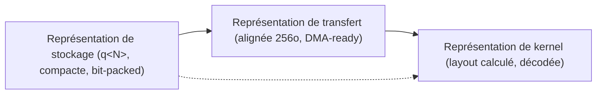
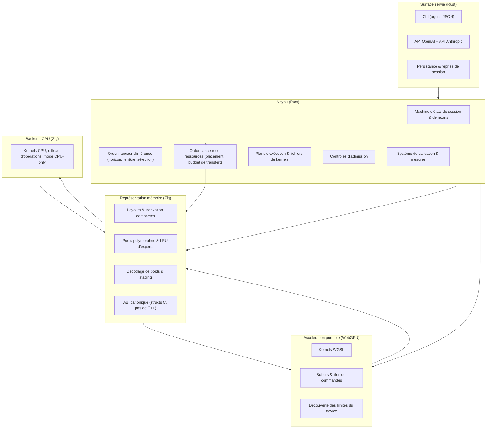
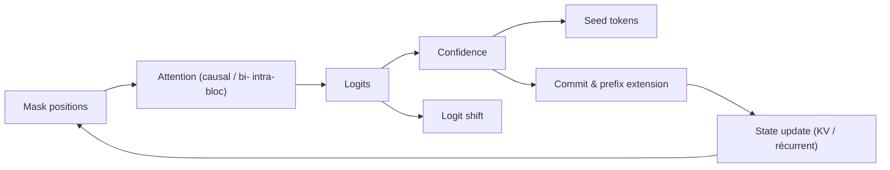
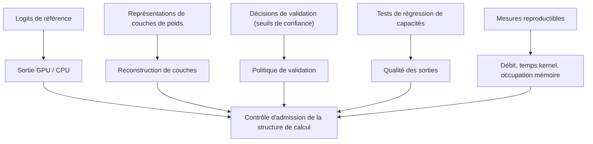

# Alethe.IA — Document de référence unique
**Version : 0.3.0** — **Date de révision : 10 novembre 2026** — **Statut : spécification normative, projet pré-1.0. Toutes les exigences sont `NOT_STARTED` ; le moteur n'est pas implémenté.**

**Nature des changements de la version 0.3.0** (`m`, ajouts compatibles + corrections de modélisation d'un checkpoint non encore `ACCEPTÉE` — aucune exigence `ACCEPTÉE` n'est modifiée, NEVER qualifier de `major` avant la première acceptation, `ADR-005`) : **reclassification de `UT-IFML/dQwen3.5-0.8B-Base` comme dLLM déjà adapté** (méthode `dQwen35`, carte lue : « adapted from Qwen3.5-0.8B », « only its attention layers are made bidirectional, and the Gated DeltaNet layers stay causal ») — NEVER le décrire comme « base à convertir », NEVER exiger une seconde conversion (R-16, §7.1, §7.2.1, §8, §13.1, `ADR-001`) ; **R-160 défigé** : `block_length = 32` est une **option d'appel** de `generate`, pas une granularité de conversion, le canva entier est dénoisé par défaut (`tau = 0.9`) ; **périmètre des formats de P0 clarifié en trois rôles** (BF16 = format de poids de référence, FP32 = oracle de comparaison **jamais** cible de production, Q8_0 = corpus GGUF LLaDA, FP16 reporté à son jalon `F-3`) ; **deux exercices CPU-only distincts** (R-90 : BF16 sur dQwen, Q8_0 sur LLaDA) ; **règle de mappage des chaînes de carte vers l'énumération canonique** (§7.1, la chaîne `Hybrid` n'est pas une valeur de `generation_family`) ; **§7.4 ajouté** : R-98 (découverte de `config.json` / `tokenizer_config.json`), R-99 (offline-first), R-100 (code distant jamais exécuté, `trust_remote_code` non exécuté), R-101 (adaptateur architectural, `reconnu` ≠ `exécutable`), R-102 (normalisation) ; **zone 30** (schéma du descripteur + table des adaptateurs, à trancher) ; `ADR-013`, `ADR-014` ajoutés (proposés, non tranchés).

**Nature des changements de la version 0.2.1** (`n`, corrections factiques **sans** contrat ni critère d'acceptation modifié) : comptages **relus à l'API Hugging Face** (LLaDA-8B-Base **8 015 581 184** paramètres BF16, la valeur `8 022 581 248` est **fausse**), **identifiants et sha vérifiés** (`google/diffusiongemma-26B-A4B-it` `f7f5b7f5fa…`, `DiffuSpace/Clover-35B-A3B-Preview` `4b0402b65e523d0183a14c431955438714cb16ff` — la casse `Diffuspace` est **corrigée** par la lecture du dépôt le 10 novembre 2026), **tailles mesurées sur `tree/main`** (DiffusionGemma 51 647 701 024 octets / 11 shards ; Clover **28 fichiers `.safetensors` = 69 322 795 672 octets** — 26 shards + 2 fichiers `bd_gdn_*` — et `usedStorage` **69 342 784 805** consigné **à part**, NEVER confler les deux chiffres), **multimodalité réelle de DiffusionGemma** (`image-text-to-text`, `vision_config` 27 couches) → `N-4` MUST être relu à cette aune, NEVER présumer une limite. La nature des changements de chaque version est consignée ici, NEVER déduite de la version (`ADR-005`).

**Nature des changements de la version 0.2.0** (`m`, ajouts compatibles) : §6.3 **table de tolérances par format** + convention de comptage de la mantisse ; §14 **zones 28 et 29** ; §15 **structure de dépôt** complétée + état constaté des répertoires de code ; Annexe B **endpoints consignés**, matrice laissée `A COMPLETER` (zones 6 / 23) ; lignes de changelog pour `ADR-005`, `ADR-010`, `ADR-011` ; **sections de vérification datées** ajoutées aux quatre audits (corps des audits **figés**).

**Politique de versionnement (adoptée, `ADR-005`)** : version sémantique `M.m.n` appliquée à la **spécification**.
- **patch** (`0.1.0` → `0.1.1`) : corrections éditoriales, clarifications, renvois, références externes, reformulations de prescriptions — **sans** modification d'un contrat, d'un invariant ni d'un critère d'acceptation.
- **minor** (`0.1.0` → `0.2.0`) : ajouts compatibles — exigence nouvelle, zone complémentée, jalon annexe, profil de modèle ajouté — **sans** changer le comportement exigé d'une exigence déjà `ACCEPTÉE`.
- **major** (`0.x` → `1.0.0`, `1.x` → `2.0.0`) : changement incompatible d'un contrat, d'un invariant, d'une interface, d'un format ou d'un critère d'acceptation.

NEVER inscrire dans ce fichier le hash du commit qui modifie ce fichier : la version est la référence, le changelog (`docs/CHANGELOG.md`) porte l'historique. NEVER qualifier une modification de `patch` si elle change un critère d'acceptation.

**Statut** : référence normative du projet. Ce fichier est **la source unique** pour l'agent IA en charge du développement. En cas de contradiction avec un autre document du dépôt, **ce fichier prévaut** ; les fiches de `docs/fiches_techniques/` restent la source des justifications.

**Mots normalisés (RFC 2119)** : MUST, REQUIRED, SHOULD, RECOMMENDED, MAY, OPTIONAL. `NEVER` = `MUST NOT` ; `AVOID` = `SHOULD NOT`.

**Deux axes de maturité** (définis en §2.4) : **maturité de la spécification** (`DEFINED`, `EXPERIMENTAL_SPEC`, `RESEARCH`, `FUTURE`) et **état d'implémentation** (`NOT_STARTED`, `IN_PROGRESS`, `IMPLEMENTED`, `VALIDATED`). **Chaque exigence porte les deux.** Un `MUST` accompagné de `RESEARCH` n'est jamais un ordre d'implémentation définitive ; un `DEFINED` n'affirme jamais que le code existe.

**Traçabilité** : la matrice §13.2 rattache chaque exigence à sa source et à sa **nature** (`Source`, `Adaptation`, `Hypothèse de recherche` — Annexe A). Un article scientifique ne peut pas être cité comme source d'une décision qui est une extrapolation d'Alethe.ia.

## 0. Usage de ce document

L'agent IA MUST :

1. Lire ce fichier **entièrement** avant toute modification de code.
2. Respecter les exigences (`R-x`), les invariants (`I-x`), les contraintes (`C-x`) et les non-objectifs (`N-x`).
3. Vérifier **les deux axes de maturité** de chaque exigence avant d'écrire du code (axe 1 : `DEFINED` → implémentation autorisée, `EXPERIMENTAL_SPEC` → implémentation mesurable et désactivable, `RESEARCH` → prototype + mesure, jamais chemin de production, `FUTURE` → ne pas implémenter ; axe 2 : `NOT_STARTED` / `IN_PROGRESS` / `IMPLEMENTED` / `VALIDATED` — matrice d'état dans `docs/etat_implementation.md`, MUST être mise à jour à chaque validation).
4. NE PAS inventer de concepts absents de ce document ; AVOID les extensions non décrites.
5. Signaler les contradictions, ambiguïtés et zones non couvertes **avant** d'écrire le code correspondant.
6. Traiter chaque livrable comme adossé à une exigence : un changement sans exigence est une dérive.
7. NE PAS trancher seul un arbitrage d'architecture (fusion des ordonnanceurs, choix d'un format de poids prioritaire, périmètre d'une API, ajout d'une dépendance). Ces décisions appartiennent au mainteneur et MUST être consignées dans ce document avant implementation.
8. **Zones à trancher (§14)** : une zone marquée **A TRANCHER** MUST NOT être codée. L'agent MUST proposer une **note de décision** (options, gains, coûts, effets sur les exigences), MUST la soumettre au mainteneur, MUST consigner la décision retenue dans la ligne de §14 **avant** d'écrire le code.
**Carte de chargement** — le document est lu entièrement avant toute modification de code (règle 1) ; la table ci-dessous indique les sections minimales à relire selon la tâche, sans remplacer la lecture complète :

| Tâche | Sections minimales |
|---|---|
| cycle, jetons, modes | §3.1, §3.2, §3.3, §5 |
| mémoire, placement, offload | §3.5, §3.6, §4.2, §4.5, §4.7, R-29..R-42, R-84..R-89 |
| kernels, WGSL, limites du device, tiling, réduction | §4.1, §4.4, §4.5 (limites lues, réduction, contrat de tiling `ADR-004`), §4.6, R-33..R-35, R-86..R-88 |
| formats de poids, n-gram, formats numériques (BF16, Q8_0, MX) | §3.9, §4.3, §5.8, §6.3, §8.1, R-58..R-64, R-83, R-60 |
| serving, API externe, API de contrôle | §3.7, Annexe B, R-48..R-51, R-80..R-82, R-92..R-96 |
| persistance | §3.8, §6.4, R-43..R-47, R-75..R-79 |
| validation numérique | §6.1, §6.3, §9, R-52..R-57, R-65..R-70 |
| checkpoints, profils d'attention, granularité, tokenizer | §7, §7.1, §7.2, §7.2.1, §7.3, §8, R-16, R-17, R-18, R-91, R-97 |
| jalons, critères d'entrée, empreinte mesurée, machine de référence, livraisons, état | §8, §8.1, §9, §16, §17, `docs/etat_implementation.md`, `ADR-001`, `ADR-002`, `ADR-006` |
| zone à trancher | §14, §0 règle 8, §11 règle 2 |

**Sources consultées pour l'écriture de cette révision (10 novembre 2026)** : les 4 fiches de `docs/fiches_techniques/`, `docs/fiches_techniques/références.txt`, les sources primaires des références (repos Strata `Niko1221/Strata`, FreeToken, DwarfStar4 ; spécifications W3C WebGPU et WGSL). **Cartes de modèles relues à la source le 10 novembre 2026** (API Hugging Face répond `200`, `id` / `sha` / `safetensors.parameters` / `cardData.license` / `base_model` lus ; fichiers du dépôt lus) : `google/diffusiongemma-26B-A4B-it` ; `Diffuspace/Clover-35B-A3B-Preview` (+ `README.md`, code `github.com/DiffuSpace/Clover-35B-A3B-Preview`) ; `GSAI-ML/LLaDA-8B-Instruct` (+ `config.json`, `configuration_llada.py`, `README.md`) ; `UT-IFML/dQwen3.5-0.8B-Base` (+ `config.json`, `tokenizer_config.json`, `tokenizer.json` via LFS, `README.md`) ; `UT-IFML/dQwen3.5-2B-Base` (+ `config.json`, `tokenizer_config.json`, `tokenizer.json`, `README.md`, `LICENSE`) ; `yuchen-zhu-zyc/HybridDiffusion-2B` (+ `README.md` : modes, `block_size`, seuil, `base_model`, licence) ; `Qwen/Qwen3.5-0.8B-Base` ; `Qwen/Qwen3.6-35B-A3B` ; `diffuse-cpp/LLaDA-8B-Instruct-GGUF` (+ arborescence : `llada-8b-q4km.gguf`, `llada-8b-q8_0.gguf`). **Structure de format lue à la source** : spec ggml `docs/gguf.md` (structure de Q8_0). **Constats retirés ce jour** : `Vals-ai/HybridDiffusion-2B`, `Nikolas-Kabbani/Fallen-2.2-26B-A3B-GGUF`, `Fucking-Panda/WAR-STRATA-7B-GGUF`, `NemoHeger/MolmoEdge42-2B-AWQ`, `microsoft/Phi-4-mini-instruct-AWQ-4-16` **ne sont pas des dépôts existants** (API : `Invalid username or password` / `401`) ; NEVER les citer comme sources. **Articles lus antérieurement, non re-accessibles depuis cet environnement ce jour** (`curl` → `000`) : WeDLM `2512.22737`, WeDLM 2.0 `2609.18795`, FLARE `2606.01774`, FLUID `2605.27387`, REPR-ALIGN `2605.06885`, LLaDA `2502.09992`, GDN `2412.06464`, auto-spéculation par ancrage `2508.19982`. MUST les relire à la source avant toute modification normative qui s'y appuie (règle 1 de §0). **Exemples d'API lues à la source** : `platform.openai.com/docs/api-reference/chat` (chat completions, `stream_options.include_usage`) et `platform.claude.com/docs/en/api/messages` (Messages, `content` array, `system`, `max_tokens` obligatoire, `stop_sequences`, `temperature` incompatible avec `output_config.effort`, `stream` + `delta` + `message_stop`). **Constat de la machine de développement** : `nvidia-smi`, `nproc`, `free`, `wslinfo`, lecture directe (10 novembre 2026). NEVER citer une source non lue ; NEVER une référence d'article non vérifiée dans l'index des sources (§13.1).

---

## 1. Vision produit

**Alethe.ia** est un moteur d'inférence **natif pour les modèles génératifs à diffusion (dLLM)**, écrit en coopération **Rust + Zig** et accéléré par **WebGPU** de manière portable.

Le moteur sert **deux familles de génération** — la diffusion par blocs et l'autorégression — **sur une infrastructure commune** (contrats d'opérations, modèle de mémoire, ordonnanceurs, système de validation, API). Il ne partage **pas** un algorithme de génération unique : l'AR conserve son chemin causal natif, la diffusion conserve son chemin de dénoisage natif. Voir §2.5 pour le périmètre exact de l'unification.

**Produit livré** (par phases) :

| Phase | Livrable | Interface utilisateur |
|---|---|---|
| P0-P2 | moteur + CLI de validation | technique uniquement |
| P3-P4 | moteur + serveur OpenAI-compatible et Anthropic-compatible + CLI d'exploitation | opérateurs, intégrateurs, agents |
| P5 | moteur + APIs + persistance + formats étendus | opérateurs |
| ultérieure | application avec interface graphique | grand public |

Le **grand public** est une cible d'adoption, pas le périmètre des interfaces livrées aux jalons P0-P5. Un agent ne MUST pas concevoir une interface graphique, un packaging grand public ou une application desktop dans les jalons initiaux (`N-4`).

**Utilisateurs** : (a) l'agent IA de développement, (b) les intégrateurs d'applications locales (CLI, serveurs API, agents de code), (c) les opérateurs de machines hétérogènes (VRAM limitée, RAM faible, NVMe rapide, WSL, iGPU), (d) les agents IA consommateurs des APIs.

**Fonctionnalités primaires** :

- génération dLLM native (dénoisage par bloc, parallèle) ;
- génération AR sur le même moteur, par son chemin natif ;
- préfill/décodage en continu, réutilisation de préfixe, reprise de session ;
- serving **OpenAI-compatible** et **Anthropic-compatible** (streaming, tool calls) ;
- persistance d'états d'inférence (checkpoints de KV, états récurrents, sessions) ;
- gestion polymorphe de la mémoire (KV, états récurrents, états de diffusion) sur VRAM / RAM / NVMe, **par rôle des objets**, pas par partition matérielle fixe ;
- exécution sur GPU grand public, iGPU, **et sur machines sans GPU discret (mode CPU-only)** ;
- exécution d'opérations sur CPU en production dans les sessions servies sur accélérateurs (offload, notamment experts MoE).

**Ce que le moteur ne fait pas** : il n'entraîne pas, n'affine pas, ne convertit pas les checkpoints. La conversion AR → dLLM est un **outillage externe** (§3.11) ; le moteur **charge** les artifacts produits par cet outillage. Voir `N-1`.

**Non-objectifs** (exclusions explicites, `N-x`) : voir §12.

---

## 2. Principes de conception

### 2.1 Architecture des couches

| Couche | Rôle principal |
|---|---|
| **Rust** | cohérence d'état, concurrence, **ordonnanceur d'inférence**, **ordonnanceur de ressources**, contrats d'interface, métadonnées canoniques de tenseurs, formats de fichiers, validation, APIs |
| **Zig** | représentation mémoire des données, layouts, indexation, structures compactes, chemins critiques, décodage de poids, préparation des buffers |
| **WebGPU** | accélération portable des calculs, kernels de dLLM, allocation de buffers, files de commandes, plans d'exécution, synchronisation |
| **CPU** | backend de référence, backend de production (offload d'opérations, mode CPU-only complet) |

**Aucune hiérarchie artificielle** : Rust n'est pas supérieur à Zig, WebGPU n'est pas subordonné aux deux. Chaque couche possède une zone de responsabilité délimitée.

**Règle de non-duplication** : chaque concept (position logique, position physique, bloc, masque, horizon, fenêtre glissante, état récurrent, état de validation, préfixe autorisé, état de session, format de poids) MUST avoir **une seule définition** dans le moteur.

**Règle de séparation stricte** (adaptée de DwarfStar4) : le CLI/server MUST NOT connaître les internals de tenseurs ; l'ordonnanceur d'inférence MUST NOT connaître les formats de poids ; l'ordonnanceur de ressources MUST NOT connaître la sémantique de dénoisage.

### 2.2 Principes d'architecture

| Principe | Formulation normative |
|---|---|
| Primauté du dLLM | les structures principales MUST être conçues pour les processus de dénoisage et de validation |
| Coopération des couches | les responsabilités MUST être clairement définies, sans subordination |
| Portabilité WebGPU | le moteur MUST s'adapter aux capacités des appareils, sans dépendre d'une extension propriétaire |
| Préservation de la sémantique | les représentations, formats et interfaces MUST conserver la sémantique des checkpoints |
| Optimisation mesurée | les optimisations MUST être justifiées par des mesures de mémoire, latence, débit, bandes passantes |
| Limites explicites | les interfaces MUST définir ce que le moteur fait et ne fait pas |
| Dégradation contrôlée | les capacités manquantes (device limitations, format unsupported, kernel fallback, cache thrashing, VRAM fragmentation, absence de `shader-f16`) MUST être explicites, jamais silencieuses |
| Déclaratif | les modèles déclarent leurs besoins (états, formats, capacités de décodage) ; les ordonnanceurs décident où les satisfaire |

### 2.3 Invariants

| # | Invariant |
|---|---|
| I-1 | **Infrastructure commune, pas algorithme unique** : AR et dLLM partagent les contrats d'opérations, la mémoire, les ordonnanceurs, le système de validation et les APIs. La sémantique de génération reste propre à chaque famille. |
| I-2 | **Deux ordonnanceurs coordonnés** : un **ordonnanceur d'inférence** (quoi calculer, dans quel ordre : blocs, pas, sélection, spéculation, admission des requêtes) et un **ordonnanceur de ressources** (où résident les données, quand elles sont déplacées, à quel coût). Ils communiquent par une interface typée, jamais par effets de bord. |
| I-3 | **Un seul modèle de mémoire** : KV, états récurrents, états de blocs, états intermédiaires, poids, tables n-gram, checkpoints persistés sont des entrées d'une **même hiérarchie de placement**, classées par rôle et coût d'accès, pas par adresse matérielle fixe. |
| I-4 | **Un seul système de validation** : interface commune (protocole typé commit / rewind / masque / rejet), instances spécialisées par classe de mécanisme (dénoisage, spéculatif, état récurrent, poids). Un AR strict n'est **pas** un cas particulier du validateur de dénoisage. |
| I-5 | **Sémantique des checkpoints préservée** : formats de poids, structures d'attention, schémas de routage, top-k, nombres d'experts MUST rester fidèles aux checkpoints. |
| I-6 | **Aucune hiérarchie artificielle entre couches** : la frontière se définit par des contrats, pas par la profondeur d'appel. |
| I-7 | **Pas de duplication fonctionnelle** : un concept a une définition, un champ, une sémantique. |
| I-8 | **Pas de lock-in GPU** : les extensions propriétaires MAY être des accélérateurs optionnels, jamais la sémantique principale. |
| I-9 | **Pas de variantes sémantiques permanentes derrière des flags** (règle DwarfStar4) : les switchs de diagnostic valident le chemin de release. |
| I-10 | **Correctivité avant rapidité** : NEVER garder un chemin plus rapide avec attention, KV ou logits drift inexpliqués. |
| I-11 | **Le CPU est un chemin de production** : (a) backend de référence et de debug ; (b) CPU offload d'opérations dans les sessions servies sur accélérateurs, y compris le calcul d'experts MoE ; (c) mode CPU-only complet sur machine sans GPU compatible. Le chemin CPU MUST satisfaire les mêmes exigences numériques, de déterminisme, de persistance, d'API et d'ordonnancement que tout autre backend. |
| I-12 | **C++ NEVER** dans le codebase. |
| I-13 | **Un concept, un champ, un flux** : la mémoire d'un état n'est pas un registre ; les états sont typés et sérialisés. |
| I-14 | **Préconditions déclarées** : tout composant qui suppose une propriété du modèle (causalité stricte, contiguïté du préfixe, checkpoint dual-stream, état récurrent, table n-gram) MUST déclarer cette précondition et refuser les modèles qui ne la remplissent pas. |

### 2.4 Deux axes : maturité de la spécification et état d'implémentation

**Un document normatif ne déclare pas que le code existe.** Chaque exigence porte **deux étiquettes distinctes**, jamais confondues.

**Axe 1 — maturité de la spécification** (colonne `Spéc.` des tables §3) :

| Valeur | Signification | Droit de l'agent |
|---|---|---|
| `DEFINED` | comportement défini, périmètre délimité, préconditions écrites | implémentation autorisée |
| `EXPERIMENTAL_SPEC` | mécanisme défini et implémentable, non validé sur l'ensemble des cibles | implémentation **mesurable et désactivable** |
| `RESEARCH` | hypothèse à étudier, définition incomplète | prototype + protocole de mesure ; NEVER chemin de production, NEVER défaut activé |
| `FUTURE` | hors du périmètre des jalons en cours | NEVER implémentée dans les jalons en cours |

**Axe 2 — état d'implémentation** (matrice dans `docs/etat_implementation.md`) :

| Valeur | Signification |
|---|---|
| `NOT_STARTED` | aucune ligne de code du chemin |
| `IN_PROGRESS` | chemin en cours, non complet |
| `IMPLEMENTED` | chemin complet, non validé sur la cible de référence |
| `VALIDATED` | chemin exercé sur la cible de référence, mesures consignées (§9) |

**État initial du projet : les exigences `R-1..R-97` sont toutes `NOT_STARTED`.** Un `DEFINED` ne signifie pas « implémenté » ; un `VALIDATED` n'est jamais déclaré sans mesure consignée.

Règles :

- Une exigence `RESEARCH` MUST être livrée avec son protocole de mesure et son critère d'abandon.
- Une exigence `EXPERIMENTAL_SPEC` MUST être derrière une option de configuration **explicitement documentée**, pas derrière un flag sémantique permanent (`I-9`).
- L'agent MUST déclarer les deux axes avant d'implémenter (§11, règle 10) et MUST mettre à jour la matrice d'état (`docs/etat_implementation.md`) à chaque validation.
- La promotion d'un axe se décide sur la base des mesures : `RESEARCH` → `EXPERIMENTAL_SPEC` → `DEFINED` (axe 1) par le mainteneur ; `IN_PROGRESS` → `IMPLEMENTED` → `VALIDATED` (axe 2) par l'exécution d'un test ou d'une mesure consignée.

### 2.5 Périmètre de l'unification AR / dLLM

**Ce qui est unifié** (une seule implémentation pour les deux familles) :

- représentation des positions logiques et physiques, masques, blocs, fenêtres ;
- hiérarchie de placement mémoire et ordonnanceur de ressources ;
- protocole de validation (commit / rewind / rejet), ses journalisations et ses invariants de cohérence ;
- cycle de vie des états (session, préfixe, état récurrent, état de diffusion) et leur persistance ;
- admission des requêtes, concurrency, workers ;
- APIs, formats de poids, métadonnées canoniques ;
- instrumentation et critères de validation.

**Ce qui reste propre à chaque famille** (deux implémentations, sous le même contrat) :

| Domaine | AR | dLLM |
|---|---|---|
| ordre de génération | séquentiel causal | parallèle par bloc, itératif |
| granularité d'avancement | 1 jeton par pas | k jetons par pas, k variable |
| granularité de validation | préfixe strictement croissant | fenêtre, ensemble de positions, révisions locales |
| granularité de restauration | point de KV | point de KV **et** point d'état récurrent |
| politique d'attention | profil d'attention déclaré : sous-modules **causal** et **local causal à fenêtre**, pas de positions masquées, préfixe visible = tout le contexte (§7.2.1) | profil d'attention déclaré : sous-modules **bidirectionnel intra-bloc**, **cross-attention** vers le préfixe causal, **récurrent** (GDN), fenêtre glissante, positions masquées, préfixe causal préservé (§7.2.1) |
| sémantique de l'horizon | fenêtre contextuelle | horizon de dénoisage + fenêtre d'attention |

**Conséquence normative** : le contrat commun MUST être typé par **famille de génération** (`generation_family = AR | Diffusion`), **topologie d'architecture** (`architecture_topology`) et **capacités servies** (`generation_capabilities`) — jamais un champ unique. Un agent MUST NOT « unifier » en écrivant un algorithme unique de génération, ni en traitant l'AR comme une spécialisation booléenne du dénoisage, ni en appliquant une politique de fenêtre et de cache globale à toutes les stratégies.


---

## 3. Exigences fonctionnelles

Chaque exigence porte un **critère d'acceptation** et un **niveau de maturité** (§2.4). Les IDs sont celles de la baseline auditée ; les ajouts sont numérotés à la suite.

### 3.1 Cycle de génération

| # | Exigence | Critère d'acceptation | Spéc. |
|---|---|---|---|
| R-1 | Le moteur MUST charger un checkpoint (natif dLLM, AR, adapté par outillage externe §8.1) en structures d'inférence : kernels, buffers, formats de poids, plans d'exécution. | le chargement échoue explicitement si une capacité déclarée n'est pas supportée (`I-14`) | DEFINED |
| R-2 | Le cycle MUST traiter le préfill, la construction des préfixes autorisés, le dénoisage de bloc, la validation de jetons, la mise à jour de l'état d'attention, la décision d'horizon, le commit. | un pas complet observable de bout en bout sur la cible de référence | DEFINED |
| R-3 | Un cycle MUST exposer des points de contrôle observables pour l'ordonnanceur : position du prochain bloc, taille de l'horizon, politique d'attention, politique de validation, révision, fenêtre active. | chaque champ est journalisé et rejouable | DEFINED |
| R-4 | Le cycle MUST être compatible avec la représentation statique d'un plan à formes fixes et avec les appels de kernels (§4.4). | le plan est reproductible sans ré-encodage de la structure de contrôle | DEFINED |
| R-5 | Le cycle MUST permettre des révisions locales : un jeton non validé, une fenêtre annulée, un état intermédiaire rejeté. | le rewind journalise l'état restauré (positions, KV, état récurrent) | DEFINED |
| R-6 | Le cycle MUST être réutilisable pour le préfill, la continuation, la reprise de session, l'interpolation, la reconstruction. | 5 modes sur la même interface de session | DEFINED |

Cycle canonique (7 étapes) :

```
1. Préfixe autorisé       — le préfixe valide est présent dans la mémoire de l'état
2. Horizon                — l'ordonnanceur d'inférence définit l'horizon de génération
3. Fenêtre de bloc        — une fenêtre de blocs est placée pour la dénoisation
4. Forward + attention    — le modèle évalue le contenu masqué
5. Candidats + validation — le modèle produit des jetons candidats, la politique de validation marque les validés
6. Commit                 — les jetons validés deviennent préfixe autorisé
7. Décision d'horizon     — l'ordonnanceur ajuste l'horizon pour le cycle suivant
```

**Périmètre** : les 7 étapes sont le **contrat d'exécution commun** (`I-1`). Elles décrivent un cycle d'obligations, pas un algorithme de génération unique. L'AR les remplit avec `horizon = 1 position`, `fenêtre = 1`, `validation = immédiate`, **par son chemin causal natif** ; il n'est pas une spécialisation du dénoisage.

### 3.2 États de jetons

| # | Exigence | Critère d'acceptation | Spéc. |
|---|---|---|---|
| R-7 | Le moteur MUST distinguer jeton masqué, jeton candidat provisoire, jeton validé. | trois états typés, jamais un booléen | DEFINED |
| R-8 | Le moteur MUST distinguer **position logique** (ordre dans la séquence d'inférence) et **position physique** (ordre dans les buffers/cache). | mapping journalisé par pas | DEFINED |
| R-9 | Le moteur MUST gérer le réordonnement topologique (WeDLM), le réordonnement de blocs (windowing), le réordonnement pour réutilisation de préfixe. | trois réordonnements typés, testés séparément | DEFINED |
| R-10 | Un jeton validé MUST devenir un préfixe autorisé et cache-valide immédiatement dans le régime causal. | préfixe contigu croissant vérifié | DEFINED |
| R-11 | Un jeton révisé MUST rester réversible : l'état d'attention et l'état de bloc MUST pouvoir être restaurés (rollback). | rollback exact sur KV **et** état récurrent | DEFINED |

### 3.3 Modes de génération

| # | Exigence | Critère d'acceptation | Spéc. |
|---|---|---|---|
| R-12 | Le moteur MUST servir un dLLM natif en dénoisage parallèle par bloc. | cycle complet sur la cible de référence | DEFINED |
| R-13 | Le moteur MUST servir un checkpoint **dual-stream** (flux `clean` / `noisy`) en mode `Diffusion-Trust` **uniquement sur un checkpoint réel identifié par une model card publique** (R-97). NEVER l'implémenter, le valider ou le démontrer sur un checkpoint fabriqué, simulé ou synthétisé par l'agent. | checkpoint réel chargé ; refus si le checkpoint n'a qu'un flux | FUTURE |
| R-14 | Le moteur MUST servir un checkpoint **dual-stream** en mode `AR-Trust` (vérification spéculative sur le flux `clean`) **uniquement sur un checkpoint réel identifié (R-97)**. NEVER l'implémenter sur un checkpoint fabriqué. | équivalence de distribution vérifiée (§5.5) sur le checkpoint réel | FUTURE |
| R-15 | Le moteur MUST servir un checkpoint AR **par son chemin causal natif**, sous le contrat commun d'exécution. NEVER l'exprimer comme une spécialisation du cycle de dénoisage, NEVER une seconde boucle AR non typée. | test de causalité stricte : aucune fuite des positions futures | DEFINED |
| R-16 | Le moteur MUST servir un checkpoint **adapté** — AR converti en dLLM par un outillage externe (méthode `WeDLM`, `FLUID`, `FLARE`, `REPR-ALIGN` ou **`dQwen35`**) — selon la stratégie et le profil d'attention **déclarés dans son `AdaptationFile`**. MUST traiter `adaptation_method` (méthode) et `adapted_model_name` (nom du modèle adapté) comme des champs distincts. **Un checkpoint publié comme adapté est servi tel quel** : NEVER exiger une seconde conversion avant le chargement, NEVER classer un checkpoint adapté comme « base à convertir », NEVER rejeter un checkpoint adapté au seul motif qu'il n'est pas « natif ». NEVER classer un dLLM natif (DiffusionGemma, Clover) comme checkpoint adapté ; NEVER imposer un régime de streaming causal strict à un checkpoint dont la topologie d'attention n'est pas causale. | `AdaptationFile` lu et vérifié au chargement ; refus si le profil d'attention déclaré n'est pas supporté ; **la méthode d'adaptation consignée par nom dans le rapport** | DEFINED |
| R-160 | **Granularité de la génération** : MUST être **déclarée** par le `AdaptationFile` (artefact converti) ou par les métadonnées du checkpoint (dLLM natif), NEVER héritée d'un autre checkpoint. MUST distinguer la **granularité de la conversion** (propriété de l'artefact) et la **fenêtre de décodage demandée à l'exécution** (`block_length`, `steps_per_block`) : la seconde est une **option d'appel**, NEVER une propriété du checkpoint. **Fait lu sur `UT-IFML/dQwen3.5-0.8B-Base` (carte du 10 novembre 2026)** : `generate` dénoise **le canva entier** par défaut, en engageant les positions au-dessus d'un seuil de confiance (`tau = 0.9`) ; `block_length = 32` est un **exemple d'option** (décodage gauche→droite), `tau = None` + `steps_per_block = k` un budget fixe — **le checkpoint ne déclare aucune granularité de conversion** : NEVER figer `B = 32` comme granularité de référence. MUST enregistrer, par exercice, la granularité réellement employée et la comparer à la granularité déclarée ; NEVER une granularité fixée globalement par le moteur. | granularité consignée par exercice, **deux fenêtres exercées distinctement (canva entier + bloc)** | DEFINED |
| R-17 | La sélection du mode MUST être déclarative (déduite du checkpoint + configuration), pas un fork de code. | un mode par session, déclaré, sans branche de code | DEFINED |
| R-97 | **Cible de validation des modes dual-stream** : avant toute implémentation de `R-13` / `R-14`, MUST identifier un checkpoint dual-stream réel (model card publique, flux `clean` et `noisy` entraînés) et MUST consigner sa référence. MUST NOT fabriquer, synthétiser ou simuler un checkpoint dual-stream pour faire passer un test. Tant que la cible n'est pas identifiée, les modes restent `FUTURE` et ne figurent dans aucun jalon. | référence du checkpoint réel consignée ; absence de checkpoint synthétique dans les suites de tests | FUTURE |

### 3.4 Ordonnanceur d'inférence

| # | Exigence | Critère d'acceptation | Spéc. |
|---|---|---|---|
| R-18 | L'ordonnanceur d'inférence MUST décider à chaque pas le nombre de positions résolues, la longueur de la fenêtre et la profondeur de vérification, **dans les capacités déclarées du modèle** (longueur de canvas, taille de bloc, fenêtre glissante). | la décision est fonction des paramètres du checkpoint, pas d'une constante globale | DEFINED |
| R-19 | L'horizon MUST être adaptatif, borné par un plafond d'horizon (paramètre K). | K configuré, plafond vérifié | DEFINED |
| R-20 | L'horizon SHOULD être borné par la **frontière de compétence** (au-delà de la confiance de validation, il ne s'étend pas). MUST NOT étendre l'horizon au-delà d'une frontière **non mesurée**. | frontière mesurée et journalisée | RESEARCH |
| R-21 | La porte de confiance SHOULD être un seuil de confiance par position (γ) ; les positions sous le seuil ne sont pas résolues. MUST écrire la définition exacte de γ, de son domaine et de sa source (équation de l'article FLUID) **avant** toute implémentation ; AVOID activer la porte sans γ écrit. | prototype + mesure du débit gagné sur la cible AR | RESEARCH |
| R-22 | Le pas de stride SHOULD être adaptatif : `stride = 1 + Δ`. MUST définir Δ (définition, domaine de valeurs, conversion en nombre entier de positions) et citer l'équation source ; à défaut, la politique reste une **hypothèse de recherche**, NEVER une règle de production. | équation écrite + prototype mesuré | RESEARCH |
| R-23 | L'ordonnanceur MUST s'informer de : incertitude de prédictions, stabilité de préfixe, coût de transfert, disponibilité de VRAM, cache misses, bandes passantes, capacité de kernels. | les informations proviennent de l'ordonnanceur de ressources (R-84..R-89), pas d'une lecture directe du device | DEFINED |
| R-24 | La réallocation dynamique des pools (KV, récurrent, cache d'experts) et l'adaptation de la fenêtre active MUST être décidées par l'**ordonnanceur de ressources** sur requête de l'ordonnanceur d'inférence. | requête / accord / rejet journalisés | DEFINED |
| R-25 | Un adaptateur de décodage **causal compatible WeDLM** MUST déclarer ses préconditions (décodage causal strict, préfixe contigu, logits disponibles pour les positions masquées). Dans ce cadre, la sélection de remplissage MUST utiliser l'entropie pénalisée par la distance `H̃ᵢ = Hᵢ + λ·dᵢ` (dᵢ = distance au masque le plus à gauche) et remplir les positions dont `H̃ᵢ < τ`. | test de sélection + refus de précondition sur un modèle non compatible | DEFINED |
| R-26 | **Dans le profil de stratégie `WeDLM` uniquement** : la métrique de progression MUST être la croissance du préfixe contigu cache-valide (`p_cache`), pas la couverture de masque. MUST être une règle déclarée par le profil, pas une constante de l'ordonnanceur. | `p_cache` croissant mesuré sur un modèle compatible WeDLM | DEFINED |
| R-27 | **Dans le profil `WeDLM` uniquement** : le remplissage MUST se faire à la volée dans la fenêtre glissante, à travail par forward quasi constant ; NEVER les pauses de fin de bloc. MUST être la règle de fenêtre du profil. | travail par forward mesuré quasi constant | DEFINED |
| R-91 | **Interface des profils de stratégie** : chaque stratégie MUST déclarer ses métriques de progression, ses conditions de cache, ses règles de fenêtre, ses préconditions et ses granularités. L'ordonnanceur d'inférence MUST consommer cette interface et MUST NOT utiliser une métrique, une règle de fenêtre ou une précondition globale commune à toutes les stratégies. MUST inclure la stratégie d'ajout du canvas dénoisé au contexte (DiffusionGemma) comme profil distinct de la fenêtre glissante. | interface typée par stratégie, testée sur deux profils distincts (WeDLM et multi-canvas) | DEFINED |
| R-28 | La politique de commit MUST être déterministe pour une graine donnée **à l'intérieur d'un même backend** (mêmes kernels, mêmes formes de workgroup, mêmes limites). MUST définir la tolérance **entre backends** (§6.3) : NEVER exiger une identité bit-à-bit entre le chemin CPU et le chemin WebGPU pour les réductions `f32`. | deux exécutions même graine sur le même backend → même séquence de commits ; parité entre backends dans la tolérance consignée | DEFINED |

### 3.5 Mémoire polymorphe

| # | Exigence | Critère d'acceptation | Spéc. |
|---|---|---|---|
| R-29 | Le moteur MUST gérer une hiérarchie de mémoire unique sur VRAM, RAM, NVMe. | une seule hiérarchie, une seule interface d'allocation | DEFINED |
| R-30 | Le moteur MUST classer les objets par **rôle** (chaud, tiède, froid, persisté, table, scratch) et MUST placer chaque objet selon son rôle, sa taille, sa fréquence d'accès et son coût de transfert. MUST NOT imposer une partition matérielle fixe par catégorie d'objet. **Une contrainte de placement déclarée par le checkpoint ou par un profil de stratégie (ex. `table_ngram` sur NVMe, R-32 / R-64) est une contrainte d'entrée de l'ordonnanceur de ressources, pas une partition du matériel : elle fixe la classe de placement, pas l'adresse.** | le placement est reproductible à partir des besoins déclarés et des limites du device ; la contrainte déclarée est journalisée comme contrainte, pas comme adresse | DEFINED |
| R-31 | Le moteur MUST garder en RAM un ensemble d'experts **selon le budget accordé** ; la politique MUST être compatible avec des modèles dont la taille dépasse la mémoire système disponible. | admission explicite (R-34, R-88) ; le placement est décidé, pas imposé | DEFINED |
| R-32 | **Si le checkpoint déclare `table_ngram = true`** : le moteur MUST garder les tables n-gram complètes sur NVMe et MUST les lire par lignes. MUST refuser un checkpoint déclarant une table n-gram sans support de lecture par lignes. **Si `table_ngram = false` : ne rien stocker, ne rien lire** (DiffusionGemma et Clover la déclarent fausse). | chemins exercés dans les deux cas | DEFINED |
| R-33 | Les décisions de placement MUST prendre en compte le coût de transfert, la taille du bloc, la réutilisation de préfixe, les fenêtres glissantes, la structure des plans d'exécution. | décision journalisée avec le coût de transfert et le coût de calcul | DEFINED |
| R-34 | Le moteur MUST effectuer des contrôles d'admission : une requête, un état de cache, un pool d'experts, une fenêtre de génération est admise ou refusée en fonction des limites mesurées du device. | admission / refus par limites mesurées | DEFINED |
| R-35 | Le moteur MUST utiliser des tampons double pour le streaming de poids et la persistance. | double buffer vérifié sans copie redondante | DEFINED |
| R-36 | Le moteur MUST masquer les chargements (FreeToken) : charger un expert manquant pendant l'inférence de l'expert partagé et des experts déjà résidents ; charger la couche suivante pendant l'inférence de la couche courante. | benchmark transferts / calcul sur une cible à experts en RAM | EXPERIMENTAL_SPEC |
| R-37 | Le moteur MUST garantir la **compatibilité et la correction** du backend CPU pour les experts manquants (calcul en place, même sémantique que le chemin device). La **participation du CPU à l'exécution d'une session sur accélérateurs** est une **décision de l'ordonnanceur de ressources** : elle est activée lorsque le coût de transfert est mesuré supérieur au coût de calcul (R-89), pas par une règle imposée. MUST calibrer le ratio par mesure (`I-11`, R-89). | parité numérique device/CPU vérifiée sur la cible MoE ; activation de l'offload justifiée par les mesures de coût | DEFINED |
| R-38 | Le cache d'experts MUST être un pool LRU à capacité adaptative (taux d'occupation d'une fraction de VRAM). | LRU mesuré, capacité adaptative vérifiée | DEFINED |
| R-39 | Le moteur MUST adapter le cache d'experts aux métriques de routeur (fréquence d'apparition, entropie, couverture de top-k). | adaptation mesurée par métriques de routeur | DEFINED |
| R-40 | Le moteur MAY anticiper la sélection d'experts (prediction routing) : prédire les experts des 1 à 2 prochains pas afin de déclencher le transfert en avance. MUST être mesuré (justesse, gain de débit, coût mémoire) avant activation. | protocole de mesure + seuil d'abandon | RESEARCH |
| R-41 | Le cache MUST avoir un **plancher de capacité** garantissant que le pool tient au moins les experts d'un pas complet, **calculé par la formule du modèle** (experts activés, top-k, taille de bloc, taille de fenêtre), pas par une constante globale. | formule dérivée par cible ; pool d'un pas sans thrashing mesuré | DEFINED |
| R-42 | Le moteur MUST minimiser les copies, rendre les transferts explicites et utiliser des buffers de staging. MUST utiliser les plans d'exécution et la réallocation dynamique de VRAM. **La mémoire hôte épinglée zéro-copy n'est pas une exigence portable** : elle MAY être exploitée par un backend dont le runtime natif l'offre, comme optimisation déclarée. | nombre de copies par pas mesuré ; optimisation de backend déclarée comme optionnelle | DEFINED |

### 3.6 Persistance et reprise

| # | Exigence | Critère d'acceptation | Spéc. |
|---|---|---|---|
| R-43 | Le moteur MUST persister des checkpoints d'états d'inférence (KV, états récurrents, états de blocs) sur NVMe. | reprise à partir du fichier | DEFINED |
| R-44 | Le moteur MUST reprendre une session depuis un checkpoint persisté (sessions locales longues). | reprise après arrêt du processus | DEFINED |
| R-45 | Le moteur MUST réutiliser un préfixe persisté entre requêtes (radix cache). MUST définir les clés d'identité (hachage du préfixe tokenisé, positions, politique d'attention, politique de validation) et les conditions d'invalidation. | deux requêtes à préfixe identique partagent l'état ; un changement de version l'invalidé | DEFINED |
| R-46 | La persistance MUST respecter la sémantique de la politique d'attention : un état récurrent MUST être cohérent avec la position d'acceptation, pas seulement coupé comme un tail de KV. | état récurrent restauré à la position d'acceptation | DEFINED |
| R-47 | Le moteur MUST valider la cohérence d'un checkpoint persisté avant de le charger. | validation au chargement, rejet explicite | DEFINED |

**Sécurité et rétention des données persistées** (la persistance stocke des contextes, prompts, historiques et états de session sensibles) :

| # | Exigence | Critère d'acceptation | Spéc. |
|---|---|---|---|
| R-75 | La persistance des sessions MUST être **explicitement activée** par l'opérateur, jamais par défaut silencieux. L'emplacement écrit MUST être journalisé au démarrage. | configuration explicite, journal de démarrage | DEFINED |
| R-76 | MUST définir la durée de rétention, la suppression d'une session, la suppression de toutes les sessions, et exposer une interface de suppression. | suppression vérifiable, sans résidu | DEFINED |
| R-77 | MUST définir les permissions des fichiers persistés (propriétaire, mode, racine de configuration de l'opérateur) et journaliser l'emplacement écrit. Aucun écrit hors de la racine déclarée. | permissions vérifiées par test | DEFINED |
| R-78 | MUST invalider toute persistance lors d'un changement de modèle, de révision du checkpoint, de tokenizer, de format de poids ou de politique de validation. | invalidation déclenchée par la détection de version | DEFINED |
| R-79 | MUST documenter la sensibilité des données persistées ; MUST proposer un chiffrement au repos ou documenter explicitement son absence, sans la masquer. | avertissement au démarrage si persistance active et non chiffrée | DEFINED |

### 3.7 Serving

| # | Exigence | Critère d'acceptation | Spéc. |
|---|---|---|---|
| R-48 | Le moteur MUST exposer une API **OpenAI-compatible** (chat completions, streaming SSE, tool calls). | matrice Annexe B remplie et testée par endpoint | DEFINED |
| R-49 | Le moteur MUST servir plusieurs sessions avec une file de workers et un ordonnanceur de batch, **selon des critères d'admission explicites** : budget mémoire des états par requête, longueur de préfixe, politique d'attention compatible, mode de génération identique. | critères de regroupement et d'admission configurés ; latence et mémoire mesurées | DEFINED |
| R-50 | Le moteur MUST servir un service local (127.0.0.1) par défaut ; une clé d'API MUST être disponible pour toute exposition au-delà de la boucle locale. | refus d'exposition sans clé | DEFINED |
| R-51 | Le CLI MUST être la porte d'entrée des agents (invocable, non-interactive, sortie JSON). | sortie JSON stable | DEFINED |
| R-80 | Le moteur MUST exposer une API **Anthropic-compatible** (messages, streaming, tool use, `system`, `stop_reason`, format d'erreurs). | matrice Annexe B remplie et testée par endpoint | DEFINED |
| R-81 | MUST documenter la matrice de compatibilité par API : endpoints, champs acceptés, streaming, contenus, erreurs, fonctionnalités prises en charge et **non prises en charge**. | Annexe B remplie, divergence documentée, pas masquée | DEFINED |
| R-82 | MUST refuser explicitement une requête demandant une fonctionnalité non prise en charge ; NEVER la dégrader silencieusement. | réponse d'erreur normalisée par API | DEFINED |

**API de contrôle** (produit local, pilotable par un agent) :

| # | Exigence | Critère d'acceptation | Spéc. |
|---|---|---|---|
| R-92 | MUST exposer une API de contrôle pour **charger** et **décharger** un modèle et pour lister les modèles chargés avec leurs capacités déclarées (R-85) et leur mode courant. | chargement / déchargement observables, refus d'admission explicite | DEFINED |
| R-93 | MUST exposer l'**état des sessions** (liste, état, positions dénoisées, longueur de préfixe, politique active) et le **contrôle** (pause, reprise, arrêt, purge de session). | état lisible, contrôle effectif, purge sans résidu | DEFINED |
| R-94 | MUST exposer l'**état des ressources** : budget accordé par device, objets résidents par rôle, transferts en cours, décisions d'admission, occupation par rôle. | état lisible et corrélé aux décisions journalisées (R-84..R-89) | DEFINED |
| R-95 | MUST exposer la **configuration effective** (racine de persistance, rétention, formats acceptés, limites du device, fonctionnalités absentes) et les **métriques** (§9) en sortie JSON stable. | sortie JSON stable, versionnée | DEFINED |
| R-96 | L'API de contrôle MUST être servie par le **CLI non-interactive** **et** par un endpoint sur la boucle locale (`127.0.0.1`). MUST refuser toute exposition au-delà de la boucle locale sans clé d'API (`R-50`). | CLI et endpoint exercés, refus d'exposition sans clé | DEFINED |

### 3.8 Validation

| # | Exigence | Critère d'acceptation | Spéc. |
|---|---|---|---|
| R-52 | Le moteur MUST valider la sortie GPU contre des logits de référence. | tolérance mesurée | DEFINED |
| R-53 | Le moteur MUST valider les représentations de couches de poids contre des représentations de référence. | reconstruction vérifiée | DEFINED |
| R-54 | Le moteur MUST valider les décisions de validation de jetons (quand la validation est sensible à des seuils de confiance). | la décision est mesurée elle-même, pas seulement la sortie | DEFINED |
| R-55 | Le moteur MUST exécuter des tests de régression de capacités contre un checkpoint réel (suites de cas, pas des scores de leaderboard). | suites exécutées sur la cible de référence | DEFINED |
| R-56 | Le moteur MUST produire des mesures reproductibles (débit, temps kernel, temps de transfert, occupation mémoire) associées à chaque optimisation. | mesure jointe à l'optimisation | DEFINED |
| R-57 | Un changement affectant l'attention, le KV cache, la sémantique de validation, la sélection d'experts, le placement mémoire MUST être testé sur les chemins affectés **avant** d'être retenu. | tests des chemins affectés avant retention | DEFINED |

### 3.9 Format de checkpoint et représentation de poids

| # | Exigence | Critère d'acceptation | Spéc. |
|---|---|---|---|
| R-58 | Le moteur MUST lire des checkpoints au format canonique du dépôt (format interne à spécifier : **zone 1 de §14**), MUST lire GGUF et safetensors comme sources d'import. | import vérifié sur les cibles de référence | DEFINED |
| R-59 | Le format MUST conserver la sémantique du checkpoint : formats de poids, structures d'attention, schémas de routage, top-k, nombres d'experts, échelles globales. | fidèle aux déclarations du checkpoint | DEFINED |
| R-60 | Les formats de poids sont ordonnés par **niveau de priorité de format** : **F-1** (prioritaire) BF16, FP8 E4M3, MXFP4, INT4 group-quantized, FP4 E2M1, INT8 ; **F-2** (secondaire) ggml q<N> (Q3, Q4, Q5, Q6), NVFP4, i-quants ; **F-3** (extensions ultérieures) FP6, FP16 scaled, FP4 scaled, INT3, INT2. MUST nommer les niveaux `F-1` / `F-2` / `F-3` ; NEVER les confondre avec les jalons `P0..P5`. | chaque format F-1 a une référence numérique et un test de déquantification | DEFINED |
| R-61 | Les formats MUST supporter la conversion de formats de poids vers des représentations de stockage, de transfert et de kernel **sans changer la sémantique**. | trois représentations coordonnées par la métadonnée canonique | DEFINED |
| R-62 | Un format MUST stocker les formats de poids, les structures d'attention, les schémas de routage, la métadonnée de validation. | lecture complète au chargement | DEFINED |
| R-63 | L'import MUST refuser un checkpoint dont la sémantique ne peut être reproduite, avec un diagnostic explicite (NEVER un chargement silencieux). | refus au chargement | DEFINED |
| R-64 | **Si `table_ngram = true`** : les tables n-gram MUST rester sur disque et MUST être lues par lignes par token, avec leurs échelles résidentes en RAM. **Si `table_ngram = false`** : aucune table, aucune lecture. MUST refuser un checkpoint déclarant la table sans le chemin de lecture. | chemins exercés dans les deux cas | DEFINED |
| R-83 | MUST refuser un checkpoint portant un format de poids non listé en indiquant le format rencontré ; NEVER requantifier silencieusement. | refus au chargement | DEFINED |

**Trois représentations MUST être définies et coordonnées par la métadonnée canonique** :



- Le décodage de poids MUST se faire pendant le transfert, caché par le calcul de la couche courante.
- Les couches de poids MUST rester stockées compactement, MUST être déplacées par le mouvement mémoire, MUST être calculées par les kernels.
- **Échelles E8M0 (spécification OCP Microscaling)** : E8M0 est un exposant **non signé à biais 127** ; il n'a **pas** de représentation du zéro ni de l'infini. `0x00` = `2^-127` (plus petite valeur positive finie), `0xFF` = **NaN réservé**. MUST préserver `0x00` comme valeur finie, NEVER comme `+0` ; MUST traiter `0xFF` comme NaN. MUST définir explicitement le comportement d'admission face à une échelle NaN : **refuser le checkpoint** avec le diagnostic de la couche concernée, NEVER produire une valeur silencieusement fausse.
- MUST appliquer la même règle aux échelles des formats groupés (`FP8` par groupe, `MXFP4`, `NVFP4`, `INT4` group-quantized, `ggml q<N>`), MUST consigner les tolérances de déquantification par format dans la matrice L4 (§6.3).

### 3.10 QA

| # | Exigence | Critère d'acceptation | Spéc. |
|---|---|---|---|
| R-65 | La validation MUST utiliser des logits de référence (sortie d'une implémentation de référence du même checkpoint, même graine, même politique d'échantillonnage). | référence déclarée par cible | DEFINED |
| R-66 | Les tolérances MUST être exprimées par format de poids et par politique d'attention, et MUST être mesurées, pas estimées. | valeurs chiffrées mesurées | DEFINED |
| R-67 | Les tests de régression de capacités MUST tourner contre un vrai checkpoint (suites de cas : noyau, difficile), MUST être re-exécutables sans génération pour la notation. | suites re-exécutables | DEFINED |
| R-68 | Un chemin plus rapide avec drift inexpliqué de l'attention, du KV cache ou des logits MUST être rejeté. | rejet documenté | DEFINED |
| R-69 | Les tests MUST couvrir : chemin GPU normal, streaming NVMe, chemins d'offload, chemin CPU-only, chemins de décodage quantifié, chemins de reprise de session. | chaque chemin exercé | DEFINED |
| R-70 | Les tests live de l'API MUST être exécutés uniquement quand la surface d'API est intentionnellement testée. | tests par endpoint | DEFINED |

### 3.11 Conversion AR → dLLM (outillage externe, hors moteur)

`N-1` fixe la décision : **le moteur ne convertit pas et n'entraîne pas.** R-71..R-74 décrivent l'outillage externe qui produit les checkpoints adaptés ; elles ne sont pas implémentées dans le moteur et ne MUST PAS être intégrées au chemin d'exécution. Le moteur MUST uniquement **charger** leurs artifacts (R-1, R-16, `AdaptationFile` §8.1).

| # | Exigence (outillage externe) | Spéc. |
|---|---|---|
| R-71 | MUST concevoir la conversion AR → dLLM comme un pipeline externe de génération de checkpoints (supervision dual-stream clean/noisy, capacité AR du checkpoint source conservée). | FUTURE |
| R-72 | MUST supporter une supervision de type REPR-ALIGN (alignement cosinus par couche vers un enseignant AR congelé, sans modules d'adaptation, loss pondéré, gel de sous-ensembles de couches). | FUTURE |
| R-73 | MUST supporter les masques de blocs avec packing au niveau document (échantillons de longueurs variables packés sans padding). | FUTURE |
| R-74 | MUST supporter le logit shift et le masquage aléatoire du noisy-stream, sans les traiter comme pilotes primaires de la qualité. | FUTURE |

**Conséquence** : la « conversion de checkpoints dans le moteur » est retirée des jalons. L'outillage de conversion est un projet séparé, avec ses propres critères de validation, son propre périmètre (préparation de modèles, pas exécution de production) et ses propres dépendances.

### 3.12 Ordonnanceur de ressources

| # | Exigence | Critère d'acceptation | Spéc. |
|---|---|---|---|
| R-84 | MUST disposer d'un **ordonnanceur de ressources** distinct de l'ordonnanceur d'inférence : il décide où réside chaque objet (device, RAM, NVMe, CPU), quand il est déplacé, sous quel budget de transfert. | les deux ordonnanceurs communiquent par une interface typée (requêtes de placement, budgets accordés, rejets) | DEFINED |
| R-85 | Les modèles MUST déclarer leurs besoins d'exécution (états requis, formats, capacités de décodage, préconditions) ; l'ordonnanceur de ressources MUST décider où les satisfaire. Un modèle sans déclaration n'est pas chargé. | refus de chargement sans déclaration | DEFINED |
| R-86 | MUST valider les limites du device (`maxBufferSize`, `maxStorageBufferBindingSize`, `maxUniformBufferBindingSize`, `maxComputeInvocationsPerWorkgroup`, `maxComputeWorkgroupStorageSize`, `maxBindGroups`, `minStorageBufferOffsetAlignment`) **avant** l'encodage des commandes, et échouer explicitement, jamais silencieusement. | le plan est validé contre les limites mesurées en P0 | DEFINED |
| R-87 | MUST garantir que la somme des objets résidents tienne dans le budget accordé par le device. | budget champ du plan, mesuré | DEFINED |
| R-88 | MUST refuser explicitement un modèle dont les besoins dépassent la mémoire disponible, en indiquant si l'exécution est **I/O-dépendante** ; NEVER masquer la contrainte derrière un cache. | message d'admission avant chargement | DEFINED |
| R-89 | MUST comparer le coût de transfert et le coût de calcul sur le lieu de résidence pour décider le placement et l'offload (R-37, R-36). | décision journalisée avec les deux coûts | DEFINED |

### 3.13 Mode CPU

| # | Exigence | Critère d'acceptation | Spéc. |
|---|---|---|---|
| R-90 | MUST supporter le **mode CPU-only complet** sur une machine sans GPU compatible : exécution d'une session entière (chargement, calcul, APIs, persistance) avec les mêmes exigences numériques, de déterminisme et de reprise que tout autre backend (`I-11`). MUST être exercé sur **deux corpus distincts** : (a) le **checkpoint de référence** `UT-IFML/dQwen3.5-0.8B-Base` en **BF16** (chemin récurrent GDN, canva entier), (b) le **corpus GGUF Q8_0** de `GSAI-ML/LLaDA-8B-Instruct` (`diffuse-cpp/LLaDA-8B-Instruct-GGUF`, commit de la quantization épinglé, zone 23) — NEVER fusionner les deux en un seul exercice, NEVER n'exercer que l'un des deux. | **deux sessions complètes exécutées sans GPU**, débit mesuré et informé à l'opérateur pour chacune | DEFINED |

---

## 4. Architecture technique

### 4.1 Couches et noyau



Frontière normative : **Rust** possède les décisions, l'état et les contrats ; **Zig** possède la représentation et le mouvement des données ; **WebGPU** et le **CPU** possèdent l'exécution. Un contrat ABI partagé (structs C, pas de C++) est le seul moyen de passer des données entre couches.

### 4.2 Métadonnées canoniques

- Un seul jeu de métadonnées MUST décrire les shapes de tenseurs, les types de kernels, les layouts de buffers, les formats de poids, les exigences d'alignement.
- Le contrat d'interface entre couches MUST être basé sur cette source unique de métadonnées.
- Les couches MUST partager la sémantique par des formats communs, des buffers communs et des contrats explicites — NEVER par des suppositions sur la profondeur d'appel.

### 4.3 Catalogue de kernels dLLM



| Kernel | Rôle contractuel |
|---|---|
| mask positions | pose des `[MASK]` sur la fenêtre active |
| attention | causal sur préfixe autorisé ; bidirectionnel intra-bloc si la politique le déclare |
| logits | sortie par position, propre au stream |
| logit shift | aligne la prédiction d'un bloc sur ses positions (FLARE) |
| confidence | score de confiance par position (entropie, marge, seuil) |
| seed tokens | sélection des positions à remplir (entropie + pénalité de distance, R-25) |
| commit & prefix extension | validés → préfixe, préfixe → cache-valide |
| state update | KV softmax et état récurrent linéaire |
| expert gather / scatter | LRU d'experts, H2D, scatter des poids manquants |
| quant decode | décodage q<N> / fp4 / fp8 / ggml vers le layout de kernel |

Chaque kernel MUST être compact, parallèle, compatible avec les plans d'exécution, et MUST éviter les allocations inutiles, les dépendances excessives, les synchronisations superflues. MUST exister en version device **et** en version CPU pour les chemins d'offload (R-37, R-90).

### 4.4 Plans d'exécution et WebGPU

WebGPU n'offre pas de capture de graphe équivalente aux graphes CUDA. MUST distinguer six niveaux, sans jamais les présenter comme équivalents :

1. **représentation statique d'un plan** ;
2. **réutilisation des pipelines et des layouts** ;
3. **réutilisation des buffers** ;
4. **encodage des commandes** ;
5. **soumission GPU** ;
6. **replay native d'un graphe**, uniquement lorsque le backend l'offre.

Le moteur MUST émuler un plan d'exécution par :

1. compilation WGSL au chargement, pipeline cache keyed par identifiant canonique de kernel ;
2. plans à forme fixe : bind group layouts stables, shapes pré-établies, un command encoder regroupe les kernels d'un pas ;
3. offsets dynamiques (workgroup count, dynamic buffer offsets) pour les variantes de taille ;
4. réutilisation de buffers par pool, NEVER un buffer par requête.

**Le chemin WebGPU portable MUST NOT être présenté comme équivalent à CUDA Graphs.**

### 4.5 Limites et fonctionnalités du device

Le moteur MUST lire les limites réelles du device au démarrage et adapter les kernels aux limites, jamais les supposer. Les identifiants MUST être exacts (`GPUSupportedLimits` / wgpu) :

| Limite WebGPU | wgpu (Rust) |
|---|---|
| `maxBufferSize` | `max_buffer_size` |
| `maxStorageBufferBindingSize` | `max_storage_buffer_binding_size` |
| `maxUniformBufferBindingSize` | `max_uniform_buffer_binding_size` |
| `maxComputeInvocationsPerWorkgroup` | `max_compute_invocations_per_workgroup` |
| `maxComputeWorkgroupStorageSize` | `max_compute_workgroup_storage_size` |
| `maxComputeWorkgroupSizeX/Y/Z` | `max_compute_workgroup_size_x/y/z` |
| `maxComputeWorkgroupsPerDimension` | `max_compute_workgroups_per_dimension` |
| `maxStorageBuffersPerShaderStage` | `max_storage_buffers_per_shader_stage` |
| `maxUniformBuffersPerShaderStage` | `max_uniform_buffers_per_shader_stage` |
| `maxSampledTexturesPerShaderStage` | `max_sampled_textures_per_shader_stage` |
| `maxSamplersPerShaderStage` | `max_samplers_per_shader_stage` |
| `maxBindGroups` | `max_bind_groups` |
| `minStorageBufferOffsetAlignment` | `min_storage_buffer_offset_alignment` |
| `minUniformBufferOffsetAlignment` | `min_uniform_buffer_offset_alignment` |

Les noms `maxBoundStorageBufferSize`, `maxInvocationsPerInvocation`, `maxTotalBufferSize`, `maxBoundUniformBuffers` **n'existent pas** dans la spécification WebGPU ; un agent MUST NOT les rechercher.

**Fonctionnalités à déclarer** — MUST utiliser les noms exacts (WebGPU / wgpu), MUST les tester sur le device au démarrage :
- `shader-f16` (`SHADER_F16`) — active le type `f16` dans les shaders.
- `timestamp-query` (`TIMESTAMP_QUERY`) — timing GPU-side.
- `texture-compression-bc`, `texture-compression-etc2`, `texture-compression-astc` (`TEXTURE_COMPRESSION_BC` / `_ETC2` / `_ASTC`) — la compression est spécifiée **par format**, il n'existe pas de feature générique `texture-compression`.
- `float32-filterable` (`FLOAT32_FILTERABLE`) — uniquement si des textures float32 sont échantillonnées avec filtrage.
- **`float64` n'est pas une fonctionnalité WebGPU** : WGSL n'expose pas de type double précision dans les shaders. Les calculs en double précision sont un choix **CPU-side** (backend Zig), déclaré comme capacité du backend CPU, jamais comme capacité GPU à détecter.
- **`subgroups`** (`SUBGROUP`) — parallélisme SIMD dans la workgroup, disponible dans Chrome depuis la version 134 (26 février 2025). MUST être testée sur le device, NEVER activée sans qu'elle soit exposée. WGSL : `enable subgroups;`, built-ins `subgroup_invocation_id` et `subgroup_size`, fonctions collectives (`subgroupAdd`, `subgroupMul`, `subgroupMin`, `subgroupMax`, `subgroupBallot`, `subgroupBroadcast`, `subgroupShuffle`, scans exclusifs / inclusifs, fonctions quad). Le device publie `subgroupMinSize` / `subgroupMaxSize` dans les informations d'adaptateur : MUST lire ces valeurs, NEVER supposer la taille d'un subgroup. `f16` et subgroups se combinent en demandant **les deux** fonctions (`shader-f16` **et** `subgroups`). Extensions WGSL à vérifier sur la cible : `subgroup_id`, `subgroup_uniformity`, contrôle de la taille de subgroup.

**Précision numérique** : la sémantique numérique de la production est **f32 dans les shaders** ; les poids stockés MUST être décodés vers le layout de kernel ; les conversions MUST être explicites. **WGSL définit le type `f16`**, mais son usage requiert `enable f16;` dans le module **et** la fonctionnalité `shader-f16` sur le device. La règle normative : **le chemin de référence MUST fonctionner sans `f16`** ; lorsque le device expose `shader-f16`, une variante spécialisée MAY être proposée après validation numérique et benchmark. NEVER compter sur `f16` comme chemin de base.

**Atomics** : les atomics de base WGSL portent sur `i32` et `u32` ; il n'existe pas d'atomic `f32` dans le langage de base. Les réductions MUST être réalisées par des passes hiérarchiques dans la workgroup memory.

**Mapping des buffers** : `MAP_READ` se combine uniquement avec `COPY_DST`, `MAP_WRITE` uniquement avec `COPY_SRC` ; un buffer mappé n'est pas disponible pour les opérations GPU tant qu'il reste mappé. Conséquence : la mémoire hôte épinglée zéro-copy n'est pas une garantie portable (`R-42`).

**Requêtes de timing** : les requêtes de timestamps GPU MAY ne pas être disponibles. MUST fournir des mesures de timing CPU-side (timer sur submit + map) comme chemin de base, et la précision GPU-side uniquement quand le device l'expose.


**Réduction dans la workgroup** — chemin de référence par nature de la réduction (`ADR-007`) :
- **Réductions flottantes** (somme de produits scalaires, accumulation de logits, agrégation de contributions d'attention, réduction d'entropie) : le chemin de référence est la **réduction hiérarchique déterministe** — agrégation par sous-groupes, puis accumulation en workgroup memory selon un **ordre d'accumulation fixe et consigné par kernel**, NEVER un ordre dépendant de la planification des threads. MUST consigner, par kernel, l'ordre d'accumulation, la largeur de chaque niveau de la hiérarchie et la précision d'accumulation (`f32` au minimum) ; MUST les rendre dans le plan d'exécution (R-2, §4.3) ; MUST les figer pour la reproductibilité (R-28).
- **Atomics entiers** (`i32` / `u32`) : **chemin de référence** pour les compteurs, drapeaux, admissions, occupations, index de file et toute opération **entière compatible** (bornes de tampon, comptage de positions dénoisées, séquence de commandes, horodatage de pas).
- **Atomics flottants** : l'extension d'atomics `f32` (`atomicAdd`, `atomicMin`, `atomicMax` sur `f32`) **ne constitue jamais le chemin de référence déterministe**. MAY être employée en option, **à quatre conditions** : (1) déclaration explicite de l'emploi dans le profil du kernel, (2) explicitation des conséquences sur la **reproductibilité** (l'ordre d'accumulation dépend de la concurrence → la sortie n'est **pas** bit-identique), (3) explicitation des **tolérances numériques** associées (§6.3, R-61, R-66), (4) publication des deux sorties (chemin de référence + variante) dans le rapport de mesure. NEVER présenter une sortie issue d'atomics flottants comme reproductible au sens de R-28.

**Réduction par subgroup** : variante mesurée ; MAY être activée après comparaison mesurée (débit, stabilité numérique) sur un device exposant `subgroups` avec `subgroupMinSize` / `subgroupMaxSize` lus (§4.5), NEVER comme chemin de base. MUST préserver la détermination de l'ordre : la réduction par subgroup MUST être le **premier niveau** de la hiérarchie, NEVER une accumulation globale concurrente.

**Contrat générique de découpage (tiling)** — `ADR-004`. Le découpage d'un tenseur en tuiles est un **contrat minimal partagé** par tous les kernels, NEVER un algorithme unique imposé à tous. MUST être respecté par chaque kernel ; chaque kernel **spécialise** sa stratégie (forme de la tuile, ordre de parcours, facteur de recouvrement, politique d'accumulation) selon sa structure de données, NEVER l'algorithmique du découpage universalisée.

Le contrat MUST préciser, pour chaque exécution, ces champs **explicites et consignés** :

| Champ du contrat | Obligation |
|---|---|
| **Dimensions de la tuile** | `tile_dims` — taille de la tuile dans chaque dimension du tenseur (`[tile_rows, tile_cols]` pour une matrice), MUST être déclarée par le kernel et MUST être compatible avec `maxComputeInvocationsPerWorkgroup` et `maxComputeWorkgroupStorageSize` lus sur le device (§4.5) |
| **Limites de la tuile** | MUST ne jamais dépasser `maxStorageBufferBindingSize` par liaison, NEVER une lecture qui franchit la fin du buffer |
| **Offsets** | `tile_offset` — décalage de départ de chaque tuile dans le tenseur source, MUST être déclaré en éléments **et** en octets, MUST respecter `minStorageBufferOffsetAlignment` |
| **Alignement** | MUST être vérifié avant l'encodage (offsets, taille de liaison, taille de tampon, `stride` des lignes), MUST échouer explicitement si l'alignement n'est pas satisfait (R-86, `I-14`) |
| **Bornes de lecture** | bornes `[start, end)` de la région source lue par la tuile, MUST être bornées par `buffer_len` (R-5), NEVER par un calcul de l'index dans le kernel sans contrôle |
| **Bornes d'écriture** | bornes `[start, end)` de la région destination écrite par la tuile, MUST être disjointes entre tuiles **sauf** accumulation déclarée, MUST respecter la capacité allouée |
| **Résultats partiels** | chaque tuile MUST produire une sortie partielle **typée et bornée** (taille, format, précision d'accumulation), MUST être stockée dans un tampon de taille consignée, NEVER une écriture en place non déclarée |
| **Recomposition / accumulation** | MUST être déclarée par le kernel et MUST suivre l'ordre d'accumulation hiérarchique de la réduction (§4.5, R-28) pour toute opération de somme ; MUST être déterministe. MUST séparer la phase de **tuiles** et la phase de **recomposition** dans le plan d'exécution (R-2) |
| **Bords (reste)** | MUST traiter le reste (`n % tile_dim`) par une tuile **bornée**, NEVER par un troncature silencieuse ; MUST consigner la politique retenue (padding, masquage, tuile de reste séparée) |
| **Limite matérielles** | MUST être vérifiées contre `maxStorageBufferBindingSize`, `maxBufferSize`, `maxComputeWorkgroupStorageSize`, `maxComputeInvocationsPerWorkgroup`, `maxComputeWorkgroupSize`, `maxComputeWorkgroupsPerDimension`, `maxBindGroups`, `maxBindingsPerBindGroup`, `maxDynamicBindingCounts` (§4.5) ; MUST refuser un plan qui les franchit, NEVER une exécution partielle |

MUST mesurer en P0 : le nombre de tuiles par tenseur, la taille effective de la tuile, le volume de restes, le coût de la recomposition, la fraction de `maxStorageBufferBindingSize` consommée (rapport §9). MUST consigner le contrat de chaque kernel dans la fiche du kernel ; NEVER un découpage implicite déduit de la taille d'un buffer.

### 4.6 Backend CPU

- backend de référence et de debug ;
- **backend de production** : mode CPU-only complet (R-90) et offload d'opérations dans les sessions servies sur accélérateurs (R-37) ;
- sémantique partagée avec les kernels device, les formats de poids, les APIs, la persistance ;
- instrumentation du coût de calcul et du coût de transfert évité, afin que la décision d'offload soit mesurée (R-89) ;
- NEVER comme chemin de performance de référence pour les modèles à forte densité de calcul (`N-7`).

### 4.7 Interfaces et ABI

- MUST définir les ABI de bas niveau entre la stack Rust et les modules de performance en Zig **avant P0** : signatures, limites de types, conventions d'erreurs, modes d'appels, transferts de buffers, formats de sérialisation, règles d'alignement (`min_storage_buffer_offset_alignment`).
- MUST partager les formats de tenseurs et les formats de scale.
- MUST conserver la granularité native des poids.
- NEVER dupliquer les formats canoniques ; NEVER convertir silencieusement.

---

## 5. Stratégies de génération

### 5.1 Mapping AR / dLLM sur le contrat commun

| Étape du contrat | dLLM natif | AR |
|---|---|---|
| préfixe autorisé | préfixe + positions masquées | préfixe complet |
| horizon | bloc, fenêtre, horizon élastique | 1 position |
| politique d'attention | causale sur le préfixe + bidirectionnelle intra-bloc | causale stricte |
| validation | seuil de confiance, entropie, marge | validation immédiate |
| mise à jour d'état | KV, état récurrent, état de bloc, état intermédiaire | KV |
| décision d'horizon | taille de bloc, fenêtre glissante, extension | extension de préfixe |
| granularité de restauration | ensemble de positions + masque, état récurrent à la frontière | point de KV |

**Règle normative** : le contrat commun est typé par les **trois dimensions canoniques** de §7.1 — `generation_family` (`AR` | `Diffusion`), `architecture_topology`, `generation_capabilities` — **jamais par un champ unique** ; `Hybride` n'est pas une valeur (`I-1`). MUST partager les objets (bloc, masque, fenêtre, horizon, préfixe, état, validation) et le protocole (commit, rewind, journal). NEVER unifier en écrivant une boucle unique de génération, NEVER traiter l'AR comme une spécialisation booléenne du dénoisage (`I-1`, R-15, `N-11`).

### 5.2 Streaming parallèle (WeDLM)

- Préconditions de l'adaptateur : décodage causale strict, préfixe contigu, logits disponibles pour les positions masquées. MUST refuser un modèle sans ces préconditions (`I-14`).
- La sélection de remplissage MUST utiliser l'entropie pénalisée par la distance : `H̃ᵢ = Hᵢ + λ·dᵢ`, remplissage des positions sous le seuil τ.
- Le préfixe contigu rempli MUST être immédiatement cache-valide sous attention causale stricte.
- La fenêtre glissante MUST conserver une taille W fixe ; à chaque pas les jetons commités sortent et un nombre égal de `[MASK]` entre.
- Le streaming causal MUST rester nativement supportable par les kernels d'attention causale (prefill en continu), sans kernel modifié.
- τ ∈ [0.3, 0.6] est la plage recommandée ; λ > 0 contrôle la préférence gauche→droite. Ces valeurs MUST être mesurées sur la cible de référence avant d'être retenues comme défaut.

### 5.3 Horizon élastique (FLUID)

- Le décodage MUST être strictement causal sur le préfixe autorisé : aucune position masquée n'est visible.
- L'horizon de vérification MUST contenir un nombre borné de `[MASK]` (plafond d'horizon K).
- La porte de confiance MUST être paramétrée par un seuil par position γ.
- La fenêtre MUST avancer avec `stride = 1 + Δ` ; les positions sous le seuil sont décalées vers la droite.
- Le pas MUST être borné par la frontière de compétence : l'horizon ne s'étend pas au-delà de la confiance mesurée.

**Exigence de précision (R-21, R-22)** : MUST écrire la définition exacte de Δ, son domaine de valeurs, la conversion du stride en nombre entier de positions, et citer le numéro d'équation ou d'algorithme de l'article source. MUST séparer ensuite, explicitement, les modifications proposées par Alethe.ia. À défaut, cette politique est une **hypothèse de recherche** (`RESEARCH`), pas une règle de production.

### 5.4 Diffusion-Trust (bloc)

- Bloc de taille B derrière le préfixe causal, dénoisé sur S étapes.
- À chaque étape s : positions non résolues `Rₛ` ; score `cᵢ` par position ; `Aₛ = {i ∈ Rₛ : cᵢ ≥ γₛ}` ; à `s = S`, toutes les positions restantes sont commitées.
- Les forwards intermédiaires contiennent des contenus provisoires : leurs états récurrents MUST NOT être écrits dans l'état causal vivant.
- Après finalisation du bloc, le préfixe autorisé est reconstruit par **causal state replay** : les jetons du bloc sont appliqués à l'état causal.
- Précondition : checkpoint préparé en **dual-stream** (flux `clean` et `noisy`), déclaré par le checkpoint (R-13). NEVER le nommer « bilingue ».

### 5.5 AR-Trust (spéculatif sur clean-stream)

- Fenêtre `[y<t ; d₁..d_K ; [MASK]^(N-1)]` ; vérification clean-stream par jeton draft.
- Acceptation : `aᵢ ~ Bernoulli(min(1, pᵢ(dᵢ)/qᵢ(dᵢ)))`, `qᵢ` étant **exactement la loi de proposition qui a échantillonné dᵢ**. Recompter `qᵢ` pendant la vérification MUST NOT casser l'équivalence de distribution.
- Rejet : échantillonner la correction normalisée `[pᵢ − qᵢ]₊`.
- **Rewind de l'état récurrent à la frontière d'acceptation** : accepter r de K jetons MUST rembobiner l'état récurrent à `S⁽ʳ⁾`, pas seulement couper un tail de KV. Deux chemins : replay (r mises à jour par couche GDN) ou cache-and-scatter (états enregistrés par position de vérification, commit par un kernel fused gather-scatter).
- Précondition : checkpoint dual-stream (R-14). NEVER proposer ce mode sur un checkpoint à flux unique.

### 5.6 Vérification de couches récurrentes

- Pour les architectures hybrides (softmax + linéaire), le moteur MUST préserver la cohérence de l'état récurrent à la frontière de commit. NEVER traiter l'état récurrent comme un KV tail trim.
- Cible de référence : Clover (paramètres GDN bidirectionnels additionnels : right-convolution, contrôles softmax) et les modèles à GDN / Mamba / SSM déclarés.

### 5.7 Politiques de validation

- La politique de validation MUST être déclarée par le mode de génération : seuil d'entropie, marge, confiance de score, acceptation spéculative, arrêt adaptatif.
- MUST être un **validateur typé** (§6.3), pas un champ global.
- MUST être testable : un test MUST mesurer la décision de validation elle-même (pas seulement la sortie finale).
- MUST refuser un checkpoint qui ne remplit pas ses préconditions.

### 5.8 Modes de décodage dLLM et arrêt adaptatif

- MUST supporter `LowConfidence` (remplir les positions dont la confiance dépasse un seuil, sinon la plus confiante pour garantir la progression ; seuil 0.95 et bloc 32 sur Clover), `EntropyBound` (sélection sous une borne d'information mutuelle, ré-noisyation complète des positions non sélectionnées ; borne 0.1, max 48 pas, température 0.8 → 0.4 sur DiffusionGemma), `TopK` (sélection des k positions les plus confiantes).
- MUST supporter l'**arrêt adaptatif** : terminaison anticipée d'un canvas lorsque la confiance est stable, sur des conditions explicites (entropie moyenne sous un seuil **et** prédictions identiques sur deux pas consécutifs). MUST les exposer comme des paramètres mesurés, pas comme un champ opaque.
- MUST respecter la granularité native : canvas 256 (DiffusionGemma), bloc 32 (Clover), valeurs déclarées par les checkpoints adaptés.

---

## 6. Validation et QA

### 6.1 Hiérarchie de validation



### 6.2 Système de validation

**Une interface, plusieurs validateurs typés.** Le protocole est partagé (journal, commit, rewind, rejet), la logique de décision est spécialisée. NEVER la fusionner en une logique unique (`I-4`, `N-11`).

```
interface Protocol :
  validate(session, step)   -> Commit | Reject(ValidationError)
  commit(session, positions)
  rewind(session, target)   -> Rewind { positions, kv_points, recurrent_points }
  journal(event)
```

| Validateurs | Préconditions | Granularité de restauration |
|---|---|---|
| `ValidatorPrefixe` | décodage causal strict, préfixe contigu | point de KV |
| `ValidatorBloc` | bloc, masque de positions, granularité de sélection | ensemble de positions + masque |
| `ValidatorSpéculatif` | couche de draft, parité avec le mode non-spéculatif, loi de proposition `qᵢ` exacte | point complet + état récurrent à `S⁽ʳ⁾` |
| `ValidatorÉtatRécurrent` | GDN / Mamba / SSM avec points de restauration | point d'état récurrent |
| `ValidatorPoids` | format listé, échelles, tolérance numérique | couche de poids |

**Un AR strict est servi par `ValidatorPrefixe`** ; il n'est pas un cas particulier de `ValidatorBloc`.

### 6.3 Matrice d'équivalence numérique

| Niveau | Comparaison | Tolérance |
|---|---|---|
| L1 | logits de la cible de référence vs implémentation de référence | tolérance par format de poids (mesurée, R-66) |
| L2 | état récurrent (GDN) après restauration à la frontière d'acceptation | exact |
| L3 | état de diffusion après commit vs référence | exact |
| L4 | déquantification des formats prioritaires vs référence FP32 | tolérance par format |
| L5 | sélection de positions sur les mêmes logits entre implémentations | tolérance mesurée |
| L6 | sortie texte d'une session persistée vs session en mémoire | exact |

**Tolérances par format exercé en P0** — MUST une ligne **chiffrée** par format, consignée à la validation (R-66, zone 19). NEVER une tolérance unique héritée pour tous les formats ; NEVER une tolérance estimée sans mesure. Les colonnes sont des quantités **mesurées** : écart absolu max observé contre la référence FP32, écart relatif max, **nombre de valeurs déquantifiées testées**, **ordre d'accumulation consigné** (`ADR-007`). **Rôles distincts** : **BF16** = format de poids de référence (la cible de production de P0) ; **FP32** = oracle de comparaison (**jamais** une cible de poids servie en production) ; **Q8_0** = format quantisé exercé sur le corpus GGUF LLaDA ; **FP16** = format `F-3` (R-60), MUST exercé à son propre jalon, NEVER exigé en P0 sans justification mesurée.

| Format | Structure lue à la source | Référence de comparaison | Tolérance absolue (mesurée) | Tolérance relative (mesurée) | Consignation obligatoire |
|---|---|---|---|---|---|
| **BF16** | 16 bits, **8 bits de mantisse** (format des distributions de référence : `model.safetensors` de dQwen) | déquantification en FP32 de la même tranche de poids | à mesurer | à mesurer | `sha` de la révision + index de couche + tranche exercée |
| **FP16** | 16 bits, **11 bits de mantisse** — niveau `F-3` de R-60 | déquantification en FP32 | à mesurer **à son propre jalon** (non exercé en P0) | à mesurer **à son propre jalon** | `shader-f16` **exposée ou absente** consignée (`ADR-002`) ; NEVER exiger FP16 en P0 sans justification mesurée |
| **FP32** | 32 bits, **24 bits de mantisse** | référence elle-même | **0** (identité bit-à-bit **à l'intérieur d'un même backend**, R-28) | **0** | ordre d'accumulation consigné par kernel (`ADR-007`) ; **rôle = oracle numérique de comparaison, NEVER format de poids de production en P0** |
| **Q8_0** | bloc `(ggml_half d, int8_t qs[32])` = **34 octets / 32 éléments**, facteur d'échelle **`float16`**, **pas d'E8M0** (`ADR-003`) | déquantification FP32 du même bloc | à mesurer | à mesurer | fichier `.gguf` + **commit de la quantization** épinglé (zone 23) |

- MUST **interdire** l'égalité bit-à-bit **entre le backend CPU et le backend WebGPU** pour les réductions `f32` (R-28, ligne « Portée » ci-dessus) : la comparaison entre chemins se fait **dans la tolérance consignée**, NEVER par `==`.
- MUST appliquer la même règle aux formats groupés (`FP8 E4M3`, `FP8 E5M2`, `MXFP4`, `NVFP4`, `INT4` group-quantized, GGUF `q<N>`) : MUST ajouter une ligne par format **avant** de l'exercer, NEVER valider un format sans ligne chiffrée consignée (R-61, R-66). NEVER réutiliser la tolérance de Q8_0 pour un format MX.
- **Convention de comptage des bits de mantisse** (MUST identique dans tous les rapports de tolérance) : le nombre consigné **inclut le bit implicite** — BF16 = 7 explicites + 1, FP16 = 10 + 1, FP32 = 23 + 1. NEVER comparer deux tolérances calculées sous des conventions de comptage différentes ; NEVER attribuer une tolérance à un nombre de bits sans la convention consignée.
- Zones **9** (seuil de tolérance de logits par format) et **19** (matrice d'équivalence numérique) pointent **toutes deux** dans cette section : **A TRANCHER avant P0**.

**Portée du déterminisme** : MUST séparer trois niveaux — (1) **bit-à-bit** à l'intérieur d'un même backend, pour une graine et une forme de workgroup fixées (R-28) ; (2) **tolérance par dtype** entre le backend CPU et le backend WebGPU, consignée dans la matrice ci-dessus (les réductions `f32` ne sont jamais bit-à-bit entre les deux chemins) ; (3) **tolérance de sortie** entre sessions (textes identiques à L6). MUST consigner les valeurs chiffrées à la validation (R-66) ; NEVER déclarer un niveau de déterminisme sans la portée qui le définit.

### 6.4 Règles de QA et de persistance

- R-65..R-70 (R-52..R-57 pour la validation de sortie, de couches, de décisions, de régressions, de mesures, de tests des chemins affectés).
- MUST couvrir le chemin CPU-only (R-90) et les chemins d'offload (R-37) dans les suites de régression (R-69).
- **Persistance et reprise (R-75..R-79)** : suites d'acceptation — écriture explicite d'une session, lecture d'une session sauvegardée, bornes de rétention exercées, suppression effective (fichier supprimé, pas marqué), permissions de fichiers vérifiées, invalidation des clés après redémarrage, chiffrement au repos documenté (mécanisme + avertissement, pas une promesse). MUST NOT déclarer la persistance valide sans ces suites exercées sur la machine de référence.
- MUST consigner les tolérances chiffrées de §6.3 à chaque validation (R-66).

---

## 7. Écosystème de modèles

### 7.1 Trois familles de checkpoints

1. **Checkpoints dLLM natifs** — générés directement comme dLLM par leurs éditeurs : **DiffusionGemma**, **Clover**. Servis par `R-12` selon le profil d'attention déclaré.
2. **Checkpoints AR adaptés** — modèles AR convertis en dLLM par un outillage externe (méthode `WeDLM`, `FLUID`, `FLARE`, `REPR-ALIGN` ou **`dQwen35`**) et livrés avec un `AdaptationFile` : la **méthode** et le **nom du modèle adapté** sont deux champs distincts (R-16). **`UT-IFML/dQwen3.5-0.8B-Base` est dans cette catégorie** : la carte publiée dit « A masked diffusion language model **adapted from** Qwen3.5-0.8B » (`arxiv:2609.20751`) — ses poids **sont déjà** un dLLM. MUST le charger et l'exécuter **tel quel**, NEVER exiger une conversion préalable par l'opérateur.
3. **Checkpoints AR natifs** — servis par le chemin causal natif (R-15).

**NEVER classer un dLLM natif comme checkpoint adapté** ; NEVER confondre une méthode d'adaptation (WeDLM, FLUID, FLARE, REPR-ALIGN, dQwen35) avec un identifiant de modèle. MUST classer comme **checkpoint adapté** tout dépôt dont `architectures` déclare une classe d'adaptation (`DiffuQwen35`, `Qwen3_5DLLMForConditionalGeneration`, `DiffuQwen3`) ; NEVER le décrire comme « base à convertir », NEVER exiger de l'opérateur une seconde conversion avant le chargement.

`AdaptationFile { adaptation_method, adapted_model_name, strategy, attention_profile, mapping_poids, couches_converties, preconditions, limites_validité, références_numériques, version_checkpoint, version_outillage }`. MUST lire l'artifact d'adaptation et refuser un checkpoint adapté sans artifact. NEVER produire l'artifact dans le moteur.

**Capacités déclarées par le checkpoint** (préconditions de R-13, R-14, R-16, R-25, R-85, R-91) :

```
Capabilities {
  generation_family       : AR | Diffusion            # stratégie de génération native
  architecture_topology   : DecoderOnly | EncoderDecoder | HybridAttention | HybridRecurrent
  generation_capabilities : [AR, Diffusion, Speculative, DualStream]   # capacités réellement servies
  profil_attention        : AttentionProfile          # sous-modules et leurs relations (§7.2.1)
  taille_bloc             : u32                       # 256 (DiffusionGemma), 32 (Clover)
  fenêtre_glissante       : u32                       # 1024 (DiffusionGemma)
  contexte_max            : u32                       # 256K / 128K
  experts                 : { total, actifs, partagés, top_k }
  formats_poids           : [Format]
  états_recurrents        : [GDN | Mamba | SSM | None]
  dual_stream             : bool                      # précondition R-13, R-14, R-97
  table_ngram             : bool                      # précondition R-32, R-64
  weDLM_compatible        : bool                      # précondition R-25
  adaptation              : Option<AdaptationFile>
}

AttentionProfile {
  sous_modules      : [ { nom, type_attention, positions_masquées, cross_attention, fenêtre, préfixe_visible } ]
  règles_progression : [ProgressionRule]              # métriques, conditions de cache, règles de fenêtre (R-91)
}
```

**`Hybride` n'est pas une valeur de `generation_family`** : le terme est trop large (architecture hybride, stratégie multi-mode, combinaison AR/diffusion dans un même checkpoint). MUST séparer la famille de génération, la topologie d'architecture et les capacités servies. NEVER utiliser un champ unique pour coder les trois dimensions. **MUST mapper les chaînes publiées par une carte vers l'énumération canonique** : la chaîne `Hybrid` de la carte de `yuchen-zhu-zyc/HybridDiffusion-2B` **n'est pas** une valeur de `generation_family` ; MUST l'enregistrer comme `generation_family = Diffusion` + la liste des capacités réellement déclarées par la carte (`AR`, `Diffusion`), NEVER comme un mode moteur. MUST consigner **la chaîne source et la valeur normalisée côte à côte** dans le rapport (R-98) ; NEVER perdre la chaîne de la carte en normalisant.

### 7.2 Matrice de support des modèles de référence

| Modèle | DiffusionGemma 26B A4B (it) | Clover-35B-A3B-Preview |
|---|---|---|
| Éditeur | Google DeepMind | **`Diffuspace`** (org HF, id vérifié le 10 nov. 2026) |
| Dépôt / carte | model card `google/diffusiongemma-26B-A4B-it` (id **vérifié à l'API HF le 10 nov. 2026**, sha `f7f5b7f5fa…`) + documentation Google | **`Diffuspace/Clover-35B-A3B-Preview`** (poids, HF — id **vérifié à l'API le 10 nov. 2026**, sha `4b0402b65e523d0183a14c431955438714cb16ff`) ; NEVER écrire `DiffuSpace` (casse inventée) ; NEVER `EurekaNL/Clover-2-36b` (id inexistant, API `404`) ; le dépôt de code + backends **n'a pas pu être relu le 10 nov. 2026** (github joignable : `000`) → **A VÉRIFIER** |
| Licence | Apache 2.0 | Apache 2.0 (base Qwen3.6-35B-A3B, Alibaba Cloud) |
| Revision épinglée | **`f7f5b7f5fa82ffc52addd066915886d497f5517b`** (sha de la révision HF, lu le 10 nov. 2026) ; MUST consigner la révision **exercée** dans chaque rapport | **`4b0402b65e523d0183a14c431955438714cb16ff`** (sha de la révision HF, lu le 10 nov. 2026 — **confirme** le `4b0402b65e` cité par la carte) |
| Architecture | **30 couches** (`num_hidden_layers`), MoE **25,82 B** de paramètres BF16 (`safetensors.parameters` = **25 823 781 228**, total **25 823 778 864** du fait de `tie_word_embeddings = true`) / ~3,8 B actifs **déclarés par l'éditeur** ; `hidden_size` 2816, `num_attention_heads` 16, `num_key_value_heads` 8, `num_global_key_value_heads` 2, `head_dim` 256, `global_head_dim` 512, `intermediate_size` 2112, `moe_intermediate_size` 704 | **40 couches**, MoE **34,66 B** de paramètres BF16 mesurés (**34 661 350 848**), fichiers mesurés **69 322 795 672 octets**, ~3 B actifs **déclarés** ; `hidden_size` 2048, `num_attention_heads` 16, `num_key_value_heads` 2 (**GQA**), `head_dim` 256, `full_attention_interval` 4, `num_experts` 256, `num_experts_per_tok` 8, `num_shared_experts` 1, `moe_intermediate_size` 512, `shared_expert_intermediate_size` 512 |
| Génération | block-autoregressive multi-canvas, dénoisage parallèle | block diffusion + `LowConfidence` |
| Attention | encoder AR (prefill + KV), décodeur bidirectionnel sur canvas, cross-attention au préfixe, sliding window 1024, contexte 256K ; `use_bidirectional_attention = "vision"` lu dans `config.json` (le bidirectionnel est **appliqué aux tokens de vision**, NEVER généraliser « décodeur bidirectionnel » sans relire le code du dépôt) | GDN hybride + full attention (`full_attention_interval = 4`), bidirectionnel intra-bloc par paramètres GDN additionnels — **preuve au niveau des fichiers** dans la distribution HF : `bd_gdn_conv_right_weight.safetensors` (1 478 024 octets) et `bd_gdn_softmax_scalars.safetensors` (15 584 octets), droit de convolution + scalars de softmax ; préfixe causal préservé, contexte 128K (`max_position_embeddings = 131 072`), `attn_output_gate = true`, `num_key_value_heads = 2` |
| Granularité | canvas 256, 15-20 jetons par passe, max 48 pas de dénoisage | bloc 32, seuil 0.95 |
| MoE | 8 actifs / 128 total + 1 partagé | top-8 / 256 routés + 1 partagé ; `moe_block_coreset` (top-p 0.9) restreint les experts par bloc |
| Modalité | **image** : `vision_config` **27 couches** (`model_type = gemma4_vision`), `image_token_id = 258 880`, `vision_soft_tokens_per_image = 280`, pipeline **`image-text-to-text`** ; **vidéo : NON lue dans `config.json` le 10 nov. 2026** (`video_token_id` absent) → A VÉRIFIER | texte uniquement (pipeline `text-generation`) |
| Tokenizer | Gemma 4 (262K) | Qwen3.6 |
| Formats de poids | **BF16** (`dtype = bfloat16`), **25 823 781 228 paramètres** → **51 647 701 024 octets** mesurés sur `tree/main` (11 shards) | BF16 (`dtype = bfloat16`), **34 661 350 848 paramètres** → **69 322 795 672 octets** mesurés (26 shards + 2 fichiers `bd_gdn_*`) ; GGUF disponible (`Diffuspace/Clover-35B-A3B-Preview-GGUF`) ; NEVER 69 342 784 805 (valeur non mesurée) |
| Échantillonnage | Entropy-Bounded Denoising, arrêt adaptatif (entropie < 0.005, stabilité sur 2 pas), température 0.8 → 0.4 | `LowConfidence`, contrôles de répétition et de longueur (`dllm_length_penalty`, `dllm_think_end_bias`), self-speculative (SGLang / llama.cpp) |
| Famille de génération | `Diffusion` | `Diffusion` |
| Topologie d'architecture | `EncoderDecoder` | `HybridRecurrent` |
| Capacités servies | `Diffusion` | `Diffusion` |
| Préconditions moteur | `generation_family = Diffusion`, `architecture_topology = EncoderDecoder`, `taille_bloc = 256`, `fenêtre_glissante = 1024`, `dual_stream = false`, `table_ngram = false` | `generation_family = Diffusion`, `architecture_topology = HybridRecurrent`, `taille_bloc = 32`, `états_recurrents = GDN`, `dual_stream = false`, `table_ngram = false` |
| État du support | **non commencé** (cible P1b) | **non commencé** (cible P3) |

**Règles** :

- MUST nommer les cibles dans la configuration, avec la revision épinglée du checkpoint.
- MUST mettre à jour la matrice à chaque progression : `non commencé` → `expérimental` → `partiel` → `validé`.
- MUST traiter la matrice comme le contrat de support : un modèle absent n'est pas pris en charge ; un agent MUST NOT l'ajouter de sa propre initiative.
- MUST respecter les valeurs déclarées (granularité, fenêtre, MoE, arrêt adaptatif) : la longueur de canvas de DiffusionGemma (256) et la taille de bloc de Clover (32) sont des propriétés distinctes ; MUST NOT les confondre.
- MUST NOT supposer un checkpoint dual-stream : aucun des deux modèles de référence ne le déclare. Les modes R-13 / R-14 restent indisponibles tant qu'un checkpoint dual-stream n'est pas chargé.

### 7.2.1 Profils d'attention par modèle

Chaque profil est **contractuel** : le moteur MUST servir le modèle selon son profil, NEVER le ramener à la règle générique « causal sur préfixe + bidirectionnel intra-bloc ».

**DiffusionGemma 26B A4B (it)** — `EncoderDecoder` :

- **encodeur autoregressif** : construit le contexte (prefill causal, KV du contexte) ;
- **décodeur** : dénoisage **bidirectionnel sur le canvas** de 256 positions masquées, **cross-attention vers le KV du contexte**, sliding window 1024 ;
- **progression** : le canvas dénoisé est **ajouté au contexte** ; la génération est multi-canvas, 15-20 jetons par passe, max 48 pas de dénoisage ;
- **conséquence** : la cross-attention encodeur/décodeur et l'ajout du canvas au contexte ne sont **pas** réductibles à une politique d'attention causale sur préfixe. MUST être des sous-modules typés du profil, avec leurs propres conditions de cache.

**Clover-35B-A3B-Preview** — `HybridRecurrent` :

- **GDN hybride + full attention** : couches linéaires (état récurrent GDN) et couches softmax ;
- **bidirectionnel intra-bloc** par paramètres GDN additionnels (right-convolution, contrôles softmax), préfixe causal préservé, bloc 32 ;
- **conséquence** : la restauration à la frontière de commit porte sur l'**état récurrent**, pas sur un tail de KV (§5.6, R-46).

**dQwen3.5-0.8B-Base** — `HybridRecurrent`, `generation_family = Diffusion` — **checkpoint dLLM déjà adapté** (catégorie 2 de §7.1, `arxiv:2609.20751`) : le moteur MUST le charger et l'exécuter **tel quel**, NEVER le convertir une seconde fois, NEVER le classer comme « base à convertir » (R-16) :

- **GDN + convolution courte + full attention** : 24 couches déclarées par le `config.json` **de l'artefact adapté** (`model_type = diffuqwen35`, **18 `linear_attention` + 6 `full_attention`**, `full_attention_interval = 4`) ; la carte : « only its **attention layers** are made bidirectional, and the **Gated DeltaNet layers stay causal** ». La topologie est celle de l'artefact exercé, MUST être reprise par le `AdaptationFile`, NEVER re-déduite par le moteur ;
- **fenêtre de décodage** : **option d'appel, pas propriété du checkpoint** — `generate` dénoise le **canva entier** par défaut (`tau = 0.9`), `block_length = 32` est un exemple de décodage gauche→droite, `tau = None` + `steps_per_block = k` un budget fixe (carte lue le 10 novembre 2026) ; NEVER figer une granularité pour ce checkpoint, NEVER transformer l'exemple `block_length = 32` en précondition du chargement (R-160) ;
- **seuil de progression** : `tau = 0.9` par défaut chez l'éditeur — le seuil de remplissage MUST être lu comme une propriété du profil d'exécution, NEVER une valeur globale du moteur (R-91) ;
- **conséquence** : la politique de fenêtre de la stratégie MUST être déclarée par la stratégie (R-91), NEVER héritée de la fenêtre de 1024 de DiffusionGemma, NEVER déduite du seul exemple `block_length = 32` publié par la carte.

**HybridDiffusion-2B** — `HybridRecurrent` ; la carte publie la chaîne `generation_family = Hybrid`, **normalisée en `Diffusion` + capacités `[AR, Diffusion]`** (règle de mappage de §7.1, R-98), jamais comme mode moteur (R-17) :

- **base `Qwen/Qwen3.5-2B` à GDN natif** (2,39 B de paramètres) : topologie déclarée par la base, MUST être reprise par le `AdaptationFile`, NEVER re-déduite par le moteur ;
- **deux modes déclarés** : `AR-Trust` (horizon `N = 4`, seuil `0.95`, préfixe AR de `L_AR = 2048`) et `Diffusion-Trust` (bloc logique `B = 4` sous la règle de décodage décalée, seuil `0.95` dans la version d'entraînement) ;
- **conséquence** : l'horizon élastique `N` et la granularité `B` sont des **paramètres du profil de stratégie**, MUST être déclarés par la stratégie (R-91), NEVER fixés globalement ; le mode de la fiche ne MUST pas être lu comme un mode moteur (`generation_mode`) ;
- **conversion de la base** : un dLLM pure est obtenu par la conversion d'un GDN natif (`WeDLM`, `FLUID`) ; MUST être traité comme **checkpoint adapté**, NEVER comme dLLM natif (R-16).

**LLaDA-8B-Base / LLaDA-1.0** — `Diffusion` (`AutoModelForCausalLM`, `mask_token = [MASK]`, 8 milliards de paramètres, licence MIT) :

- **pas de granularité déclarée** : les métadonnées ne déclarent **aucune** taille de bloc ; MUST utiliser la valeur **consignée par le moteur pour ce checkpoint**, NEVER une valeur héritée d'un autre modèle, MUST être consignée dans le rapport d'exécution ;
- **tokenizer Qwen2 (151 646)** : MUST être chargé depuis la fiche, NEVER supposé ;
- **conversion GGUF à épingler** : la quantization GGUF utilisée en P0 / P1a est un dépôt tiers, MUST être épinglée par commit, NEVER absorbée dans la revision des poids du modèle d'origine ;
- **conséquence** : `mask_token = [MASK]`, jamais un id numérique fixe supposé (R-6).

MUST ajouter un profil d'attention à chaque fiche de modèle (§7.2) avant d'implémenter son chemin d'attention. MUST refuser un checkpoint sans profil déclaré.

### 7.3 Rôle de la mémoire vis-à-vis de la conversion

La conversion n'est pas un cas d'usage du moteur. Le moteur MUST uniquement charger les artifacts produits, avec leurs préconditions vérifiées (R-16, R-85), leurs mappings de poids et leurs références numériques (R-53, R-61).


### 7.4 Découverte de la configuration, descripteur interne et fonctionnement hors-ligne

Un checkpoint est **découvert**, jamais supposé. MUST lire les fichiers publiés du dépôt local (`config.json`, `tokenizer_config.json`, `tokenizer.json`, `generation_config.json`, `model.safetensors` / `model.safetensors.index.json`, `adaptation.json` le cas échéant), MUST en déduire un **descripteur interne**, MUST refuser un checkpoint dont un champ nécessaire n'est pas lu ou est contradictoire. NEVER déduire une topologie d'un nom de modèle, d'une famille d'édition ou d'un nom de fichier. NEVER charger par `architectures` absent.

| # | Exigence | Critère d'acceptation | Spéc. |
|---|---|---|---|
| R-98 | **Découverte** : MUST lire `architectures`, `model_type`, `auto_map`, `num_hidden_layers`, `layer_types`, `hidden_size`, `num_attention_heads`, `num_key_value_heads`, `head_dim`, `full_attention_interval`, les champs GDN (`linear_num_key_heads`, `linear_num_value_heads`, `linear_key_head_dim`, `linear_value_head_dim`, `linear_conv_kernel_dim`), `max_position_embeddings`, `vocab_size`, `tie_word_embeddings`, `use_cache`, le token de masque lu dans `tokenizer_config.json` + `added_tokens` ; MUST valider la **cohérence interne** (nombre de couches congruent à `layer_types`, dimensions des têtes congruentes aux tenseurs indexés, index de poids congruent à `model.safetensors.index.json`) ; MUST consigner les **chaînes brutes lues** à côté des valeurs normalisées. | descripteur produit à partir des fichiers **lus** ; refus explicite nommant le champ manquant ou la contradiction | DEFINED |
| R-99 | **Offline-first** : l'inspection, la normalisation, le chargement et l'inférence d'un checkpoint local MUST fonctionner **sans aucun accès réseau**. MUST résoudre le checkpoint depuis un dépôt local épinglé (revision consignée, zone 23). MUST que les téléchargements soient **facultatifs, explicites et consignés** (mandat de l'opérateur, URL, `sha` vérifié, revision exercée). MUST que les métadonnées et l'adaptateur nécessaires à l'exécution soient **disponibles localement** avant l'exécution. NEVER une exécution qui échoue faute d'appeler un service distant ; NEVER un téléchargement déclenché implicitement par un chargement. | chemin complet exercé **réseau coupé** ; journal des accès réseau **vide** pendant l'inspection et l'inférence ; un téléchargement consigné exercé, un refus consigné sans mandat | DEFINED |
| R-100 | **Code distant jamais exécuté** : MUST traiter `auto_map` et `trust_remote_code` comme des **indices d'architecture**, jamais comme une source d'exécution ; NEVER télécharger, importer ni exécuter du code fourni par le dépôt d'un modèle. MUST s'appuyer sur l'adaptateur interne (R-101). `trust_remote_code=True` dans un exemple d'éditeur **n'est pas** une exigence d'Alethe.ia. | refus de chargement d'un module remote exercé ; adaptateur interne sélectionné sans import de code du dépôt | DEFINED |
| R-101 | **Adaptateur architectural** : MUST associer à chaque architecture reconnue un adaptateur (mapping des tenseurs, profil d'attention, formats supportés, granularité déclarée, préconditions, limites). MUST refuser un checkpoint **reconnu mais sans adaptateur** en nommant l'architecture rencontrée (R-83, R-85). MUST distinguer dans le rapport **`reconnu`** (architecture identifiée) et **`exécutable`** (adaptateur + préconditions réunis) ; NEVER présenter `reconnu` comme `exécutable`. | table des adaptateurs consignée ; deux refus exercés (architecture inconnue, architecture reconnue sans adaptateur) | DEFINED |
| R-102 | **Normalisation vers l'énumération canonique** : MUST mapper les valeurs lues vers les trois dimensions de §7.1 (règle de mappage des chaînes de carte), MUST consigner la chaîne source **et** la valeur normalisée côte à côte, MUST signaler un mappage non établi (la chaîne publiée ne correspond à aucune valeur canonique) comme un **refus d'admission**, NEVER comme une approximation. | mappage consigné par checkpoint ; un mappage non établi consigné comme refus | DEFINED |

MUST exercer R-98..R-102 **en P0** (§8.1) : la découverte est le premier artefact de P0, NEVER un détail du chargement. NEVER ajouter un adaptateur pour une architecture non exercée.

---

## 8. Jalons de développement

| Jalon | Livrables | Critères d'acceptance |
|---|---|---|
| **P0** | device WebGPU découvert, limites lues et appliquées, 2 kernels exécutés, plan d'exécution à forme fixe compilé, **configuration du checkpoint découverte et normalisée** (R-98..R-102), **backend CPU exercé sur le checkpoint de référence** | les limites §4.5 mesurées et appliquées aux plans ; **trois rôles de format distincts en P0** : **BF16 = format de poids de référence** (format de la distribution du checkpoint de référence, chemin fonctionnant sans `f16`, absence d'atomic `f32` gérée), **FP32 = oracle numérique** (référence de comparaison des déquantifications — NEVER une cible de poids que le moteur doit servir en production), **GGUF Q8_0 = format quantisé exercé sur le corpus LLaDA** (`diffuse-cpp/LLaDA-8B-Instruct-GGUF`, commit de la quantization épinglé, zone 23) ; **FP16 n'est pas une obligation de P0** (niveau `F-3` de R-60 : MUST être exercé à son propre jalon, avec sa ligne de tolérance §6.3, NEVER exigé sans justification mesurée) ; déquantification des formats **exercés** validée contre référence (L4), **y compris la sémantique E8M0 `0x00` / `0xFF` pour les formats MX** (Q8_0 n'utilise **pas** E8M0 : son échelle est `float16`, §8) ; **empreinte mémoire réelle mesurée** : poids, tampons de travail, activations, états récurrents, séquences de test, copies et conversions (§8.1) ; contrat de tiling exercé (§4.5) dans les limites de `maxStorageBufferBindingSize` ; préconditions des politiques refusées (R-57, `I-14`) ; **deux sessions CPU complètes distinctes : (a) BF16 sur le checkpoint de référence `UT-IFML/dQwen3.5-0.8B-Base`, (b) Q8_0 sur le corpus GGUF LLaDA** ; débit mesuré pour chacune |
| **P1a** | cycle dLLM complet sur **`UT-IFML/dQwen3.5-0.8B-Base`** : mémoire polymorphe par rôle, contrôle d'admission, réallocation, tampons double, **décodage par canva avec commit par seuil de confiance**, **état récurrent GDN cohérent sur le préfixe prompt et sur le canva**, **rejouet (rewind) recalculant l'état récurrent du préfixe** | requête admise/refusée par limites mesurées ; plan d'un pas sans thrashing (R-41) ; **progression de la dénoisation mesurée par positions dénoisées par pas et par nombre de pas jusqu'à complétion du canva** (métrique §9, profil déclaré par R-91 ; **NEVER** la rattacher à R-9, qui définit la fenêtre logique du canva) ; `p_cache` n'est **pas** un critère de complétion ; parité L1/L3 sur le checkpoint de référence ; débit mesuré ; **les critères ne portent que sur les mécanismes déclarés par ce checkpoint** (§8) |
| **P1b** | **DiffusionGemma 26B** : mémoire polymorphe par rôle à la taille réelle, **canva 256**, **attention croisée sur le préfixe**, **fenêtre glissante de 1024**, **arrêt adaptatif** (seuil d'entropie + stabilité des prédictions sur deux pas consécutifs) | parité L1/L3 sur DiffusionGemma ; débit mesuré sur la machine de référence ; seuil de débit consigné en P1a respecté ; `p_cache` mesuré comme métrique, jamais comme critère de complétion ; **la validation CPU-only complète de DiffusionGemma n'est pas un critère de P1b** : 25,2 B de paramètres en BF16 ne tiennent pas dans la RAM système de la machine de développement, elle est reportée à P5 (formats étendus, offload complet) |
| **P2** | ordonnanceur d'inférence complet (horizon, fenêtre, sélection, admission), ordonnanceur de ressources (placement par rôle, budget de transfert, offload), instrumentation | décisions journalisées des deux ordonnanceurs ; transferts mesurés ; R-89 prouvé sur une cible MoE (R-37 mesuré en production) |
| **P3** | AR sur son chemin natif + Clover : GDN, MoE top-k, couche de draft, validation par logits de référence | causalité stricte vérifiée (R-15) ; tolérances mesurées (R-66) ; restauration de l'état récurrent à la frontière d'acceptation (R-46, L2) |
| **P4** | APIs OpenAI et Anthropic, **API de contrôle**, streaming, tool calls, matrice Annexe B complétée | conformance par endpoint ; rejets explicites (R-82) ; streaming et tool calls sur les deux APIs ; charge / décharge / état des sessions et des ressources pilotables (R-92..R-96) |
| **P5** | persistance NVMe, reprise de session, sécurité et rétention, formats étendus, tests de régression de capacités | session longue reprise depuis un checkpoint NVMe ; validation §6.4 complète (rétention, suppression, permissions, invalidation, chiffrement documenté) |

**Hors jalons du moteur** : conversion de checkpoints AR → dLLM (R-71..R-74, outillage externe FUTURE), interface graphique (`N-4`), multi-GPU (`N-9`), WASM (`N-8`).

Ordre imposé : P0 → P1a → P1b → P2 → P3 → P4 → P5. NEVER inverser P0 et P3. NEVER implémenter un mode de confiance (`R-13`, `R-14`) avant la validation du cycle de P1a sur un checkpoint **réel** déclarant `dual_stream` (R-97).

**Critères d'entrée entre jalons** — un jalon MUST NOT démarrer sans : (1) le rapport de capacités du jalon précédent consigné (§4.5, §9), (2) les tolérances chiffrées de §6.3 consignées pour les formats exercés, (3) le **seuil de débit** consigné par le mainteneur sur le **checkpoint de référence** (tokens/s mesurés sur la machine de référence, valeur inscrite dans le rapport du jalon précédent), (4) l'empreinte mémoire mesurée (§8.1) et l'écart à la réservation d'admission (R-32), (5) l'état d'implémentation des exigences de la ligne du jalon. MUST consigner le seuil retenu **avant** de planter P1b ; NEVER démarrer un jalon sur un seuil implicite, NEVER sur un débit mesuré hors de la machine consignée (§9).

**Checkpoint de référence (P0 / P1a)** — identifié, MUST être déclaré dans le rapport (`ADR-001`) :

| Champ | Valeur |
|---|---|
| Source | `UT-IFML/dQwen3.5-0.8B-Base` (license **Apache-2.0**, `arxiv:2609.20751`, dépôt de code `AntonXue/dQwen`, base `Qwen/Qwen3.5-0.8B`) |
| Format exercé | **safetensors BF16** (`model.safetensors`, 1 504 822 808 octets, ~0,75 B de paramètres) — format numérique de référence de P0 (voir §8.1) |
| Architecture déclarée | `architectures = ["DiffuQwen35"]`, `model_type = diffuqwen35`, code personnalisé `modeling_dqwen3_5.py` (`trust_remote_code` exigé par l'implémentation de référence) |
| Topologie | `generation_family = Diffusion`, `architecture_topology = HybridRecurrent` (18 couches Gated DeltaNet causales + 6 couches de softmax attention pleine, `full_attention_interval = 4`), `encoder_decoder = false`, `cross_attention = false` |
| Profil d'attention | couches d'attention pleine **bidirectionnelles** sur le canva (`is_causal = false`) ; couches récurrentes **causales** par construction. La bidirectionnalité est une propriété de la **méthode d'adaptation**, pas un attribut de la famille Qwen3.5 |
| Mécanismes réellement présents | forward complet sur le canva (`use_cache = false`), positions masquées initialisées après le préfixe prompt, **commit par seuil de confiance** `tau` (défaut `0.9`), `block_length` **optionnel** (ex. 32) pour un décodage par blocs gauche→droite, `steps_per_block`, `order` (`low_confidence`, `random`, `sequential`, `entropy`, `topk_margin`), `stop_strings` (le modèle ne terminant pas par EOS en mode diffusion), `temperature = 0` = argmax, masque jamais proposé (`logits[:, mask_id] = -inf`), compteurs `n_forward` et `commit_step` |
| Tokenizer | `Qwen2Tokenizer`, vocabulaire 248 320, MUST être lu depuis les métadonnées du fichier, NEVER re-déduit |
| Token de masque | `248061` (`<|fim_middle|>` réemployé comme masque par la méthode d'adaptation) ; BOS `248073` prepended par la modélisation de référence ; décalage BOS/logit (`hidden` de longueur `L+1`, `logits` de longueur `L`) — MUST être reproduit à la position exacte, NEVER assimilé à un décalage d'une position sur le canva |
| Contexte déclaré | `max_position_embeddings = 262144` ; `head_dim = 256`, `hidden_size = 1024`, 8 têtes d'attention, 2 têtes KV, `tie_word_embeddings = true`, MLP dense (pas d'experts) |
| Compatible Transformers | **Oui pour la lecture des poids** (safetensors, `bf16`). **NON pour l'exécution de la modélisation de référence** : elle exige `transformers >= 5.13`, un GPU CUDA et `trust_remote_code`. La compatibilité Transformers **n'est pas** la compatibilité native d'Alethe.ia (`ADR-001`) |
| Runtime de référence de la modélisation (lu dans `README.md` + `modeling_dqwen3_5.py`, 10 nov. 2026) | `transformers >= 5.13`, `torch 2.7.1+cu128` testé, `flash-linear-attention 0.5.1`, GPU CUDA obligatoire, `trust_remote_code=True`, **taille de batch 1 uniquement** (`generate` lève `ValueError` si `input_ids` n'est pas `dim == 2` et `size(0) == 1`). MUST consigner ces versions dans le rapport de P0 : la comparaison d'implémentation n'a de sens que sur le runtime de référence. NEVER présenter `batch > 1` comme supporté par le chemin de référence |
| Adaptation | checkpoint **déjà adapté** par la méthode **`dQwen35`** (`arxiv:2609.20751`, `architectures = ["DiffuQwen35"]`, base `Qwen/Qwen3.5-0.8B`) : MUST être déclaré par l'`AdaptationFile` (R-16) à partir des champs publiés (méthode, modèle de base, couches converties, préconditions, limites de validité), NEVER inventé. **NEVER re-convertir ce checkpoint** : la conversion AR → dLLM est un outillage externe **hors jalons du moteur** (§8, R-71..R-74) |
| Rôles de validation | format **BF16** de référence (P0), **session CPU-only BF16 (R-90, corpus dQwen)**, kernels de base, formes de workgroups, décodage par canva + commit par seuil de confiance, état récurrent GDN causale, cohérence préfixe prompt / canva (P1a). **Le format Q8_0 et la session CPU-only Q8_0 sont exercés sur le corpus LLaDA, pas sur ce checkpoint** (R-60, R-90, `ADR-001`) |
| Révision épinglée | **A TRANCHER** (`ADR-001`, zone 23) : `main` (défaut) ou `step25000-swa` (checkpoint 50 B tokens de l'article). MUST épingler la révision exercée dans le rapport |

**Ce checkpoint ne déclare pas** : double flux (`dual_stream = false`), table n-gram, fenêtre glissante, MoE, encoder-décodeur, attention croisée, cache KV (la modélisation de référence passe `use_cache = false`), réutilisation de préfixe WeDLM. NEVER attribuer à ce checkpoint un mécanisme qu'il ne déclare pas (Annexe A, matrice §13.2).

**Checkpoint complémentaire (non bloquant)** : `yuchen-zhu-zyc/HybridDiffusion-2B`, aussi nommé **FLARE-2B** (`yuchen-zhu-zyc/FLARE-2B` redirige vers ce dépôt, `arxiv:2606.01774`, dépôt `yuchen-zhu-zyc/HybridDiffusion`).

| Champ | Valeur |
|---|---|
| Source / license | **1 881 825 088 paramètres**, safetensors **BF16** = `model.safetensors` **3 763 687 248 octets** (lu le 10 nov. 2026), base `Qwen/Qwen3.5-2B`. License **`other` : PolyForm Noncommercial 1.0.0** — **NEVER le considérer comme libre d'usage commercial** sans confirmation juridique ; la license est dans le fichier `LICENSE` du dépôt |
| Architecture déclarée | `architectures = ["Qwen3_5DLLMForConditionalGeneration"]`, `model_type = qwen3_5`, 24 couches, `full_attention_interval = 4`, `hidden_size = 2048`, contexte 262 144, vocabulaire 248 320, **token de masque natif `<|fim_middle|>` = id `248061`** (lu dans `tokenizer_config.json` + `added_tokens` de `tokenizer.json`, 10 nov. 2026) — **le même id que dQwen3.5-0.8B-Base** : NEVER affirmer qu'il diffère |
| Profils déclarés par la carte | `AR-Trust` (flux bruité propose des brouillons, flux propre vérifie sur un horizon `N = 4`, vérification `Exact-Truncated`), `Diffusion-Trust` (bloc actif masqué dénoisé en parallèle, raffinement puis commit), **causal** — sur le **même** jeu de poids. Runtime de référence : `sglang` / FlashInfer, `block_size: 3` (bloc logique `B = 4` sous la règle de décodage décalée), seuil de confiance `0.95` |
| Statut dans la spécification | **référence complémentaire** : sert à étudier et valider une autre réalisation de la diffusion hybride, et à exercer les modes `AR` / `Diffusion` / `dual-stream` sur un checkpoint **qui les déclare** (R-13, R-14, R-97). Son **absence n'est pas** un prérequis de la validation de P1a ; son intégration **ne bloque jamais** P1a |
| Adaptation nécessaire | la carte exige un moteur d'inférence spécialisé (`sglang`) ; MUST consigner les préconditions d'adaptation (R-16, R-85) **avant** toute exécution par Alethe.ia, NEVER présumer une compatibilité du seul fait de l'appartenance à la famille Qwen3.5 |

**Checkpoint repositionné — `GSAI-ML/LLaDA-8B-Instruct`** : il **n'est plus** le checkpoint de référence de P1a. Il reste pertinent pour deux validations **distinctes** :
1. **Format de quantification** : les quantizations GGUF existent dans `diffuse-cpp/LLaDA-8B-Instruct-GGUF` (fichiers `llada-8b-q8_0.gguf`, `llada-8b-q4km.gguf` ; carte déclarant `apache-2.0` pour le dépôt dérivé, base MIT, `context_length = 4096`, `total = 8 015 581 184` paramètres) — corpus de validation du format **Q8_0** de F-1 (R-60) et de la session CPU-only. MUST épingler le commit de la quantization exercée (zone 23).
2. **Contre-épreuve de profil** : `LLaDAModelLM` (`model_type = llada`, `block_type = llama`) déclare 32 couches d'attention pleine, `n_heads = 32`, `n_kv_heads = 32` (**pas de GQA**), `intermediate_size = 12288`, `max_sequence_length = 4096` (contexte **4096**, **pas** 262 144), vocabulaire 126 464, **token de masque `126336`**, `weight_tying = false`, `use_cache = false`, poids BF16 (~16 Go). Topologie : `generation_family = Diffusion`, `architecture_topology = DecoderOnly` (**`Dense` n'est pas une valeur de l'énumération §7.1**), `profil_attention = Bidirectional` sur toutes les couches, **aucune couche récurrente**. NEVER lui attribuer un préfill AR causal, un cache KV, une fenêtre glissante, une attention croisée, un double flux ou une table n-gram : ces mécanismes ne sont pas déclarés. NEVER mélanger ses caractéristiques (attention bidirectionnelle pleine, contexte 4096, masque `126336`) avec celles d'un checkpoint hybride Qwen3.5 (couches GDN causales, contexte 262 144, masque `248061`).
3. **Contrôle intra-famille** : `UT-IFML/dQwen3-1.7B-Base` (`architectures = ["DiffuQwen3"]`, `model_type = diffuqwen3`, **28 couches, 28 `full_attention`, 0 `linear_attention`**, `hidden_size = 2048`, `num_attention_heads = 16`, `num_key_value_heads = 8`, `use_cache = false`, contexte **40960**, 1,72 B) est le **checkpoint de contrôle** publié par la méthode d'adaptation : **même méthode d'adaptation, backbone uniquement dense**. MUST l'exercer comme contre-épreuve **iso-famille** : il isole la contribution des couches GDN (état récurrent, noyau de convolution 4, `linear_num_key_heads = linear_num_value_heads` hors jeu) en neutralisant la variable « méthode d'adaptation » que la comparaison avec LLaDA ne neutralise pas (méthodes, tokenizer, contexte et masque diffèrent). MUST consigner le `sha` de la révision exercée.

**Structure réelle du bloc Q8_0 (ggml)** : un bloc est `(ggml_half d, int8_t qs[32])` = **34 octets** pour **32 éléments** ; le **facteur d'échelle est `float16`** (`ggml_half`), **pas `float32`**, et il n'y a **pas** d'exposant E8M0 dans Q8_0. MUST décrire cette structure exacte dans le code ; MUST consigner la tolérance de déquantification par format (R-61, §6.3). NEVER présenter la validation de Q8_0 comme couvrant **tous** les formats F-1 : elle couvre **ce** format ; chaque format supplémentaire (BF16, FP16, FP32, FP8 E4M3, FP8 E5M2, MXFP4, NVFP4, INT8, INT4, GGUF `q<N>`) MUST disposer de ses **vecteurs de référence** et de ses tests.

NEVER exiger un checkpoint de 26B dans P0 / P1a. MUST nommer le checkpoint exercé dans le rapport de P0.

### 8.1 P0 — Périmètre initial et mesures

Livrables : structures canoniques (bloc, masque, fenêtre, horizon, préfixe, état récurrent, état de diffusion, session, mode, politique), hiérarchie de placement par rôle, ordonnanceur d'inférence minimal, ordonnanceur de ressources minimal, kernels de base, session, CLI de validation, **chargement et exécution du checkpoint de référence** (`UT-IFML/dQwen3.5-0.8B-Base`, **artefact adapté, jamais re-convertis**), **validation des formats BF16 (format de poids de référence), FP32 (oracle de comparaison) et Q8_0 (corpus GGUF LLaDA)** (§6.3), **inspection d'un checkpoint local sans réseau** (R-99), **descripteur de configuration normalisé et adaptateur architectural retenu** (R-98..R-101, §7.4), **exercice du contrat de tiling** (§4.5, `ADR-004`), **comparaison mesurée des deux chemins de réduction** (§4.5), **empreinte mémoire mesurée** (poids, tampons, activations, états récurrents, séquences de test), **machine de référence consignée** (§9).

**P0 MUST mesurer** : mémoire par classe (device, RAM, NVMe), débit par classe de kernel, bandes passantes HBM / RAM / PCIe, latence d'appels, coût de compilation d'un pipeline, coût d'encodage d'un plan, **limites du device lues (§4.5), dont `maxStorageBufferBindingSize` et la découpe effective des tenseurs en tuiles (contrat de tiling exercé, §4.5)**, formes de workgroups effectives, atomics `i32` / `u32` disponibles, fonctionnalités **exposées et absentes** (`shader-f16`, `timestamp-query`, `subgroups` avec `subgroupMinSize` / `subgroupMaxSize`, `texture-compression-bc`, `texture-compression-etc2`, `texture-compression-astc`, `float32-filterable`), formats de poids réellement décodables (F-1), capacités du backend CPU (précision, largeur de vector, débit mesuré), **machine de référence (§9) consignée**.

**P0 MUST mesurer l'empreinte mémoire réelle** (règle 4 du §3, « mesurer avant d'optimiser »), par classe et par phase, MUST être consigné dans le rapport de P0 : **poids** (octets chargés par format et par couche), **tampons de travail** (entrées, sorties, workgroup, accumulation), **activations** (volume par couche et par pas, peak), **états récurrents** (états GDN / convolutions courtes par couche, par canva et par session), **séquences de test** (longueur de contexte exercée, volume de tokens, occupation du canva), **copies et conversions** (volume déquantifié, volume transféré RAM → device, volume ressource `map`), **peak observé** par classe (device, RAM, NVMe) et **occupation réservée vs peak**. MUST comparer l'empreinte mesurée à la réservation d'admission (R-32) et consigner l'écart, NEVER une empreinte déduite d'un modèle théorique. NEVER présenter 32 Go de VRAM comme une garantie universelle : la capacité exercée est celle de la machine **consignée** (§9), et l'empreinte de P0 MUST être publiée sous la forme d'un **budget mesuré**, pas d'une taille de modèle admissible.

**P0 MUST valider** : la déquantification de chaque format **exercé** (BF16, Q8_0) contre la référence **FP32** (oracle) avec tolérances définies, **y compris la sémantique E8M0 `0x00` / `0xFF` pour les formats MX** (la structure de Q8_0, bloc de 32 éléments avec facteur d'échelle `float16`, est **distincte** d'E8M0 : NEVER les confondre) ; le refus des formats non listés (R-83) ; le refus des préconditions manquantes ; **la session complète en mode CPU-only sur le checkpoint de référence (BF16) et la session CPU-only sur le corpus GGUF Q8_0 (LLaDA) — deux exercices distincts, NEVER fusionnés en un seul** ; l'inspection et la normalisation d'un checkpoint **local, sans accès réseau** (R-98, R-99) ; **deux kernels de réduction comparés par mesure — workgroup memory hiérarchique (chemin de base) et subgroup sur le device qui l'expose**.

**P0 MUST produire** : rapport de capacités par device (limites lues, fonctionnalités exposées / absentes, taille de subgroup), rapport de références numériques (tolérances chiffrées par format **exercé**), rapport de découverte de configuration (chaînes brutes lues depuis `config.json` / `tokenizer_config.json`, descripteur normalisé, `architectures` reconnu, adaptateur retenu, **distinction `reconnu` / `exécutable`**), mesures de bandes passantes, formes de workgroups, débit CPU mesuré **pour les deux exercices (BF16 dQwen, Q8_0 LLaDA)**, **empreinte mémoire réelle par classe** (poids, tampons, activations, états récurrents, séquences de test, conversions), **contrats de tiling exercés** (taille de tuile, fraction de `maxStorageBufferBindingSize`), **format numérique de référence BF16 exercé**, **seuil de débit retenu pour l'entrée en P1a**, machine de référence consignée. NEVER une clôture de P0 sans ces artefacts.

---

## 9. Métriques d'acceptation

Le moteur MUST mesurer et exposer :

| Métrique | Définition contractuelle |
|---|---|
| `p_cache` | fraction de préfixe cache-valide à chaque pas |
| tokens/s générés | débit effectif, mesuré sur submit + timer |
| tokens/forward | jetons produits par forward |
| bytes transférés | total H2D / D2H par pas |
| temps de transfert | temps de la copie de poids |
| temps kernel | temps cumulé des kernels |
| occupation par rôle | chaud, tiède, froid, persisté, table, scratch (R-30) |
| taux de cache miss d'experts | misses / top-k par pas |
| décodage de poids | temps de décodage par couche |
| tolérance de logits | écart max contre la référence (L1) |
| taux d'acceptation spéculative | α, horizon K |
| taille de bloc B / pas S | paramètres effectifs (déclarés par le checkpoint) |
| coût de calcul vs coût de transfert | décision d'offload (R-89), par opération |
| coût de réallocation | coût d'un changement de placement (R-24) |
| positions dénoisées par pas | progression de la dénoisation |

Règle de mesure : une optimisation MUST être justifiée par des **mesures explicites** sur des machines représentatives (VRAM de différentes capacités, RAM, bandes passantes de transfert, occupation de buffers, temps de kernels, débit de tokens). NEVER une revendication sans mesure ; NEVER des mesures non produites par l'agent.

**Machine de développement (constatée le 10 novembre 2026, observation directe, non un choix normatif)** — MUST être lue comme la description de la machine sur laquelle P0 sera exercé, NEVER comme la machine de référence de tous les jalons (la désignation normative reste **A TRANCHER**, `ADR-006`) :

| Composant | Valeur observée |
|---|---|
| GPU | **NVIDIA GeForce RTX 5090**, **32 607 MiB** de VRAM, compute capability **12.0** (architecture Blackwell), NVENC **non vérifié** |
| Pilote | version **616.64** (lue par `nvidia-smi`) |
| CPU | **AMD Ryzen 9 7950X3D**, 16 cœurs |
| RAM système | **47,04 GiB** |
| Système d'exploitation | **Ubuntu 24.04.4 LTS** sous **WSL2** (`wslinfo --version` 2.7.8.0), noyau **6.18.33.1-microsoft-standard-WSL2** |
| Limites du device | MUST être **lues** au démarrage (§4.5) et consignées ; NEVER déduites de lanotice commerciale |
| Runtimes / outils | versions de `wgpu`, de la chaîne de compilation Rust et de Zig : **non consignées à ce jour** (`ADR-008`, `ADR-009`) |

**Le « 32 Go de VRAM » n'est pas une description suffisante.** MUST être remplacé par le tableau ci-dessus complété (limites lues, versions de pilotes et de runtimes, environnement de compilation). MUST NOT en déduire une capacité admissible pour un modèle : l'empreinte mesurée (§8.1) est la seule base d'une décision d'admission (R-32). NEVER présenter cette machine comme la machine de référence des jalons de performance avant la décision du mainteneur. MUST NOT traiter WSL2 comme équivalent d'une installation native : la couche de virtualisation modifie la latence de transfert et la disponibilité de certaines capacités (codage matériel, accès direct aux tampons), MUST être mesurée et consignée en P0.

**Machine de référence** — MUST être nommée avant P0 et consignée dans chaque rapport : processeur (nom, jeu d'instructions vectorielles), accélérateur (nom, VRAM), RAM système, stockage NVMe, système d'exploitation et version de pilote, **limites du device lues** (§4.5, rapport de P0), versions des checkpoints exercés. « **Cible de référence** » se lit comme le couple (checkpoint déclaré + machine de référence) ; NEVER une validation déclarée sur une machine non consignée, NEVER une mesure transplantée d'une machine à une autre.

**Règles de terminaison** : un cycle MUST se terminer par un commit, une révision explicite, une limite de pas atteinte, une limite de mémoire atteinte, un rejet de précondition ou une dégradation mesurée. NEVER une terminaison implicite.

**Lisibilité de la sortie** : tokens, métriques de progression (positions dénoisées, pas par canvas), métriques de latence (temps par pas), métriques de qualité (entropie, confiance, stabilités de prédiction).

---

## 10. Conventions d'implémentation

Le code base est compact, les interfaces sont étroites, les commentaires sont instructifs.

| # | Convention |
|---|---|
| C-1 | Le code de production MUST être compact et direct ; la duplication de logique MUST être supprimée. |
| C-2 | MUST éviter les allocations inutiles et les dépendances excessives. |
| C-3 | MUST partager des formats communs, des buffers communs et des contrats explicites. |
| C-4 | MUST garder les interfaces étroites et les noms évocateurs. |
| C-5 | MUST implémenter des commentaires instructifs **à côté du code**, pas en périphérique. |
| C-6 | Les kernels MUST être compact, parallèle, compatible avec les plans d'exécution. |
| C-7 | MUST utiliser des tampons double et la réallocation dynamique de VRAM. |
| C-8 | MUST utiliser les limites mesurées du device. |
| C-9 | Le code de production MUST respecter la granularité native des tenseurs et MUST partager les formats de tenseurs et de scale. MUST conserver les valeurs des scales exactes : E8M0 est un exposant non signé à biais 127, `0x00` = `2^-127` (finie), `0xFF` = NaN réservé (`R-61`). MUST éviter les copies redondantes, les synchronisations superflues et les conversions implicites de scales. MUST minimiser les conversions. MUST respecter les formats de poids des modèles convertis. |
| C-10 | MUST éviter la redondance logique, les couches superflues, les dépendances de modules, l'accumulation de conversions, les couches d'adaptation sans valeur sémantique. |
| C-11 | MUST respecter la sémantique des formats de poids lors des transformations de representations. |
| C-12 | MUST minimiser les conversions et les allocations de buffers. |
| C-13 | MUST éviter les passes inutiles et les synchronisations superflues. |
| C-14 | MUST respecter la sémantique de la persistance. |
| C-15 | MUST valider les limites du device. |

Règle de structure : un module de production MUST avoir une responsabilité unique, une interface étroite, une taille bornée, sans redondance, sans conversion implicite et sans adaptation de convenance.

---

## 11. Interface de l'agent de développement

L'agent de développement MUST respecter les règles suivantes :

1. MUST lire les exigences, les invariants et les jalons avant d'implémenter.
2. MUST proposer une décision pour les zones non spécifiées (§14), MUST la faire valider par le mainteneur, MUST consigner la décision retenue dans la ligne de §14 **avant** d'écrire le code.
3. MUST joindre une mesure à chaque optimisation.
4. MUST déclarer les préconditions non remplies avant d'implémenter.
5. MUST reporter les dépassements de limites du device, les refus d'admission et les dégradations.
6. MUST respecter la granularité native des tenseurs.
7. MUST garder les kernels compacts.
8. MUST journaliser les décisions d'horizon, de placement, d'admission et de commit.
9. MUST respecter les zones de responsabilité des couches (R-4, §15).
10. **MUST déclarer les deux axes de maturité de chaque exigence touchée avant d'implémenter** (axe 1 : `DEFINED` / `EXPERIMENTAL_SPEC` / `RESEARCH` / `FUTURE` ; axe 2 : `NOT_STARTED` / `IN_PROGRESS` / `IMPLEMENTED` / `VALIDATED`).
11. **MUST reporter un conflit de design au lieu de résoudre localement par une adaptation de convenance.**
12. MUST refuser un modèle sans préconditions et l'indiquer explicitement.
13. MUST fournir un protocole de mesure pour les exigences `RESEARCH` et respecter le seuil d'abandon.
14. MUST déclarer les limites du device.
15. MUST déclarer les formats de poids refusés.
16. MUST valider la sémantique des formats de poids et des échelles.
17. MUST respecter les exigences de persistance et de sécurité (§6.4, R-75..R-79).
18. MUST valider la compatibilité du checkpoint et de la fonctionnalité demandée avant l'exécution.
19. MUST refuser une exécution sans préconditions.
20. MUST refuser une conversion silencieuse.
21. MUST mettre à jour la matrice d'état d'implémentation (`docs/etat_implementation.md`) à chaque validation consignée, et MUST la reporter dans le rapport de jalon.

---

## 12. Non-objectifs

| # | Non-objectif |
|---|---|
| N-1 | Le moteur ne convertit pas des checkpoints et n'entraîne pas des modèles. L'outillage de conversion AR → dLLM est un projet séparé avec ses propres critères de validation, ses dépendances et ses interfaces d'export (R-71..R-74 FUTURE). NEVER intégrer la conversion dans le chemin d'exécution du moteur. |
| N-2 | Le moteur ne vise pas les scores de leaderboard. |
| N-3 | Le moteur ne vise pas le training de pleine ampleur. |
| N-4 | Pas d'interface graphique, de gestion de fichiers, de console d'administration, de modélisation 3D, de support d'entrée multimodale (images), de conversion de checkpoints dans le moteur. |
| N-5 | Pas de mode de dégradation silencieux. |
| N-6 | Pas de conversion implicite de sémantique. |
| N-7 | Pas de mode CPU **dégradé** : le mode CPU complet est un mode normal (R-90) et le calcul CPU d'experts est un mode de production (R-37). NEVER le mode CPU comme chemin de performance de référence pour les modèles à forte densité de calcul. |
| N-8 | **WASM / navigateur** : le périmètre exact MUST être décidé avant toute implémentation. Trois positions : (A) **hors périmètre** — recommandé pour P0-P5, le moteur ne vise pas le navigateur ; (B) **cible de portage** — le moteur est compilable en WASM, mais les sessions servies en WASM ne sont pas un objectif de production ; (C) **produit complet** — sessions servies dans le navigateur, cible de production, avec ses propres contraintes de mémoire et de device. MUST trancher par décision écrite ; NEVER laisser l'ambiguïté entre (A), (B) et (C) dans les exigences. |
| N-9 | Pas de support multi-GPU (la mémoire polymorphe est mono-device). |
| N-10 | Pas de conversion de format de poids non listée, pas de requantification silencieuse. |
| N-11 | Pas de fusion des logiques de validation en une logique unique. |

---

## 13. Traçabilité et index des références

### 13.1 Index des sources (revisions épinglées)

| Source | Identifiant vérifiable | Revision / date épinglée | Usage |
|---|---|---|---|
| WebGPU | spécification W3C `webgpu` + `WGSL` | **version datée consignée au démarrage de P0** | limites, atomics, `f16`, mapping, features |
| wgpu | `gfx-rs/wgpu` (crate `wgpu`) | version + commit consigné au démarrage de P0 | noms de limites, features, mapping |
| llama.cpp | `ggml-org/llama.cpp` | commit consigné | formats de poids, décodage, serving MoE |
| GGUF / ggml | `ggml-org/ggml`, spec `docs/gguf.md` | commit consigné | formats de poids, quantifications, tables n-gram |
| SGLang | `sgl-project/sglang` | commit consigné | serving, MoE, self-speculative |
| Strata | `Niko1221/Strata` — README, `docs/DETAILS.md`, `docs/AI_REFERENCE.md` ; dépôt **lu le 10 nov. 2026** (tarball `codeload.github.com/Niko1221/Strata/tar.gz/refs/heads/main`, `curl` `200`, **35 148 702 octets** ; `docs/DETAILS.md` **1 638 lignes / 173 110 octets**, `docs/AI_REFERENCE.md` **131 lignes / 10 225 octets**) | version **0.2.13** lue dans `apps/host/package.json:4` (révision antérieure reviewée le 25 oct. 2026 : app & Terminal 0.2.5, Control & engines 0.1.50) | exécution sur machines personnelles, API OpenAI (`POST /v1/chat/completions`, `docs/DETAILS.md:427`) / Anthropic (`POST /v1/messages`, `:428`) / OpenAI Responses (`:429`) sur `127.0.0.1:8080` (`:442`), licence MIT (`README.md:19`), usage depuis le SSD quand le modèle dépasse la mémoire (`src/core/expert_source.cpp:821 mmap(..., PROT_READ, MAP_SHARED, fd_b, 0)`, `:1024 pread_full`, `:847 preadn` en `O_DIRECT`), **zero-copy depuis la page cache du fichier mmappé** (`docs/DETAILS.md:290`), **cache qui ne chasse pas** (`expert_cache.hpp:111`, `:125`, `:158`), formats déquantisés mesurés (`dequant_bf16.cu:4` : `q2_0/q4_0/q5_0/q8_0/q3_K/q4_K/q5_K/q6_K/iq4_nl/iq4_xs`, **IQ2_XS absent**) |
| FreeToken | `FlashML-org/FreeToken` + article `arxiv:2608.16157` (**non relu ce jour**) ; dépôt **lu le 10 nov. 2026** (tarball, `curl` `200`, **3 158 952 octets** ; `README.md` **86 lignes / 5 037 octets**) | version **0.2.2** lue dans `python/freetoken/version.py:1` | chargement d'experts pendant la phase de calcul ; `moe/offload_cache.py:130 cache_policy="lru"`, `:886 prefetch_prefill_layer`, `:964 _prefetch_split(layer_id, buffer_id)` (double buffer), `engine/graph.py:116 GraphRunner`, `engine/cache_budget.py:38 net_cache_budget_bytes` / `:55 plan_cache_budget`, `scheduler/cache.py:157 snapshot_toolcall_anchor` (GDN state figé au tool call) ; serveur sur `127.0.0.1` (`server/args.py:39`) ; API Anthropic/OpenAI compatibles (`README.md:23`) |
| DwarfStar4 | `antirez/ds4` ; dépôt **lu le 10 nov. 2026** (tarball, `curl` `200`, **16 400 610 octets** ; `README.md` **267 lignes / 13 967 octets**, `ds4.c` **89 775 lignes / 4 070 731 octets**) | **aucune chaîne de version de release trouvée dans le tarball lu** ; version de payload consignée : `ds4.h:645 DS4_SESSION_PAYLOAD_VERSION = 2`, `:648 DS4_SESSION_LAYER_PAYLOAD_VERSION = 1` | conventions de code compact, frontières de responsabilités ; chargement mmap (`ds4.c:11`, `ds4.c:2977 mmap(NULL, st.st_size, PROT_READ, mmap_flags, fd, 0)`), streaming SSD (`ds4.h:147 ssd_streaming_cache_experts`, `:161 ssd_streaming`, `ds4_ssd.h:26 ds4_ssd_auto_cache_plan`, `:24 ds4_ssd_cache_experts_for_byte_budget`), KV sur disque (`ds4_kvstore.h:113 ds4_kvstore_open(kc, dir, budget_mb, …)`, règle `ds4.h:471`), serveur `127.0.0.1:8000` (`README.md:124`) |
| WeDLM | `arxiv:2512.22737` | article daté | sélection d'entropie pénalisée, fenêtre glissante |
| FLARE | `arxiv:2606.01774` | article daté | logit shift |
| FLUID | `arxiv:2605.27387` | article daté | horizon élastique, seuil par position, stride |
| REPR-ALIGN | `arxiv:2605.06885` | article daté | supervision d'alignement cosinus par couche |
| DiffusionGemma | model card **`google/diffusiongemma-26B-A4B-it`** (id **vérifié à l'API HF le 10 nov. 2026**) + documentation Google ; **25 823 781 228 paramètres BF16 = 51 647 701 024 octets en 11 shards**, `canvas_length = 256`, `sliding_window = 1024`, 30 couches, 128 experts / top-8, masque `<mask>`, pipeline `image-text-to-text` (`vision_config` 27 couches) | sha de la révision **`f7f5b7f5fa82ffc52addd066915886d497f5517b`** (lu le 10 nov. 2026) ; MUST consigner la révision **exercée** dans chaque rapport | cible de référence dLLM ; NEVER « 25,2 B » ; NEVER texte-only |
| Clover | dépôt `github.com/DiffuSpace/Clover-35B-A3B-Preview` — **lu le 10 nov. 2026** (`curl` `200`, tarball **5 670 277 octets**, `README.md` **109 lignes / 5 409 octets**, `sft/README.md` **7 lignes / 158 octets**) : le dépôt **ne contient pas de code d'inférence** — « Backend code and setup guides **will be added** » ; SFT « **Coming soon** » ; poids **`Diffuspace/Clover-35B-A3B-Preview`** (id vérifié à l'API ce jour) | sha de la révision des poids **`4b0402b65e523d0183a14c431955438714cb16ff`** (lu le 10 nov. 2026, confirme le `4b0402b65e` cité par la carte) | cible de référence dLLM ; implémentation de référence **lue à l'API GitHub** : **SGLang PR 46927** « [Feat] clover: Add native serving and self-speculative decoding » — état **open**, **non fusionnée** — et **llama.cpp PR 31306** « feat: add Clover support » — **fusionnée le 2026-11-02T17:37:28Z** ; NEVER citer le dépôt de code comme contenant l'implémentation |
| **Checkpoint de référence de P0 / P1a** | **`UT-IFML/dQwen3.5-0.8B-Base`** (licence Apache-2.0, `safetensors` **BF16**, `model.safetensors` = **1 504 822 808 octets** pour **752 393 024 paramètres**, `architectures = ["DiffuQwen35"]`, `model_type = diffuqwen35`, code personnalisé `modeling_dqwen3_5.py` ; 24 couches = **18 `linear_attention` (GDN) + 6 `full_attention`**, `full_attention_interval = 4`, `hidden_size = 1024`, `head_dim = 256`, `num_attention_heads = 8`, `num_key_value_heads = 2`, `linear_num_key_heads = linear_num_value_heads = 16`, `linear_key_head_dim = linear_value_head_dim = 128`, `linear_conv_kernel_dim = 4`, `intermediate_size = 3584`, `mamba_ssm_dtype = float32`, `tie_word_embeddings = true`, `use_cache = false`, contexte 262 144, vocabulaire 248 320, masque `<|fim_middle|>` = id `248061`, `eos_token_id = 248044`, dépôt de code `AntonXue/dQwen`, base `Qwen/Qwen3.5-0.8B`, `arxiv:2609.20751`) — décision consignée `ADR-001` | **trois révisions épinglables au choix, lues le 10 nov. 2026** : `main` = `1b6ae9426071d5e372d58e309bd4ed85de39c762` (défaut), `step25000-swa` = `006d0b07fba4fffba7af33bfa875697d545a7a2f`, `step50000-swa` = `9a69f0e2a8ef14b7793c43c80c3b8ca899b58acf` ; MUST consigner la révision **exercée** dans chaque rapport | **P0 / P1a** : validation BF16, chemin GDN, masque natif, granularité lue depuis les métadonnées (R-160), empreinte mesurée (§8.1) |
| Corpus de validation GGUF Q8_0 et session CPU-only | `GSAI-ML/LLaDA-8B-Instruct` (MIT, `arxiv:2502.09992`, dépôt de code `ML-GSAI/LLaDA`, `AutoModelForCausalLM`, `mask_token = [MASK]`, 32 couches d'attention **pleine**, `n_heads = 32`, `n_kv_heads = 32` (pas de GQA), `intermediate_size = 12288`, `max_sequence_length = 4096`, vocabulaire 126 464, masque `126336`, `weight_tying = false`, `use_cache = false`, **aucune couche récurrente**, **aucune taille de bloc déclarée**) | **deux revisions distinctes, lues le 10 nov. 2026** : poids d'origine `08b83a6feb34df1a6011b80c3c00c7563e963b07` **et** dépôt de quantization `diffuse-cpp/LLaDA-8B-Instruct-GGUF` = `f80c9ca008bc4de577abe02790cb323e431702fe` | P0 (Q8_0, R-60), session CPU-only (R-90), **contre-épreuve de profil** (R-16, `ADR-001`) ; NEVER comme référence de P1a, NEVER granularité supposée |
| **Contrôle iso-famille (contre-épreuve GDN)** | **`UT-IFML/dQwen3-1.7B-Base`** (Apache-2.0, `architectures = ["DiffuQwen3"]`, `model_type = diffuqwen3`, **28 couches toutes `full_attention`, 0 `linear_attention`**, `hidden_size = 2048`, `num_attention_heads = 16`, `num_key_value_heads = 8`, `use_cache = false`, contexte 40960, **1 720 574 976 paramètres BF16**) — publié par la **même** méthode d'adaptation que dQwen3.5 : **backbone dense, méthode identique** | `f7a02dcf8fac5f86b2fe3fcbcc990b74acaee36f` (sha de la révision HF, lu le 10 nov. 2026) | contre-épreuve **iso-famille** de la contribution GDN (§7.2.1 item 3, R-16) ; NEVER comme référence de P1a |
| Base de conversion AR → dLLM | `Qwen/Qwen3.5-0.8B-Base` (Apache 2.0, `architectures = ["Qwen3_5ForConditionalGeneration"]`, `model_type = qwen3_5` ; `text_config` : 24 couches = **18 `linear_attention` + 6 `full_attention`**, `full_attention_interval = 4`, `hidden_size = 1024`, `head_dim = 256`, `num_attention_heads = 8`, `num_key_value_heads = 2`, **GDN : `linear_num_key_heads = 16`, `linear_num_value_heads = 16`, `linear_key_head_dim = linear_value_head_dim = 128`**, `linear_conv_kernel_dim = 4`, `intermediate_size = 3584`, `partial_rotary_factor = 0.25`, `mamba_ssm_dtype = float32`, `tie_word_embeddings = true`, contexte 262 144 ; carte multimodale : `image_token_id`, `video_token_id`, `vision_config`) | `dc7cdfe2ee4154fa7e30f5b51ca41bfa40174e68` (sha de la révision HF, lu le 10 nov. 2026) | **modèle source de l'adaptation**, jamais l'artefact exercé de P0 / P1a : la conversion AR → dLLM est un outillage externe **hors jalons du moteur** (§8, R-71..R-74) ; conversion WeDLM / FLARE / FLUID / dQwen35 (R-16, R-160) |
| Checkpoint hybride GDN | `yuchen-zhu-zyc/HybridDiffusion-2B` (2,39 B, base `Qwen/Qwen3.5-2B`, `Qwen3_5DLLMForConditionalGeneration`, `generation_family = Hybrid` dans la fiche, modes `AR-Trust` / `Diffusion-Trust` / causal sur le **même** jeu de poids, `block_size = 3` → bloc logique `B = 4`, seuil `0.95`, horizon `N = 4`, licence **PolyForm Noncommercial 1.0.0**) | `04e16a066c17a512f9a567b01362d6ab811bcf4b` (sha de la revision HF, lu le 10 nov. 2026) | chemin GDN + granularité déclarée, cible de validation dual-stream (zone 24) (R-50, R-91, R-97, §7.2.1) |
| Qwen3.6-35B-A3B | `Qwen/Qwen3.6-35B-A3B` (base de Clover, MoE 256 experts / top-8 + expert partagé, 40 couches, 35 951 822 704 paramètres) | `345d467b117d1fd5eda9b879a5988de9ae5f47a7` (sha de la revision HF, lu le 10 nov. 2026) | provenance de Clover (§7.2) |
| WeDLM 2.0 | `arxiv:2609.18795` (WeDLM-2.0, blocs de 64, seuil 0.9) | article daté | granularité de la conversion (R-160, §8.1) |
| Auto-spéculation par ancrage des positions de confiance | `arxiv:2508.19982` — *Diffusion Language Models Know the Answer Before Decoding* (remasking de basse confiance, `block length` 32 sur GSM8K) | article daté | auto-ancrage des positions de confiance, inspiration du self-speculative (R-92, §8.3) |
| LLaDA-1.0 | `arxiv:2502.09992`, dépôt `ML-GSAI/LLaDA` (LLaDA-8B-Base / LLaDA-1.0, MIT) | dépôt épinglé | profil d'attention, granularité non déclarée (§7.2.1) |
| **Cible de P1b** | **`google/diffusiongemma-26B-A4B-it`** — faits lus dans `config.json` et la carte le 10 nov. 2026 : `model_type = diffusion_gemma`, `architectures = ["DiffusionGemmaForBlockDiffusion"]`, **licence Apache-2.0** (`cardData`), `dtype = bfloat16`, `safetensors.parameters` **BF16 = 25 823 781 228** (total **25 823 778 864**, `tie_word_embeddings = true`), `canvas_length = 256`, `sliding_window = 1024`, `max_position_embeddings = 262 144`, `vocab_size = 262 144`, `num_hidden_layers = 30`, `num_attention_heads = 16`, `num_key_value_heads = 8`, `num_global_key_value_heads = 2`, `num_experts = 128`, `top_k_experts = 8`, `hidden_size = 2816`, `intermediate_size = 2112`, `moe_intermediate_size = 704`, `final_logit_softcapping = 30.0`, masque **`<mask>`**, `boi_token_id = 255 999`, `eoi_token_id = 258 882`, `image_token_id = 258 880`, `vision_soft_tokens_per_image = 280`, `vision_config` **27 couches** (`model_type = gemma4_vision`), `use_bidirectional_attention = "vision"` ; pipeline **`image-text-to-text`** | sha de la révision **`f7f5b7f5fa82ffc52addd066915886d497f5517b`** | P1b (canva 256, fenêtre 1024, MoE 128 / top-8, arrêt adaptatif) ; **la validation CPU-only complète est reportée à P5** ; NEVER dire `25,2 B` (mesure : **25,82 B**) ; NEVER ignorer la composante **vision** : la multimodalité est refusée par `N-4`, NEVER présenter le checkpoint comme texte-only |
| Clover (cible de P5 / contre-épreuve MoE+GDN) | **`Diffuspace/Clover-35B-A3B-Preview`** (HuggingFace : 4 700 téléchargements, 264 likes, lu le 10 nov. 2026) ; **miroir GitHub `DiffuSpace/Clover-35B-A3B-Preview`** (nom canonical lu via `api.github.com` : 154 stars, branche `main`) — faits lus dans `config.json` et la carte le 10 nov. 2026 : `model_type = clover_moe`, `architectures = ["CloverMoeModelLM"]`, licence **Apache-2.0**, base `Qwen/Qwen3.6-35B-A3B`, **34 661 350 848 paramètres BF16** (somme des fichiers `.safetensors` **69 322 795 672 octets** sur **28 fichiers** : 26 shards + `bd_gdn_conv_right_weight.safetensors` 1 478 024 + `bd_gdn_softmax_scalars.safetensors` 15 584 ; `usedStorage` HF **69 342 784 805 octets**), `num_hidden_layers = 40`, `hidden_size = 2048`, `num_attention_heads = 16`, `num_key_value_heads = 2` (GQA), `head_dim = 256`, `full_attention_interval = 4`, GDN : `linear_num_key_heads = 16`, `linear_num_value_heads = 32`, `linear_key_head_dim = linear_value_head_dim = 128`, `linear_conv_kernel_dim = 4`, `attn_output_gate = true`, `block_size = 32`, `mask_token_id = 151 669` (`<|mask|>`), `eos_token_id = 248 044`, `num_experts = 256`, `num_experts_per_tok = 8`, `num_shared_experts = 1`, `moe_block_coreset_enabled = true` (`top_p = 0.9`), `max_position_embeddings = 131 072`, `vocab_size = 248 320`, `tie_word_embeddings = false`, `dtype = bfloat16`, pipeline **`text-generation`** (texte uniquement) ; **le dépôt lu ne contient pas de code d'inférence** (`README.md` 109 lignes : « Backend code and setup guides **will be added** », SFT « **Coming soon** ») ; **implémentation de référence** : SGLang PR 46927 (open), llama.cpp PR 31306 (fusionné le 2026-11-02T17:37:28Z) | sha de la révision **`4b0402b65e523d0183a14c431955438714cb16ff`** (lu le 10 nov. 2026 : **confirme** le `4b0402b65e` cité par la carte) | granularité déclarée (bloc 32), GDN + MoE partagé (R-16, §7.2), corpus de quantization GGUF **`Diffuspace/Clover-35B-A3B-Preview-GGUF`** (HuggingFace : 66 929 téléchargements, 43 likes, **3 fichiers `.gguf` lus le 10 nov. 2026** dont `Clover-35B-A3B-Preview-Q8_0.gguf` ; **aucun fichier `IQ4_XS` dans la liste** — MUST ne pas supposer une couverture i-quant pour ce corpus) ; NEVER 25,2 B pour DiffusionGemma |
| GDN | `arxiv:2412.06464` — **Gated DeltaNet** (`NVlabs/GatedDeltaNet`) | article + dépôt | base de l'état récurrent (R-46, §5.6) |
| OpenAI API | documentation officielle `platform.openai.com/docs/api-reference` | date de la version consommée | Annexe B |
| Anthropic API | documentation officielle `docs.anthropic.com` (`/v1/messages`) | date de la version consommée | Annexe B |
| OCP Microscaling | `OCP Microscaling Formats (MX) Specification v1.0` | version 1.0 | sémantique E8M0, MXFP4/FP8 (R-61) |
| CUDA | NVIDIA CUDA 12.8 | version datée | comparaison de graphes et de transferts |

MUST utiliser les versions épinglées dans les rapports de références. **MUST NOT écrire « version courante »** dans une table annoncée comme contenant des révisions épinglées : une référence destinée à un agent doit être immuable ou datée.

**Règle des identifiants invérifiables** : une source non récupérable sous l'identifiant indiqué MUST être remplacée par son identifiant exact ou supprimée. NEVER fonder une décision d'implémentation sur une référence non vérifiable. Identifiants retirés de l'index : `BenoitMalo/xLLaMA.cpp`, `ggermet/ggml`, `rustwasm/wgpu`, `OpenAI/openai`, `Anthropic/anthropic`, `google-gemma` (nom d'organisation, pas un identifiant de dépôt).

**Règles de traçabilité** :
- MUST rattacher chaque exigence à sa source et à sa nature : `Source`, `Adaptation`, `Hypothèse de recherche` (Annexe A).
- MUST nommer les sources par repository, nom d'article, référence API et révision épinglée dans la matrice §13.2.
- **Strata** : le dépôt de référence est **`Niko1221/Strata`**. `ro99/strata` est un **projet homonyme distinct** (moteur C++20/CUDA de placement d'experts) et n'est **pas** une référence d'Alethe.ia. MUST nommer le dépôt et l'organisation dans chaque mention de Strata ; NEVER laisser deux projets homonymes sous une seule référence « Strata ».
- MUST distinguer, dans chaque exigence, ce qui vient d'un article, ce qui vient d'un dépôt, ce qui est une décision d'Alethe.ia, ce qui est une hypothèse.
- MUST citer les sections, équations ou algorithmes source pour les formules précises (R-21, R-22, R-25, §5.5, §5.6).
- MUST déclarer les préconditions des mécanismes empruntés (WeDLM, FLARE, n-gram, dual-stream).
- MUST employer `checkpoint dual-stream` (flux `clean` / `noisy`), NEVER « checkpoint bilingue ».

### 13.2 Matrice de traçabilité Nature → exigences

`Nature = Source | Adaptation | Hypothèse de recherche` (Annexe A). MUST utiliser un seul nom : `WeDLM` (pas « WeDLLM »).

| ID | Nature | Source précise | Exigences | Zone d'application |
|---|---|---|---|---|
| N01 | Source | WeDLM | R-25, R-26, R-27 | décodage causal strict, sélection d'entropie pénalisée, fenêtre glissante |
| N02 | Source | FLUID | R-21, R-22, R-19 | horizon élastique, seuil par position, stride adaptatif |
| N03 | Source | FLARE | §4.3 logit shift | logit shift |
| N04 | Source | Repr-Align (REPR-ALIGN) | R-72 | supervision d'alignement cosinus par couche |
| N05 | Source | AR-Trust (spéculatif clean-stream) | R-14, §5.5 | acceptation de Bernoulli, `qᵢ` exact, correction `[pᵢ − qᵢ]₊` |
| N06 | Source | Diffusion-Trust | R-13, §5.4 | bloc de taille B, `Aₛ = {i ∈ Rₛ : cᵢ ≥ γₛ}`, causal state replay |
| N07 | Source | GDN (**Gated DeltaNet**, `arxiv:2412.06464`, `NVlabs/GatedDeltaNet`) | R-46, §5.6 | état récurrent, rewind à `S⁽ʳ⁾` |
| N08 | Source | Mamba / SSM | §5.6, R-9 | restauration d'état récurrent |
| N09 | Source | MoE top-k + 1 partagé | R-37..R-41 | LRU d'experts, offload, calibrage par mesures |
| N10 | Source | FreeToken | R-36 | chargement d'experts pendant la phase de calcul |
| N11 | Source | CUDA (transferts DMA) | R-42, §4.4 | DMA, transferts pendant le calcul |
| N12 | Source | WebGPU | §4.5, C-15 | limites, atomics, `f16`, mapping |
| N13 | Source | OpenAI | R-48..R-50, Annexe B | endpoints, streaming, erreurs |
| N14 | Source | Anthropic | R-80..R-82, Annexe B | endpoints, messages, streaming |
| N15 | Source | NVFP4, MXFP4, FP4, FP8, INT4, INT8 | R-60, R-61 | formats prioritaires |
| N16 | Source | GGML `q<N>` et i-quants | R-60, R-64 | formats et n-gram |
| N17 | Source | DiffusionGemma (Google DeepMind) | R-12, §7.2, §7.3 | cible de référence dLLM |
| N18 | Source | Clover (**`Diffuspace/Clover-35B-A3B-Preview`**, poids — id vérifié à l'API le 10 nov. 2026 ; dépôt de code **non relu**) | R-37, R-46, R-9, §5.6, §7.2, §7.3 | cible de référence dLLM |
| N19 | Adaptation | ordonnanceur de ressources séparé de l'ordonnanceur d'inférence | R-84..R-89, R-24, R-18, R-19, R-26 | architecture du moteur |
| N20 | Adaptation | séparation des validateurs | §6.3, R-57 | interface, préconditions, granularité |
| N21 | Adaptation | placement par rôle, pas par classe d'objet | R-29..R-31, R-33, R-34 | politique de placement |
| N22 | Adaptation | mémoire polymorphe par rôle et budgets | §4.1, R-29, R-30 | couches de mémoire |
| N23 | Adaptation | plan d'exécution à forme fixe | §4.4 | chemin WebGPU portable |
| N24 | Adaptation | mode CPU complet | R-90, N-7, §4.6 | backend CPU |
| N25 | Adaptation | sécurité de persistance | R-75..R-79 | interface, journalisation, validation |
| N26 | Hypothèse de recherche | Δ du stride | R-22 | définition, conversion en positions entières, validation |
| N27 | Hypothèse de recherche | prédiction de routage | R-40 | protocole de mesure, seuil d'abandon |
| N28 | Hypothèse de recherche | τ et λ | R-25, R-27 | plage initiale [0.3, 0.6], λ > 0, mesure par cible |
| N29 | Hypothèse de recherche | arrêt adaptatif | §5.8 | entropie moyenne sous un seuil + prédictions identiques sur 2 pas |
| N30 | Source | `UT-IFML/dQwen3.5-0.8B-Base` (`architectures = ["DiffuQwen35"]`, 18 GDN + 6 full attention, 752 393 024 paramètres BF16, 1 504 822 808 octets, contexte 262 144, `mask_token = <|fim_middle|>` = id `248061`) ; contre-épreuve de profil : `GSAI-ML/LLaDA-8B-Instruct` (attention pleine, pas de GQA, contexte 4096, `mask = 126336`) ; **contrôle iso-famille** : `UT-IFML/dQwen3-1.7B-Base` (même méthode d'adaptation, **28 couches toutes `full_attention`, 0 GDN**, contexte 40960) | R-58, R-60, R-16, §8 | checkpoint de référence de P0 / P1a (`ADR-001`) ; LLaDA exercé pour Q8_0 et la session CPU-only ; le contrôle iso-famille isole la contribution GDN |

---

## 14. Zones non spécifiées
**Registre des décisions consignées** (`docs/decisions/`) — MUST être lu avec les zones :
- `ADR-001` — checkpoint de référence de P0 / P1a (`UT-IFML/dQwen3.5-0.8B-Base`), LLaDA repositionné (Q8_0, CPU-only, contre-épreuve de profil) : **accepté** → zone 22.
- `ADR-002` — BF16 comme format numérique de référence de P0, **trois rôles distincts** : BF16 (format de poids de référence), FP32 (oracle de comparaison, jamais cible de production), Q8_0 (corpus GGUF LLaDA), FP16 reporté à son jalon (`F-3`), tolérance par format, `shader-f16` non préconditionnant : **accepté** → §6.3, §8.1.
- `ADR-003` — structure réelle de Q8_0 (facteur d'échelle `float16`, bloc de 34 octets pour 32 éléments, E8M0 réservé aux formats MX) et validation par format : **accepté** → §8, R-60.
- `ADR-004` — contrat minimal partagé de découpage (tiling) avec spécialisation par kernel : **accepté** → §4.5, §8.1, R-86.
- `ADR-005` — version sémantique de la spécification (`M.m.n`), changelog obligatoire, version applicative distincte : **accepté** → en-tête, zone 15.
- `ADR-006` — machine de référence (constat de la machine de développement, options A / B / C, proposition B) : **proposé, A TRANCHER** → zone 26.
- `ADR-007` — chemin de référence de la réduction par nature (hiérarchie déterministe pour le flottant, atomics entiers, atomics `f32` jamais de référence, subgroup mesuré) : **accepté** → §4.5, R-28, R-33, R-34.
- `ADR-008` — version de `wgpu` + limites lues du device : **proposé, A TRANCHER** → zone 27.
- `ADR-009` — chaîne Rust / Zig, ABI en définition partagée, versions + commits + machine consignés : **proposé, A TRANCHER** → zones 2, 27.
- `ADR-010` — modèle de concurrence (propriété des tampons attachée à l'étape de pas, liste des points de bloquage) : **proposé, A TRANCHER** → zone 3.
- `ADR-011` — format de checkpoint canonique à clé de topologie explicite, GGUF et safetensors comme imports distincts : **proposé, A TRANCHER** → zone 1.
- `ADR-012` — rattachement des mécanismes empruntés à des `chemin:ligne` + identificateurs **lus** (`Niko1221/Strata`, `FlashML-org/FreeToken`, `antirez/ds4`), homonymie `ro99/strata` consignée, citation **d'un chemin non lu interdite en normatif** : **rattachement exercé, liste normative à trancher** → zone 25.
- `ADR-013` — découverte de la configuration, descripteur interne, adaptateurs architecturaux et distinction `reconnu` / `exécutable` (R-98, R-101, R-102) : **proposé, A TRANCHER** → zone 30, §7.4.
- `ADR-014` — fonctionnement **offline-first** et interdiction d'exécuter le code distant d'un dépôt de modèle (R-99, R-100, `trust_remote_code` jamais exécuté) : **proposé, A TRANCHER** → §7.4.

NEVER une décision normative sans ligne dans `docs/CHANGELOG.md` **et** sans ADR ; NEVER une zone résolue sans la référence à l'ADR qui la tranche.

**Processus de décision des zones** — Ces zones ne sont pas spécifiées. L'agent de développement MUST, pour chaque zone qu'il touche : (1) signaler la zone, (2) **proposer** une note de décision (options, invariants respectés, conséquences sur les exigences, coûts), (3) **soumettre la note au mainteneur**, (4) consigner la décision tranchée dans la ligne correspondante de §14 (décision retenue + date) **avant** d'écrire le code. MUST NOT implémenter une zone non tranchée ; MUST NOT trancher seul un arbitrage d'architecture (§0, règle 8). NEVER une zone résolue par un choix d'implémentation non consigné.

Le dépôt ne spécifie pas ces points. La ligne d'une zone MUST rester à `A TRANCHER` tant que la décision n'est pas consignée.

**Échéance de la décision** — MUST être lue avec la zone : **avant P0** (une décision non prise bloque P0), **avant le jalon nommé**, **sans échéance immédiate**. L'échéance est inscrite en tête de chaque ligne.

1. **Format de checkpoint canonique** (R-58) — **avant P0** : nom, versioning, encodage, en-tête, tables n-gram. L'exigence est normative ; la **convention de format** reste à trancher (`ADR-011`). — **A TRANCHER**
2. **ABI Rust ↔ Zig** (I-12, §4.7) — **avant P0** : signatures, limites de types, conventions d'erreurs, modes d'appels, transferts de buffers, formats de sérialisation, règles d'alignement. Sans ABI consignée, l'exécution mixte ne peut pas être testée. — **A TRANCHER** (`ADR-009`, note proposée : définition partagée de l'ABI, versions + commits + machine consignés, vérification avant encodage ; le choix de l'ABI n'est **pas** tranché)
3. **Modèle de concurrence** — **avant P0** : threading Rust vs threads Zig, propriété des buffers, synchronisation avec les files de commandes WebGPU, points de bloquage. — **A TRANCHER** (`ADR-010`, note proposée, non tranchée)
4. **Multi-GPU et multi-device** : `N-9` (hors périmètre). La mémoire polymorphe est mono-device ; NEVER étendre la sémantique à une distribution multi-machine sans décision explicite. **Non-objectif déjà tranché** (`N-9`) ; seule une révision du périmètre reste ouverte. **Sans échéance immédiate.**
5. **Support d'entrée multimodale (images)** : `N-4` jusqu'à décision. — **A TRANCHER** (sans échéance immédiate)
6. **Surface d'API exacte** (R-48, R-80, Annexe B) — **avant P4** : versions d'API, endpoints, schémas de tool calls, format de streaming. — **A TRANCHER**
7. **Stratégie d'échantillonnage complète** (R-65) — **avant P3** : temperature / top-p / top-k, afin que la validation par logits de référence soit déterministe. — **A TRANCHER**
8. **Plafond d'horizon K, taille de bloc B, nombre de pas S, taille de fenêtre W** — **avant P1a** : valeurs par défaut, plages, dépendance au checkpoint. **Faits vérifiés, MUST être lus avant la décision** : `dQwen3.5-0.8B-Base` applique `tau = 0.9` par défaut et un `block_length` **optionnel** (ex. 32, décodage par blocs gauche→droite) ; `HybridDiffusion-2B` applique `block_size = 3` (bloc logique `B = 4` sous la règle de décodage décalée), seuil `0.95` en `Diffusion-Trust`, horizon `N = 4` en `AR-Trust` ; `LLaDA-8B-Instruct` ne déclare **aucune** taille de bloc dans ses métadonnées ; DiffusionGemma applique un canva de 256 et une fenêtre glissante de 1024. NEVER choisir une valeur sans la rattacher au checkpoint exercé. — **A TRANCHER**
9. **Seuil de tolérance de logits par format de poids** (R-66) — **avant P0** : valeurs chiffrées à mesurer en P0 (formats F-1) et en P1a / P1b (cibles). — **A TRANCHER**
10. **Politique de réallocation de VRAM** (R-24, R-87, R-42) — **avant P2** : critère, granularité, coût. — **A TRANCHER**
11. **Plancher de capacité du pool d'experts** (R-41) — **avant P2** (MoE) : formule de la capacité d'un pas. — **A TRANCHER**
12. **Prediction routing** (R-40) — **avant P2** : horizon de prédiction, coût, politique de déclenchement. — **A TRANCHER**
13. **Contrôles d'admission** (R-34) — **avant P0** : critère d'admission pour une requête, une fenêtre, un pool d'experts. — **A TRANCHER**
14. **Format des mesures reproductibles** (§9) — **avant P0** : format d'artefact, granularité, procédure de reproduction. — **A TRANCHER**
15. **Convention de versioning** — **résolue pour la spécification** par `ADR-005` (version sémantique, politique dans l'en-tête de ce document). **Reste à trancher** : version de l'ABI, des formats de poids, des métadonnées canoniques et la règle de compatibilité associée. — **A TRANCHER** (avant P0)
16. **Durée de rétention de la persistance** (R-76) et **procédure de suppression** des sessions — **avant P5**. — **A TRANCHER**
17. **Chiffrement au repos** (R-79) — **avant P5** : mécanisme retenu et avertissement. — **A TRANCHER**
18. **Interfaces de sécurité** (R-77) — **avant P4** : clé d'API, emplacements autorisés, permissions des fichiers. — **A TRANCHER**
19. **Matrice d'équivalence numérique** (§6.3) — **avant P0** : tolérances chiffrées par format de poids. — **A TRANCHER**
20. **Mode CPU complet** (R-90) — **avant P0** : granularité des kernels CPU, formats de poids supportés, formes de workgroups. **Deux exercices distincts consignés par R-90** : (a) BF16 sur le checkpoint de référence (chemin GDN + canva), (b) Q8_0 sur le corpus GGUF LLaDA (chemin dense, contexte 4096). MUST trancher la granularité des kernels CPU **par famille de kernel** (élémentaire, réduction, déquantification), NEVER une granularité unique pour tous les kernels. — **A TRANCHER**
21. **Périmètre WASM / navigateur** (`N-8`) — **sans échéance immédiate** : trancher (A) hors périmètre, (B) cible de portage, (C) produit complet. — **A TRANCHER**
22. **Checkpoint de référence de P0 / P1a** (§8) — **décision consignée** (`ADR-001`, 2026-11-10) : **`UT-IFML/dQwen3.5-0.8B-Base`** (Apache-2.0, safetensors BF16) comme checkpoint de référence de la démonstration d'inférence native de diffusion hybride ; **`yuchen-zhu-zyc/HybridDiffusion-2B`** (alias FLARE-2B, **PolyForm Noncommercial 1.0.0**) comme **référence complémentaire non bloquant** ; **`GSAI-ML/LLaDA-8B-Instruct`** (MIT) **repositionné** comme corpus de validation du format GGUF Q8_0 et comme contre-épreuve du profil bidirectionnel sans couches récurrentes. Reste à consigner : la **révision épinglée** du checkpoint de référence (`main` ou `step25000-swa`), le **commit du dépôt de quantization GGUF** exercé (LLaDA), le **profil de décodage retenu** (`tau`, `block_length`, `order`), la machine de référence (§9). — **échéance : avant P0**
23. **Complétion de la matrice d'API Annexe B** — **avant P4** : schémas, en-têtes, événements SSE, tool calls, format d'erreurs, champs acceptés / ignorés / refusés. **La matrice porte 12 lignes `A COMPLETER` ; les endpoints sont consignés (`POST https://api.openai.com/v1/chat/completions`, `POST https://api.anthropic.com/v1/messages`).** — **A TRANCHER**
24. **Cible de validation dual-stream** (R-97) — **avant toute implémentation de `R-13` / `R-14`** : **`yuchen-zhu-zyc/HybridDiffusion-2B`** est le **candidat identifié** : sa carte publie trois modes sur le **même** jeu de poids (`AR-Trust` — le flux bruité propose des brouillons, le flux propre vérifie sur un horizon `N = 4` avec la vérification `Exact-Truncated` ; `Diffusion-Trust` ; causal). **L'adoption de ce checkpoint comme cible de validation reste réservée au mainteneur** ; sa license non commerciale MUST être tranchée avant toute utilisation en production. — **A TRANCHER**
25. **Rattachement des mécanismes empruntés** — **avant toute réimplémentation d'un mécanisme emprunté** : chaque mécanisme repris de Strata, FreeToken, DwarfStar4 MUST être rattaché à des fichiers précis du dépôt source (chemin + fonction) ; à défaut, MUST être déclaré **adaptation d'Alethe.ia**, jamais présenté comme reproduction. **Rattachement exercé le 10 novembre 2026** (`ADR-012`) : les trois dépôts ont été **lus** (tarballs `curl` `200` : `Niko1221/Strata` 35 148 702 octets, `FlashML-org/FreeToken` 3 158 952 octets, `antirez/ds4` 16 400 610 octets) et chaque mécanisme est rattaché à un `chemin:ligne` + identificateur **lus** dans `docs/fiches_techniques/Influences et inspirations (DwarfStar4 Strata et FreeToken).md` (DwarfStar4 : 6 lignes de rattachement ; Strata : 10 lignes, dont **6 Sources** et **4 Adaptation/Hypothèse** ; FreeToken : 7 mécanismes rattachés). **Ce qui reste à trancher** : la **liste normative** des mécanismes retenus pour l'implémentation. `Adaptation` (hiérarchie par rôle, LRU d'experts, admission de modèle) et `Hypothèse de recherche` (placement multinode, **absent du dépôt Strata lu**) ne sont pas des reproductions et MUST NOT être écrites comme telles. — **A TRANCHER**
26. **Machine de référence** (§9) — **avant P0** : désignation normative de la machine sur laquelle les jalons de performance sont exercés. **Faits constatés le 10 novembre 2026 (observation directe, non un choix normatif)** : NVIDIA GeForce RTX 5090 **32 607 MiB**, compute capability **12.0**, pilote **616.64**, AMD Ryzen 9 7950X3D (16 cœurs), RAM **47,04 GiB**, Ubuntu 24.04.4 LTS sous WSL2 (noyau 6.18.33.1). NEVER lire « 32 Go de VRAM » comme une description suffisante, NEVER en déduire une capacité admissible. Options notées dans `ADR-006` (A : machine de développement unique ; **B : couple native + WSL2, retenu comme proposition** ; C : native seule, WSL2 non normatif). — **A TRANCHER** (`ADR-006`, note proposée, non tranchée)
27. **Versions d'outillage consignées** (§9, §13.1, zones 1 / 2 / 3) — **avant P0** : version + commit du crate `wgpu`, version du compilateur Rust, version du compilateur Zig, version de la chaîne de liaison, machine d'exercice. **Non consignées à ce jour.** NEVER une version isolée de sa machine ; NEVER une version inventée. — **A TRANCHER** (`ADR-008`, `ADR-009`)
28. **Fractionnement de la source normative** — **avant P1** : le document fait **1 331 lignes / 184 424 octets** (mesuré `wc -l -c` le 10 novembre 2026, ~38 400 tokens au ratio consigné) et la règle 1 de §0 impose la **lecture intégrale** avant toute modification de code ; à cette taille les règles vitales se noient dans les règles de détail. **Croissance consignée** : 1294 → 1302 → 1308 → 1331 lignes (154 660 → 157 687 → 164 251 → 165 366 → 165 378 → 169 967 → 184 424 octets) **pendant que la zone est ouverte** — les ajouts du jour sont des **faits lus à la source**, la **correction des citations fausses du 25 octobre 2026**, la **reclassification de dQwen** et **§7.4 (R-98..R-102)**, pas des prescriptions de détail ; NEVER masquer la croissance, NEVER citer une taille non mesurée, MUST re-mesurer (`wc -l -c`) à chaque modification de la source normative. Options : (A) document unique ; (B) **noyau court toujours chargé** (invariants `I-x`, règles du §0, non-objectifs `N-x`, processus de décision des zones) + **fiches par domaine** chargées selon la tâche, l'index du noyau pointant dans les fiches ; (C) (B) + statut d'implémentation **hors** de la spécification — partiellement fait : `docs/etat_implementation.md` et `docs/CHANGELOG.md` existent, le noyau **n'existe pas**. MUST trancher **avant** d'ajouter du contenu normatif ; NEVER augmenter la taille du document sans trancher la zone. — **A TRANCHER**
29. **Emploi des mots de la RFC 2119 sur les exigences `RESEARCH`** — **avant P1** : une exigence `RESEARCH` porte aujourd'hui des `MUST` (ex. « une exigence `RESEARCH` MUST être livrée avec son protocole de mesure et son critère d'abandon »), ce qui met une hypothèse à valider au rang d'ordre d'implémentation. Options : (A) conserver `MUST` et laisser la **colonne de maturité** porter la contrainte d'application ; (B) `SHOULD` / `MAY` sur les exigences `RESEARCH`, `MUST` réservé à `DEFINED`. MUST trancher avant d'écrire du code au titre d'une exigence `RESEARCH`. — **A TRANCHER**

30. **Schéma du descripteur interne de configuration et table des adaptateurs** (R-98, R-101, R-102, §7.4) — **avant P0** : la liste des champs **obligatoires** du descripteur interne (champs canoniques, types, valeurs par défaut interdites), la table des architectures **reconnues**, l'affectation d'un adaptateur par architecture, le format du journal de découverte (chaînes brutes + valeurs normalisées). Options : (A) descripteur = projection fidèle de `config.json` (tout champ inconnu consigné, mappé vers les trois dimensions de §7.1) ; (B) descripteur canonique court + champs étendus archivés ; (C) (B) + table des adaptateurs publiée dans le dépôt. MUST trancher **avant P0** ; NEVER écrire un adaptateur pour une architecture non exercée ; NEVER présenter un descripteur partiel comme complet. — **A TRANCHER** (`ADR-013`, note proposée, non tranchée)

---

## 15. Structure de dépôt imposée

La structure MUST refléter les zones de responsabilité des couches.

```
Alethe.IA/
  _Alethe.IA.md          # ce document — source unique
  docs/CHANGELOG.md        # registre des décisions consignées (ADR-005) — obligatoire à chaque modification normative
  docs/etat_implementation.md  # matrice d'état d'implémentation, **hors** de la spécification (règle 21 de §11)
  docs/decisions/          # ADR-001.. : notes de décision ; chaque zone de §14 pointe l'ADR qui la tranche
  docs/audit/              # audits figés à leur date + sections de vérification datées ; NEVER réécrire le corps d'un audit
  docs/fiches_techniques/  # fiches de sources ; NEVER une fiche dont le mécanisme n'est pas rattaché à un fichier du dépôt source (zone 25)
  core/                  # Rust : état, ordonnanceur d'inférence, plans, admission, validation, formats
  resources/             # Rust : ordonnanceur de ressources, budgets, coût de transfert
  mem/                   # Zig : layouts, indexation, pools, décodage de poids, staging, ABI
  gpu/                   # WGSL : kernels, plans d'exécution, découverte des limites
  cpu/                   # Zig : kernels CPU, offload, mode CPU-only
  cli/                   # Rust : CLI, invocations non-interactive, sortie JSON
  config/                # Rust : lecture des fichiers de configuration (`config.json`, `tokenizer_config.json`, index de poids), descripteur interne, table des adaptateurs, mappage canonique (R-98, R-101, R-102)
  serve/                 # Rust : API OpenAI, API Anthropic, API de contrôle (R-92..R-96), file de workers, streaming, tool calls
  persist/               # Rust + Zig : checkpoints d'états, sessions, radix cache, rétention, permissions
  tests/                 # unitaires, régression de capacités, mesures, validation de logits
```

Règles de structure :
- NEVER placer de la représentation mémoire dans `core/` ; NEVER placer de la décision d'ordonnancement dans `mem/`.
- NEVER placer de la sémantique GPU dans `core/` : `core/` consomme les limites du device, ne les invente pas.
- NEVER placer de décision de placement dans `core/` sans passer par l'interface typée de l'ordonnanceur de ressources.
- **État constaté le 10 novembre 2026** : `core/`, `resources/`, `mem/`, `gpu/`, `cpu/`, `cli/`, `config/`, `serve/`, `persist/`, `tests/` **n'existent pas** ; le dépôt ne contient que `_Alethe.IA.md` et `docs/` (dont `docs/decisions/`, **suivi par git** à ce jour). NEVER déclarer la structure respectée sans les répertoires ; NEVER créer un répertoire de code avant que la zone correspondante (1, 2, 3, 14, 20, 26, 27, **30**) soit **tranchée et consignée**.
- `tests/` MUST être organisé par jalon, chaque test pointant une exigence par son ID.

---

## 16. Matrice de traçabilité exigences → jalons

| Jalon | Exigences couvertes |
|---|---|
| P0 | R-1, R-4, R-34, R-58..R-64, R-83, R-85, R-86, R-90, R-98..R-102, §4.5 (limites lues, tiling, réduction), C-15, checkpoint de référence dQwen (F-1, artefact adapté), BF16 (format de référence), FP32 (oracle), Q8_0 (corpus LLaDA), inspection locale sans réseau, journal de découverte, empreinte mesurée, R-25 (mesures), R-28 (ordre d'accumulation) |
| P1a | R-2..R-6, R-7..R-12, R-25, R-28, R-29..R-35, R-41, R-42, R-84..R-89, R-18, §7.2.1 (sur dQwen / HybridDiffusion / LLaDA), R-37 (plage mesurée, seuil consigné) |
| P1b | R-16, R-91, cible DiffusionGemma (mémoire polymorphe, canva 256, arrêt adaptatif), R-13 / R-14 exercés sur HybridDiffusion-2B (modes déclarés par le checkpoint, R-97) |
| P2 | R-19..R-24, R-26, R-27, R-36..R-40, R-87, R-89, R-37 |
| P3 | R-15, R-17, R-37..R-41, R-46, R-52..R-57, R-65..R-68, R-70, §5.5, §5.6, §6.3 |
| P4 | R-48..R-51, R-80..R-82, R-92..R-96, Annexe B complétée |
| P5 | R-43..R-47, R-75..R-79, R-67..R-69, R-64 |
| FUTURE (hors jalons du moteur) | R-71..R-74 |

**Lecture de la matrice** : une exigence qui figure dans plusieurs jalons se lit comme **première livraison** (jalons antérieurs) puis **validation finale** (dernier jalon de sa ligne). Un jalon MUST NOT être déclaré complété si une exigence de sa ligne n'est pas exercée par un test ou une mesure ; la validation d'une exigence multi-jalons se consigne à la ligne la plus avancée. NEVER déclarer une exigence couverte par sa seule première livraison.

---

## 17. Critères d'acceptation globale

1. Le moteur sert un dLLM natif, un checkpoint AR adapté, un checkpoint AR natif — par le même contrat d'exécution typé par famille de génération, topologie d'architecture et capacités servies (`I-1`, `N-11`). **Les modes `dual-stream` (`R-13`, `R-14`) ne figurent dans ce critère que lorsqu'un checkpoint réel est identifié (R-97)** ; NEVER les considérer comme acquis.
2. Les décisions d'horizon, de fenêtre, de commit, de réallocation viennent de deux ordonnanceurs séparés (I-2, R-84..R-89, R-18).
3. KV, états récurrents, états de blocs, poids et tables n-gram vivent dans une seule hiérarchie de placement par rôle (I-3, R-29, R-30).
4. La validation de sortie, de couches, de jetons, de structures suit un seul mécanisme de référence, avec des validateurs typés (§6.3).
5. Les formats de poids et de checkpoint conservent la sémantique des checkpoints (I-5, R-59, C-9).
6. Les responsabilités Rust / Zig / WebGPU / CPU sont délimitées par des contrats (I-6, I-7, I-12).
7. Le moteur s'adapte aux capacités du device WebGPU, sans lock-in (I-8, R-34, C-8, R-86).
8. Les dégradations sont explicites (R-34, §9, N-5) ; les fonctionnalités non prises en charge sont documentées.
9. Chaque optimisation est justifiée par des mesures explicites (§9), sur la **machine de référence** consignée.
10. Le code base est compact, avec interfaces étroites (C-1..C-15).
11. Les interfaces d'API sont documentées par une matrice de compatibilité, y compris les fonctionnalités non prises en charge (Annexe B, R-81) ; l'API de contrôle (`R-92..R-96`) est documentée par les mêmes règles (endpoints, schémas, versions, en-têtes).
12. La persistance est explicite, bornée, supprimable, journalisée et sécurisée (R-75..R-79, §6.4).
13. Les exigences de recherche sont mesurées par un protocole et un seuil d'abandon (Annexe A, R-40, R-22).
14. Les cibles de référence sont nommées, leurs préconditions sont déclarées, leur état de support est publié (§7.2, §7.3) ; le checkpoint de référence de P0 / P1a est nommé (§8, `ADR-001`) et sa **granularité est lue depuis ses métadonnées**, NEVER supposée.
15. L'état d'implémentation est consigné dans `docs/etat_implementation.md` avec l'artefact de mesure ; NEVER un rapport de jalon sans cet état.
16. Une zone de §14 marquée **A TRANCHER** n'est jamais implantée sans décision consignée (§0, règle 8).
17. Le mode CPU complet est un mode normal de production (I-11, R-90, N-7).
18. La conversion de checkpoints est un outillage externe (I-9, N-1, R-71..R-74 FUTURE).

---

## Annexe A — Axes de maturité et état d'implémentation

### A.1 Axe 1 — maturité de la spécification

| Valeur | Usage | Preuve |
|---|---|---|
| **DEFINED** | périmètre et préconditions écrits | définition + critère d'acceptation |
| **EXPERIMENTAL_SPEC** | chemin de production à valider | prototype fonctionnel, mesure sur la cible |
| **RESEARCH** | hypothèse à prouver | protocole de mesure, seuil d'abandon, journal de gains |
| **FUTURE** | intention non implémentée | justification, critère d'entrée en périmètre |

### A.2 Axe 2 — état d'implémentation

La matrice d'état vit dans `docs/etat_implementation.md`, **hors de ce document normatif** : la spécification change lentement, l'état d'implémentation change à chaque validation. MUST y être mise à jour à chaque validation consignée (règle 21 de §11).

Valeurs : `NOT_STARTED` → `IN_PROGRESS` → `IMPLEMENTED` → `VALIDATED`. `VALIDATED` exige une mesure consignée (§9) sur le couple (checkpoint déclaré + machine de référence). NEVER `IMPLEMENTED` sans chemin complet exercé, NEVER `VALIDATED` sans mesure consignée.

### A.3 Nature des reprises

| `Nature` | Usage |
|---|---|
| **Source** | équation, politique, protocole, format, API, nom ou limite reproduits depuis la source |
| **Adaptation** | adaptation d'une source aux structures d'Alethe.ia |
| **Hypothèse de recherche** | politique, seuil, plage, heuristique ou prédiction proposée par Alethe.ia, à valider |

---

## Annexe B — Matrice de compatibilité des APIs (spécification à compléter avant P4)

**Lignes vides = non spécifié.** MUST être complétée, validée par endpoint, avant P4 ; une ligne non complétée est un refus explicite de la fonctionnalité correspondante (R-82).

| Dimension | OpenAI (`/v1/chat/completions`) | Anthropic (`/v1/messages`) |
|---|---|---|
| Endpoint exact et version consommée | A COMPLETER | A COMPLETER |
| Schéma de requête acceptée (champs, types, valeurs par défaut) | A COMPLETER | A COMPLETER |
| Champs **acceptés** | A COMPLETER | A COMPLETER |
| Champs **ignorés** (acceptés sans effet) | A COMPLETER | A COMPLETER |
| Champs **refusés** (réponse d'erreur, R-82) | A COMPLETER | A COMPLETER |
| En-têtes requis (`Authorization`, `api-key`, `anthropic-version`) | A COMPLETER | A COMPLETER |
| Streaming SSE : format des événements, `data: [DONE]` / `message_stop` | A COMPLETER | A COMPLETER |
| Contenus (`content` blocks, `system`, `tool_use`, `tool_result`) | A COMPLETER | A COMPLETER |
| Tool calls / tool use (schéma, choix de tool, streaming) | A COMPLETER | A COMPLETER |
| Arrêts (`finish_reason` / `stop_reason`) | A COMPLETER | A COMPLETER |
| Format des erreurs (`type`, `code`, `message`, HTTP) | A COMPLETER | A COMPLETER |
| Contenus multimodaux (images) | refusé (`N-4`) | refusé (`N-4`) |
| API de contrôle (R-92..R-96) | hors API OpenAI | hors API Anthropic |
| Tests d'acceptation par endpoint | A COMPLETER | A COMPLETER |

MUST la remplir et la tester par endpoint (R-81, R-82).
+
